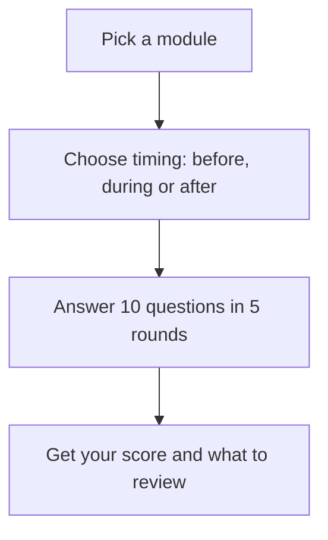

# Lesson quiz

> A ten-question quiz on one module of Kiro Crew How To, with feedback after
> every round and a list of sections to review.

## Highlights

- Ten questions per module, mixing "what is it" and "how do I do it".
- Covers all 24 modules, from Module 0 (What is an AI agent?) to Module 23
  (Back up, move, or host it), plus the capstone.
- Three timings: before the module, during it, or after it.
- Tells you the right answer and why for every question you miss.
- 250 questions in `references/question-bank.md`.
- In the dashboard, questions come as clickable question cards.

## How to run it

**Surface: Dashboard.**

1. Copy this skill into your own skills folder, so it loads in every chat:

   ```bash
   cp -R ~/kirocrew-howto/.kiro/skills/lesson-quiz ~/.kiro/crew/skills/
   ```

   Change `~/kirocrew-howto` to wherever you downloaded this repo.

2. In a new chat, send `$lesson-quiz 4` (any module number), or `$lesson-quiz`
   to pick from a list.

You should see a loaded-skill card, then a question card that asks when you are
taking the quiz.

> **Tip:** You can also use it as a **project skill** without copying it. Pick
> the repo folder as the chat's project, then send `$lesson-quiz`. The first
> time, the dashboard asks **Trust this project's skills?** Click **Trust this
> folder** only for a folder you recognise, because a skill can tell the agent
> to run commands.

## When to use it

| Say this | The skill will |
|---|---|
| "quiz me on hooks" | Run ten questions on Module 20 |
| `$lesson-quiz 7` | Test you on Module 7: Skills |
| "do I understand connections?" | Quiz you on Module 10 |
| "practice quiz" | Let you pick a module, then quiz you |

For "what is my level?", use the **self-assessment** skill instead.

## How it works



## What you get

- A score out of 10 and a grade (Mastered, Proficient, Developing, Beginning,
  Not yet).
- For each miss: your answer, the right answer, why, and which section to read.
- Advice that fits when you took the quiz.

## Files

| Path | What it holds |
|---|---|
| `SKILL.md` | The steps the agent follows |
| `references/question-bank.md` | All 250 questions, with answers and explanations |
| `references/results-template.md` | The layout of the results report |
