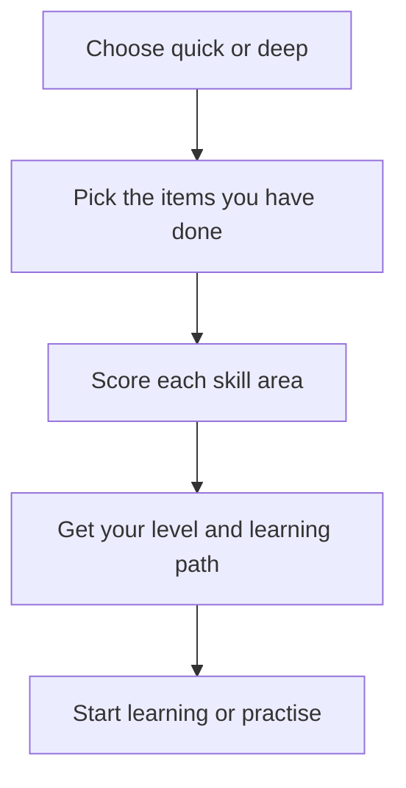

# Self-assessment and learning path

> Find your Kiro Crew level and get a learning path through the 24 modules
> and the capstone that skips what you already know.

## Highlights

- Two modes: **quick** (about 2 minutes) and **deep** (20 items in 5 rounds,
  about 5 minutes).
- The deep mode scores ten skill areas from 0 to 2.
- Levels match the [learning roadmap](../../../LEARNING-ROADMAP.md): Novice,
  Intermediate, Advanced and Expert.
- The path respects what each module needs first and shows the time for each
  phase.
- In the dashboard, the questions come as clickable cards where you pick every
  item that applies.

## How to run it

**Surface: Dashboard.**

1. Copy this skill into your own skills folder, so it loads in every chat:

   ```bash
   cp -R ~/kirocrew-howto/.kiro/skills/self-assessment ~/.kiro/crew/skills/
   ```

   Change `~/kirocrew-howto` to wherever you downloaded this repo.

2. In a new chat, send `$self-assessment`.

You should see a loaded-skill card, then a question card that asks how much
time you have.

> **Tip:** You can also use it as a **project skill** without copying it. Pick
> the repo folder as the chat's project, then send `$self-assessment`. The
> first time, the dashboard asks **Trust this project's skills?** Click
> **Trust this folder** only for a folder you recognise, because a skill can
> tell the agent to run commands.

## When to use it

| Say this | The skill will |
|---|---|
| "assess my level" | Run the check and give your level |
| "where should I start?" | Find your first gap module |
| "what should I learn next?" | Build a learning path from your gaps |

To test yourself on one module, use the **lesson-quiz** skill instead.

## How it works



## Files

| Path | What it holds |
|---|---|
| `SKILL.md` | The steps and both question sets |
| `references/output-templates.md` | Layouts for the results and the learning path |
| `references/topic-recommendations.md` | What to focus on for each module |
