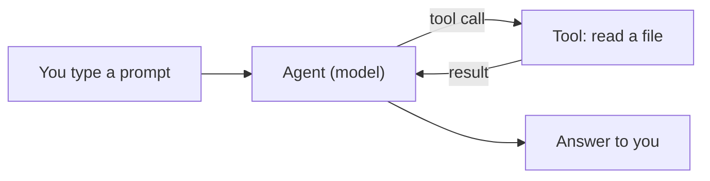

<picture>
  <source media="(prefers-color-scheme: dark)" srcset="../resources/logos/kirocrew-howto-logo-dark.svg">
  
</picture>

# What is an AI agent?

**Time:** 15 minutes. **Level:** Novice. **You install:** nothing.

This module is for you if you have never used an AI agent. You will not install
anything yet. You will learn five ideas, read one short chat, and write three
practice prompts on paper. In Module 1 you will try those prompts for real.

## What you will learn

- What a **prompt** is, and how a clear prompt helps.
- What a **model** is, and why it is not a search engine.
- What a **tool call** is, and how to spot one in a chat.
- Why an answer can be wrong, even when it sounds sure.
- Why a good agent asks you before it acts.

## Words to know

| Word | What it means |
|---|---|
| **Prompt** | The message you type to the agent. For example: `List the files in my notes folder.` |
| **Model** | The program that reads your words and writes words back. It learned from a lot of text. It does not look things up unless it uses a tool. |
| **Agent** | A model that can also *do* things for you, like read a file or run a command. You say what you want; it works out the steps. |
| **Tool** | One action the agent can take, such as "read a file", "write a file" or "run a command". |
| **Tool call** | The moment the agent uses a tool. It is the agent *doing* something, not just talking. |
| **Guess** | An answer the model made up because it had no facts to work from. It can sound sure and still be wrong. |
| **Approval** | When the agent stops and asks "May I do this?" before a tool call. You say yes or no. |

## Before you start

You need nothing for this module. A pen and paper, or a plain text file, is
enough for the practice task.

## Step by step

### 1. A prompt is a request

A **prompt** is what you type. The agent only knows what you tell it, plus what
it can find with its tools. Compare these two prompts:

```text
Help with my notes.
```

```text
Read the file notes.md in my my-project folder and list the three oldest dates in it.
```

The first one makes the agent guess what you want. The second one says which
file, what to look for and what shape the answer should take.

### 2. A model writes words, it does not "know" things

A **model** learned patterns from a huge amount of text. When you ask a
question, it writes the words that most likely come next. Most of the time that
is a good answer. Sometimes it is not.

So a model can be wrong in three ways:

| Why it is wrong | Example |
|---|---|
| It never had the facts | You ask what you ate for breakfast. It cannot know. |
| Its facts are old | You ask for today's weather without letting it look it up. |
| It filled a gap with a guess | You ask for a book quote and it invents one that sounds right. |

A good habit: when an answer matters, ask "How do you know that?" or ask it to
check with a tool.

### 3. An agent can use tools

An **agent** is a model plus **tools**. A tool lets it do one real thing on your
computer or the web. When it uses one, that is a **tool call**.



You type a prompt. The agent decides it needs a fact, so it makes a tool call,
for example "read `notes.md`". The tool sends back what it found. Then the agent
writes its answer from that result, not from a guess.

### 4. Why it asks before acting

A tool call can change things. It can write a file, delete a file or run a
command. A mistake there costs more than a wrong sentence. So an agent can stop
and ask for your **approval** first. You read what it wants to do, then say yes
or no.

In Module 2 you choose how often Kiro Crew asks you first.

### 5. Read a real chat

Open [the sample chat](sample-transcript.md). It is short. Find two things in
it:

1. The one **tool call**.
2. The one answer that is a **guess**.

The answers are at the bottom of that page. Try before you look.

## Try it yourself

Open [the three prompts worksheet](three-prompts-worksheet.md). Pick one small
task from your own life, such as planning a meal or tidying a folder. Write
three prompts for that same task:

1. A **vague** prompt.
2. A **clear** prompt.
3. A **clear prompt plus an example** of the answer you want.

You should see something like this for your clear prompt:

```text
Read ~/my-project/notes.md and list the three oldest dates.
```

The answers to step 5 are at the bottom of
[the sample chat](sample-transcript.md#answers).

Keep the page. You will paste all three into Kiro Crew in Module 1 and compare
the answers.

## Check your work

- [ ] You can say in one sentence what a tool call is.
- [ ] You can name one reason an answer may be wrong.
- [ ] You found the tool call and the guess in the sample chat.
- [ ] You wrote three prompts for one task.

## Common problems

| What you see | What to do |
|---|---|
| You could not find the guess in the sample chat | Look for an answer about something the agent had no way to check. Then read the answers at the bottom of the page. |
| Your vague and clear prompts look the same | Add to the clear one: which file or thing, what to look for, and what shape the answer should take (a list, two sentences, a table). |
| You are not sure what counts as a tool call | Ask: did the agent *do* something (read, write, run), or only talk? Doing is a tool call. |

## What you learned

- A **prompt** is your request. Clear prompts get better answers.
- A **model** writes likely words. It can be wrong, old or guessing.
- An **agent** is a model that can make **tool calls** to read, write and run
  things.
- A tool result is a fact the agent found. A guess is not.
- An agent can ask for your **approval** before a tool call, because actions
  can change things.

## Next

Continue with [Module 1: Get it running and say hello](../01-getting-started/README.md).
You will install Kiro Crew, say hello, and run your three prompts.

---
**Last updated:** 2026-10-30
**Checked against:** Kiro Crew public source @ 2808e9478c (github.com/kirodotdev/KiroCrew) and kiro.dev/docs/cli
*Part of the [Kiro Crew How To](../) guide.*
