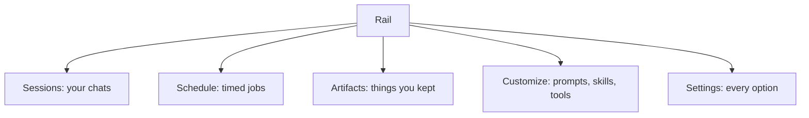

<picture>
  <source media="(prefers-color-scheme: dark)" srcset="../resources/logos/kirocrew-howto-logo-dark.svg">
  
</picture>

# Get it running and say hello

**Time:** 45 minutes. **Level:** Novice. **Where:** the Kiro Crew desktop app.

In this module you install Kiro Crew, sign in, and send your first message. Then
you take a short tour of the dashboard. Last, you learn the most useful trick in
this guide: when you are lost, ask Kiro Crew itself where things are.

The module has three short lessons:

1. **Lesson 1.1:** install the app, sign in, first chat.
2. **Lesson 1.2:** a tour of the rail.
3. **Lesson 1.3:** ask Kiro Crew about itself.

## What you will learn

- How to install the Kiro Crew desktop app on macOS, Windows or Linux.
- How the **Set up Kiro** page gets you signed in.
- How to start a chat and read the answer.
- What the five main rail items do.
- How to ask Kiro Crew where a setting lives, and get a click path back.
- How a **change card** works, and how to **Undo** it.

## Words to know

| Word | What it means |
|---|---|
| **Kiro Crew** | The program you talk to. It keeps your chats, memory and schedules, and shows the dashboard. |
| **Dashboard** | The window where you chat and change settings. In the desktop app it is the app window. |
| **kiro-cli** | A small helper program that connects Kiro Crew to the AI model. You install it once and sign in. |
| **Terminal** | A window where you type commands instead of clicking. You use it for two lines in this module. |
| **Session** | One chat with the agent. It remembers what was said earlier in the same session. |
| **Rail** | The column of icons and names down the side of the dashboard. Each one opens a page. |
| **Change card** | A box the agent puts in the chat to offer a settings change. Nothing changes until you press its button. |
| **Click path** | The list of things to click to reach a page, written like **Settings → Chat**. |

## Before you start

You need these four things:

| What | Check |
|---|---|
| An internet connection | You can open any web page. |
| About 1 GB of free disk space | Your system's storage settings show at least 1 GB free. |
| An account to sign in with | You will create or pick one during sign-in. |
| Your three prompts from Module 0 | You have the [worksheet](../00-what-is-an-agent/three-prompts-worksheet.md) filled in. If not, you can still do this module. |

You also need to open a **terminal** once, to paste two lines:

- **macOS:** press Cmd+Space, type `Terminal`, press Enter.
- **Windows:** open **PowerShell** from the Start menu.
- **Linux:** open your system's terminal app.

## Step by step

### Lesson 1.1: install the app and say hello

#### 1. Download the desktop app

Go to the [Kiro Crew app downloads](https://github.com/kirodotdev/KiroCrew#app-downloads)
table. Pick the **Stable** link for your system:

| Your system | File to pick |
|---|---|
| macOS (Apple Silicon or Intel) | `.dmg` |
| Windows (x64) | `.exe` |
| Linux | `.deb`, `.rpm` or AppImage, for your computer type (x86_64 or aarch64) |

Open the file you downloaded and follow the installer. On macOS, drag
**KiroCrew** into **Applications**. Then open the app.

#### 2. Use the Set up Kiro page

The first time the app opens, it checks for kiro-cli. If kiro-cli is missing or
you are not signed in, you see a page titled **Set up Kiro**.

The page shows the commands to run, with a **Copy command** button. You do two
things in a terminal:

1. **Install kiro-cli.** On macOS or Linux, the command looks like this:

   **Surface: kiro-cli (terminal).**

   ```bash
   curl -fsSL https://cli.kiro.dev/install | bash
   ```

   On Windows (PowerShell):

   **Surface: kiro-cli (terminal).**

   ```powershell
   irm 'https://cli.kiro.dev/install.ps1' | iex
   ```

   When it finishes, close the terminal and open a new one.

2. **Sign in.**

   **Surface: kiro-cli (terminal).**

   ```bash
   kiro-cli login
   ```

   It opens your browser, or prints a web address and a code. Finish signing in
   in the browser, then come back.

Go back to the app and press **Check again**. The **Set up Kiro** page goes
away.

> **Tip:** On first start, Kiro Crew also downloads a search model in the
> background. It is about 610 MB. Until it finishes, memory search matches
> exact words only. You do not need to wait for it.

#### 3. The welcome tour

Next comes a short welcome tour. It can bring over settings from other AI tools,
asks how technical you are, and lets you pick a look. You can press **Skip** on
any step.

To see the tour again later, type this in the message box:

| What to type | Surface | What it does |
|---|---|---|
| `/onboarding` | Dashboard | Replays setup import and the welcome tour. |

#### 4. Send your first message

Click into the message box at the bottom of the window. Type this and press
Enter:

```text
Hello! In two short sentences, tell me what you can help me with.
```

You should see the answer appear a few words at a time. A new row also appears
under **Sessions** on the rail. That row is this chat.

> **In a terminal. Surface: kiro-cli (terminal).**
>
> You do not need this box. It is for people who prefer a terminal over the
> desktop app, or who use Linux without a desktop. Each line is one command,
> typed at a normal terminal prompt, not inside `kiro-cli chat`.
>
> | Command | Surface | What it does |
> |---|---|---|
> | `curl -fsSL https://download.crew.kiro.dev/cli.sh \| sh` | kiro-cli (terminal) | Installs Kiro Crew without the desktop app (macOS and Linux). |
> | `kirocrew setup` | kiro-cli (terminal) | Runs a setup wizard in the terminal. |
> | `kirocrew gateway` | kiro-cli (terminal) | Starts Kiro Crew in this terminal. The dashboard opens at `http://localhost:5476`. Keep the window open. |
> | `kirocrew status` | kiro-cli (terminal) | In a second terminal, shows whether Kiro Crew is running. |
> | `kirocrew doctor` | kiro-cli (terminal) | Checks your install and prints a fix hint for each problem. |
>
> When `kirocrew status` finds Kiro Crew running, you should see something
> like:
>
> ```text
> Kiro Crew gateway is running (token auth enabled).
> ```

### Lesson 1.2: a tour of the rail

The **rail** runs down the side of the window. Find these five items. Click
each one, look, then come back to **Sessions**.

| Rail item | What it is for | Module that teaches it |
|---|---|---|
| **Sessions** | Your chats. Each row is one chat. Start a new one from here. | 3 |
| **Schedule** | Jobs that run at set times, like a morning summary. | 12 |
| **Artifacts** | Things the agent made that you kept, like a chart or a report. | 18 |
| **Customize** | Saved prompts, rules, skills, connections and more. | 6, 7, 10 |
| **Settings** | Every setting, split into tabs such as **Chat** and **Security**. | 2, 9 |



You do not need to learn the other rail items yet. Later modules cover them.

### Lesson 1.3: ask Kiro Crew about itself

You do not have to search menus. Kiro Crew can tell you where things are. When
you ask about a page or setting, the agent uses its built-in guide tools:

| Tool | What it finds |
|---|---|
| `find_ui` | Where a page or button is on the dashboard. |
| `find_setting` | Which setting does what you want, and its click path. |
| `search_docs` | The Kiro Crew user guide pages about a feature. |
| `propose_change` | Puts a change card in the chat, so you can change a setting with one press. |

You do not type these names. You ask in plain words, and the agent picks the
tool.

#### 1. Ask where a setting lives

Start a new chat from **Sessions**. Type:

```text
Where do I change how long your replies are?
```

You should see something like:

```text
It's under Settings → Chat → Response Verbosity.
```

The agent may also put a **change card** under its answer. A change card shows
the setting, its new value, and a button such as **Apply change**.

> **Tip:** Change cards only appear for messages you send from the dashboard.
> If the agent gives you a click path but no card, ask for one:
>
> ```text
> Can you give me a change card for that?
> ```

#### 2. Use the card, then undo it

1. Read the card. It says which setting changes and to what.
2. Press **Apply change**. The card shows a line like
   `Setting changed: Response Verbosity`.
3. Open **Settings → Chat** and find **Response Verbosity**. It shows the new
   value.
4. Go back to the chat and press **Undo** on the card. The card says
   **Restored**, and the setting is back to what it was.

If you do not want a change, press **Decline change** instead. Nothing
changes.

## Try it yourself

Do these three in the same chat or in new ones. The full prompts are in
[First prompts to try](first-prompts.md).

1. **Run your three Module 0 prompts.** Paste your vague prompt, then your clear
   prompt, then your clear prompt with an example. Compare the three answers.
   Which one gave you what you wanted with no follow-up?
2. **Ask it something it cannot know.** Type:

   ```text
   What did I eat for breakfast today?
   ```

   It has no way to know. A good answer says so, or asks you. Notice whether it
   guessed instead.
3. **Ask for a click path.** Type:

   ```text
   Where is the Chat tab in Settings, and what can I change there?
   ```

   Follow the click path it gives you. Check that it is right.

## Check your work

- [ ] A reply appeared, and your chat shows as a row in **Sessions**.
- [ ] You clicked all five rail items: **Sessions**, **Schedule**,
      **Artifacts**, **Customize** and **Settings**.
- [ ] You got a click path for a setting from the agent.
- [ ] You saw a change card, pressed **Apply change**, then pressed **Undo**.
- [ ] The agent said it could not know your breakfast (or you spotted that it
      guessed).

## Common problems

| What you see | What to do |
|---|---|
| The **Set up Kiro** page does not go away | Open a new terminal, run `kiro-cli login` again and finish sign-in in the browser. Then press **Check again**. |
| The terminal says `command not found: kiro-cli` | Close the terminal and open a new one. A new window picks up the new program. Then try again. |
| On macOS, the app's About page says automatic updates are unavailable | You opened it from the downloaded file. Drag **KiroCrew** into **Applications**, then open it from there. |
| Your message gets no answer | Check that you finished sign-in. In a terminal, run `kirocrew doctor` and read the fix hint it prints. |
| The agent gave a click path but no change card | Change cards appear only for messages sent from the dashboard. Ask it for a change card. Some settings cannot be changed from a card; follow the click path instead. |
| **Undo** is missing on a card | The card says why, for example that the setting changed again after you applied it. Change the setting on its own page instead. |

## What you learned

- You install the **desktop app**, then the **Set up Kiro** page walks you
  through installing kiro-cli and signing in.
- You chat in the message box. Each chat is a row under **Sessions**.
- The rail has five main items: **Sessions**, **Schedule**, **Artifacts**,
  **Customize** and **Settings**.
- When you are lost, ask the agent. It finds pages and settings for you.
- A **change card** changes a setting only when you press its button. **Undo**
  puts it back.
- `/onboarding` (Dashboard) replays the welcome tour.

## Next

Continue with [Module 2: Decide how often it asks first](../02-approval-modes/README.md).
You will choose when the agent checks with you before it acts.

---
**Last updated:** 2026-10-30
**Checked against:** Kiro Crew public source @ 2808e9478c (github.com/kirodotdev/KiroCrew) and kiro.dev/docs/cli
*Part of the [Kiro Crew How To](../) guide.*
