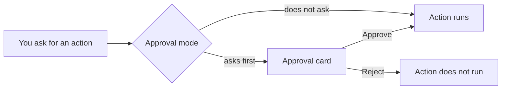

<picture>
  <source media="(prefers-color-scheme: dark)" srcset="../resources/logos/kirocrew-howto-logo-dark.svg">
  
</picture>

# Decide how often it asks first

**Time:** 20 minutes. **Level:** Novice. **Where:** the dashboard.

An agent can do real work: make files, delete files, run commands. You decide
how often it stops to check with you first. In this module you send the same
three small requests in three approval modes, and you write down what happened
each time. Your notes become a table that shows how your own setup behaves.

## What you will learn

- What an **approval card** is, and how to approve or reject one.
- What the four approval modes are meant to do: **Normal**, **Reads**,
  **Trust** and **YOLO**.
- How to switch modes for one chat.
- How to test what your own setup asks about, and record it.
- How long YOLO stays on, and where to change that.
- How to stop the agent in the middle of a task.
- Why you should start in **Normal**.

## Words to know

| Word | What it means |
|---|---|
| **Action** | Something the agent does, not just says: make a file, delete a file, run a command. |
| **Approval card** | A box in the chat that says **Tool approval requested:** and shows the action. It has an **Approve** and a **Reject** button. |
| **Approval mode** | How often the agent asks before an action. You pick it with the approval pill. |
| **Approval pill** | The small button in the message box that shows the current mode, such as **Normal**. |
| **Read-only** | An action that only looks, like listing files. It changes nothing. |
| **Shell command** | A command the agent runs in a terminal behind the scenes, such as `ls` to list files. |
| **Auto-approve** | The agent acts without asking you. **Trust** and **YOLO** both auto-approve. |
| **Engine** | The program that does the AI work behind Kiro Crew. Kiro Agent is the default. |

## Before you start

| What | Check |
|---|---|
| Kiro Crew is installed and you can chat | You finished [Module 1](../01-getting-started/README.md) and got an answer. |
| A practice folder, `~/my-project`, with `hello.txt` in it | Make it with the commands below. |

You make the practice folder yourself, so this part never needs an approval.
Later modules use the same folder and file.

> **In a terminal. Surface: kiro-cli (terminal).** On macOS or Linux, run:

```bash
mkdir -p ~/my-project
echo "Hello from Kiro Crew." > ~/my-project/hello.txt
```

> **In a terminal. Surface: kiro-cli (terminal).** On Windows, in PowerShell,
> run:

```powershell
New-Item -ItemType Directory -Force ~/my-project
Set-Content ~/my-project/hello.txt "Hello from Kiro Crew."
```

Nothing is printed on macOS or Linux. PowerShell prints one line about the new
folder. Both are fine.

## Step by step

### 1. Find the approval pill

**Surface: Dashboard.** Start a new chat from **Sessions** on the rail. Look at
the message box. In its row of controls you see a small button that says
**Normal**. That is the **approval pill**. Click it. A menu opens with four
modes. The text next to each name is the dashboard's own wording:

| Mode | What the dashboard says it is meant to do |
|---|---|
| **Normal** | Kiro Crew checks with you before doing anything. |
| **Reads** | Kiro Crew runs read-only shell commands on its own, but asks for everything else. |
| **Trust** | In this chat, Kiro Crew works without asking you first. |
| **YOLO** | In every chat, Kiro Crew works without asking you first. |

Close the menu and leave it on **Normal**.

These descriptions say what each mode is for. What really asks first can
differ by engine and by version. So do not take the table above as a promise.
In the next steps you test it, and **your own table is the truth for your
setup**.



The diagram shows the two paths an action can take. If the agent asks first,
you see a card and choose. If it does not ask, the action runs straight away.
Both paths are normal. The test below shows which path each request takes on
your setup.

### 2. Learn what to do when a card appears

You may see an approval card during the test. It looks like this:

```text
Tool approval requested:
<the action it wants to run>
[Approve]  [Reject]
```

1. Read the action on the card. Check that it only does what you asked.
2. Press **Approve** to let it run, or **Reject** to say no.
3. The card then shows **Approved** or **Rejected**.

During the test in step 4, press **Approve** on every card. The three requests
build on each other, so each one needs the one before it to run.

### 3. Copy your results table

Copy this table into a note, or onto paper. You fill in one cell after each
request.

| Request | Normal: did it ask first? | Reads: did it ask first? | Trust: did it ask first? |
|---|---|---|---|
| 1. List the files | yes / no | yes / no | yes / no |
| 2. Create a file | yes / no | yes / no | yes / no |
| 3. Delete that file | yes / no | yes / no | yes / no |

"Yes" means an approval card appeared before the action ran. "No" means the
action ran with no card. **Both answers are a correct result.** You are
recording what happens, not trying to get a card.

### 4. Run the three requests in each mode

Do one round per mode, in this order: **Normal**, then **Reads**, then
**Trust**. Use a **new chat** for each round, so one round cannot affect the
next.

For each round:

1. **Surface: Dashboard.** Start a new chat from **Sessions** on the rail.
2. Click the approval pill and choose the mode for this round.
3. Send these three requests, one at a time. Wait for each answer before you
   send the next.

   ```text
   Using a shell command, list the files in ~/my-project.
   ```

   ```text
   Create a file named test.txt in ~/my-project with one line: test.
   ```

   ```text
   Delete the file ~/my-project/test.txt.
   ```

4. After each request, write **yes** or **no** in that mode's column.

You should see `hello.txt` in the answer to the first request. After the third
request, `test.txt` is gone again, so the next round starts from the same place.

When the **Trust** round is done, click the pill and choose **Normal**.

### 5. Practice saying no

Look at your table. Did any request show a card?

- **Yes, at least one did.** Start a new chat, set the pill to the mode where
  you saw the card, and send the same request again, but use the file name
  `no-thanks.txt` instead of `test.txt`. When the card appears, press
  **Reject**. Then ask:

  ```text
  Does ~/my-project/no-thanks.txt exist?
  ```

  Write down the answer next to your table.

- **No, none did.** That is a valid result. On your setup these requests run
  without asking. You will see approval cards again in later modules, for
  example when you connect a tool server in
  [Module 10](../10-connections/README.md).

Set the pill back to **Normal** before you go on.

### 6. Look at YOLO, but do not turn it on

**Surface: Dashboard.** Click the pill and choose **YOLO**. A box opens first.
It says **YOLO mode is an app-wide setting** and
**All tools will get auto-approved across all sessions.**

Press **Cancel**. Do not press **Enable** while you are learning.

> **Warning:** YOLO lets the agent change files and run commands in *every*
> chat without asking. One mistake can delete or overwrite your work.

YOLO turns itself off after a set time, then asks again. To see or change that
time:

1. **Surface: Dashboard.** Open **Settings → Security**.
2. Find the **YOLO (auto-approve)** section.
3. Find **How long auto-approve stays on**. The choices are 30 minutes, 1 hour,
   6 hours, 12 hours, 24 hours, or until Kiro Crew restarts. The default is
   6 hours.

You can also ask the agent: `Where do I set how long auto-approve stays on?`

### 7. Stop a task in the middle

Sometimes you want the agent to stop now. **Surface: Dashboard.** Send:

```text
Write a 2,000-word story about a lighthouse keeper.
```

While the words appear, a stop button shows next to the message box. Its label
is **Stop generation**. Press it. The answer stops where it was.

## Try it yourself

Pick one more small request, for example:

```text
Using a shell command, show today's date.
```

Run it in a new chat in **Normal**, then in a new chat in **Reads**. Add a row
to your table for it. Then set the pill back to **Normal**.

Compare your table with the dashboard's descriptions in step 1. Where they
match, you have seen the mode do what it says. Where they differ, your table
tells you what your setup really does.

## Check your work

- [ ] `~/my-project/hello.txt` exists.
- [ ] Your table has a **yes** or **no** in all nine cells.
- [ ] You know what to press when a card appears: **Approve** to run the
      action, **Reject** to say no.
- [ ] You did step 5: either you pressed **Reject** once, or you recorded that
      no card appeared.
- [ ] You can say in your own words what each mode is meant to do.
- [ ] You opened the YOLO box and pressed **Cancel**.
- [ ] You found **How long auto-approve stays on** in **Settings → Security**.
- [ ] You stopped a long answer with **Stop generation**.
- [ ] The pill is back on **Normal**.

## Common problems

| What you see | What to do |
|---|---|
| No card appeared at all | That is a valid result. Write **no** in the table and go on. |
| A card appeared where you did not expect one | Also a valid result. Press **Approve**, write **yes** and go on. |
| A card says **This approval has expired or was already decided — the agent is no longer waiting on it.** | Send the request again. |
| A mode in the menu says **Disabled by your organization's security policy** | A security policy on this computer turned that mode off. Write "disabled" in that column and use the other modes. |
| The first request does not show `hello.txt` | The practice folder is missing. Run the commands in [Before you start](#before-you-start) again. |
| `test.txt` is still there after a round | Ask the agent: `Delete the file ~/my-project/test.txt.` Then start the next round. |
| You turned on YOLO by mistake | Click the pill and choose **Normal**. |

## What you learned

- An **approval card** shows an action before it runs. **Approve** runs it,
  **Reject** says no.
- The dashboard describes **Normal** as asking before anything, and **Reads**
  as running read-only shell commands on its own and asking for the rest.
- **Trust** works without asking in one chat. **YOLO** works without asking in
  every chat.
- What really asks first can differ by engine and version. Your own table is
  the truth for your setup.
- **How long auto-approve stays on** is under **Settings → Security**. The
  default is 6 hours.
- **Stop generation** stops the agent mid-task.
- Start in **Normal**, so you see what the agent does.

## Next

Continue with [Module 3: Keep chats tidy and pick up where you left off](../03-sessions/README.md).
You will keep your work apart in folders and find old chats again.

---
**Last updated:** 2026-10-30
**Checked against:** Kiro Crew public source @ 2808e9478c (github.com/kirodotdev/KiroCrew) and kiro.dev/docs/cli
*Part of the [Kiro Crew How To](../) guide.*
