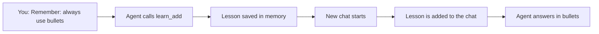

<picture>
  <source media="(prefers-color-scheme: dark)" srcset="../resources/logos/kirocrew-howto-logo-dark.svg">
  
</picture>

# Make it remember you, or not

**Level:** Novice · **Time:** 30 minutes · **Surface:** Dashboard, plus tools the agent calls

Kiro Crew can remember how you like things, in every new chat. You can also
open a chat that it will not learn from at all. This module shows both.

It has three short lessons:

- **4.1** Tell it a rule.
- **4.2** Check and remove what it saved.
- **4.3** Private chats.

## What you will learn

- How to make the agent remember a rule by saying "Remember: ...".
- Where saved rules show in the dashboard, and how to remove one.
- What the agent learns by itself from your chats.
- How the agent looks up old facts when you ask.
- The three memory modes: **Persistent**, **Incognito** and **Temporary**.
- How to pick the memory mode for new chats.

## Words to know

| Word | What it means |
|---|---|
| **Memory** | What Kiro Crew keeps about you between chats: preferences, projects, a daily history and lessons. |
| **Lesson** | One saved rule, such as "Always answer in bullet points". New chats follow it. |
| **Tool** | An action the agent can take, such as saving a lesson. You do not type the tool name. You ask in plain words and the agent picks the tool. |
| **Memory mode** | How one chat uses memory. Each chat has one mode. |
| **Persistent** | The normal mode. The chat uses memory and can save new memory. |
| **Incognito** | The chat uses what is already saved, but saves nothing new. |
| **Temporary** | The chat starts blank. It reads no memory and saves nothing new. |

## Before you start

| You need | How to check |
|---|---|
| Kiro Crew running, from [Module 1](../01-getting-started/README.md) | The dashboard opens |
| You know how to start a new chat, from [Module 3](../03-sessions/README.md) | You can click **New** in the sidebar |

You do not need a terminal. One optional box shows the terminal way.

## Step by step

### 1. How memory works



When you say "Remember: ...", the agent saves a lesson. Every new chat starts
with your saved lessons, so the agent follows them without being told again.

Kiro Crew also learns by itself. After a long chat, or after a chat goes quiet
for a while, it writes short notes about your preferences, your projects and
what you did that day. You do not have to do anything for this.

### 2. Lesson 4.1: tell it a rule

**Surface: Dashboard.**

1. Start a new chat.
2. Type this and press Enter:

   ```text
   Remember: always answer me in bullet points.
   ```

   You should see the agent call a tool and say it saved the rule. The tool is
   `learn_add`.

3. Click **New** to start another new chat.
4. Ask anything:

   ```text
   What are good ways to save water at home?
   ```

   You should see an answer written as bullet points, even though you did not
   ask for bullets in this chat.

Good lessons are short and clear. They say what to do, and when. See
[remember-examples.md](remember-examples.md) for more lines you can copy.

> **Tip:** The message you type now always wins over a saved lesson. If you say
> "answer this one in a paragraph", the agent does that, for this answer only.

### 3. Lesson 4.2: check and remove what it saved

You can see your lessons in two ways.

**Ask the agent.** **Surface: Dashboard.**

```text
What lessons have you saved about me?
```

You should see a list that includes "always answer me in bullet points". The
agent used the `learn_list` tool.

**Look in the memory view.** **Surface: Dashboard.**

1. Click **Settings** in the left rail.
2. Click **Overview**, then **Memory**.
3. Find the **Lessons** table.

You should see your rule in the table. The **Source** column shows where each
lesson came from. Your rule says **Saved by you or the agent**. A row that says
**Learned from chat** is one Kiro Crew picked up by itself.

**Remove a lesson.** Pick one way:

- In the **Lessons** table, click **Delete** on the row.
- Or ask the agent:

  ```text
  Forget the rule about bullet points.
  ```

  The agent uses the `learn_remove` tool.

Then start a new chat and ask a question. You should see a normal answer, not
bullet points.

**Look up a fact from past chats.** When you ask about something you said
before, the agent searches memory with `memory_recall`.

```text
What do you remember about my balcony garden?
```

You should see the agent search, then tell you what it found. If you just
started, it may say it found nothing yet. That is correct.

> **In a terminal. Surface: kiro-cli (terminal).**
>
> Kiro Crew has commands for the same lists. Run them in a terminal, not in
> the dashboard:
>
> ```bash
> kirocrew learn list
> ```
>
> ```bash
> kirocrew memory search "balcony"
> ```
>
> The first lists your lessons. The second searches memory for a word.

### 4. Lesson 4.3: private chats

Sometimes you do not want a chat to teach Kiro Crew anything. Pick a memory
mode for that chat.

| Mode | Reads what is saved | Saves new memory | Use it for |
|---|---|---|---|
| **Persistent** (normal) | Yes | Yes | Everyday work |
| **Incognito** | Yes | No | A private question where your saved rules still help |
| **Temporary** | No | No | A clean test, as if the agent never met you |

Every mode keeps the chat itself. An Incognito or Temporary chat still shows in
**Older Sessions**, so you can read it again. What the two private modes stop is
learning: no lesson is saved and no notes are written from that chat. The
agent's chat search also never finds them.

**Pick a mode for one chat.** **Surface: Dashboard.**

1. Click **New** to start an empty chat.
2. Above the message box, click the memory chip (its label says **Choose memory
   mode**).
3. Click **Incognito** or **Temporary**.

You should see the chip change to show the mode. Click it again to switch back
to Persistent.

You can also start one from a folder: open the folder's menu and click **New
incognito chat** or **New temporary chat**.

**Pick the mode for all new chats.** **Surface: Dashboard.**

1. Click **Settings**, then **Chat**.
2. Find **Default Memory Mode** under Sessions.
3. Pick **Persistent**, **Incognito** or **Temporary**.

New chats you start in the dashboard use that mode. A choice you make for one
chat still wins.

### 5. The flagship project: a rule that sticks, a fact that does not

**Surface: Dashboard.**

1. In a Persistent chat, say:

   ```text
   Remember: always answer me in bullet points.
   ```

2. Start a new chat and ask anything. You should see bullet points.
3. Start an **Incognito** chat (step 4). Say:

   ```text
   Remember: my favorite color is green.
   ```

   You should see the agent say it cannot save memory in this chat. Incognito
   blocks `learn_add`.

4. Start a new Persistent chat and ask:

   ```text
   What is my favorite color?
   ```

   You should see that the agent does not know. The fact from the Incognito chat
   was not kept.

## Try it yourself

1. Save one rule of your own, such as:

   ```text
   Remember: always give me measurements in centimeters.
   ```

2. Find it in **Settings → Overview → Memory → Lessons**.
3. Remove it with **Delete**.
4. Start a new chat and ask for the size of something. You should see that the
   agent no longer follows the rule you removed.

## Check your work

- [ ] Your rule showed in the **Lessons** table.
- [ ] A new chat followed the rule.
- [ ] The fact you gave in an Incognito chat was not saved.
- [ ] You removed a rule and a new chat stopped following it.
- [ ] You can say the difference between Incognito and Temporary.

## Common problems

| What you see | What to do |
|---|---|
| The agent did not save my rule | Start with "Remember:" and make it one clear sentence. Check that the chat is not Incognito or Temporary. |
| A new chat ignores my rule | Start a **new** chat. Check the rule is in the **Lessons** table. |
| The memory chip is not there | The chip shows only in a new, empty chat. Click **New** first. |
| The agent remembers something from an Incognito chat | Incognito still reads memory saved earlier. To start blank, use Temporary. |
| A rule I never gave shows in Lessons | Its source is **Learned from chat**. Kiro Crew picked it up from a correction. Delete it if it is wrong. |
| `kirocrew` is not found in the terminal | The terminal box is optional. Use the dashboard steps instead. |

## What you learned

- Say "Remember: ..." and the agent saves a lesson with `learn_add`.
- New chats follow your lessons. What you type now still wins.
- See and delete lessons in **Settings → Overview → Memory**.
- Kiro Crew also learns by itself, and `memory_recall` looks up old facts.
- **Incognito** reads memory but saves nothing. **Temporary** reads and saves
  nothing.

## Next

Sometimes the agent gets something wrong. Go on to
[Module 5: Fix a mistake](../05-fix-a-mistake/README.md).

---
**Last updated:** 2026-10-30
**Checked against:** Kiro Crew public source @ 2808e9478c (github.com/kirodotdev/KiroCrew) and kiro.dev/docs/cli
*Part of the [Kiro Crew How To](../) guide.*
