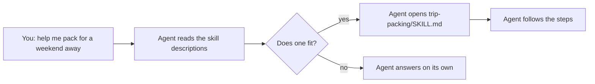

<picture>
  <source media="(prefers-color-scheme: dark)" srcset="../resources/logos/kirocrew-howto-logo-dark.svg">
  
</picture>

# Teach it a procedure: skills

**Level:** Intermediate · **Time:** 35 minutes · **Surface:** Dashboard, plus tools the agent calls

A skill is a recipe card for the agent. It holds the steps for one kind of
task, such as "make a packing list" or "review this code". You write the steps
once. After that, the agent follows them whenever the task comes up, even if
you do not name the skill.

In this module you build a `trip-packing` skill. It asks where you are going
and for how long, then saves a packing checklist as a file.

## What you will learn

- What a skill is, and what goes in a `SKILL.md` file.
- Three ways to make a skill: ask the agent, copy a file, or use the dashboard.
- How to use a skill on purpose with `$name`, and how the agent picks one by
  itself.
- Where skills live, and why a project's own skills need your trust first.
- How to add a skill someone else shared, and how Kiro Crew can draft skills
  for you.
- When a saved prompt is enough, and when you need a skill.

## Words to know

| Word | What it means |
|---|---|
| **Skill** | A folder with a `SKILL.md` file of steps for one kind of task. It can also hold helper files and scripts. |
| **`SKILL.md`** | The main file of a skill: front matter, then the steps in plain markdown. |
| **Description** | One sentence in the front matter that says what the skill does and when to use it. The agent reads it to decide whether the skill fits. |
| **`$name`** | Type `$` and a skill's name in the dashboard message box to load that skill on purpose, such as `$trip-packing`. |
| **Loaded-skill card** | A small card with a book icon that appears in the chat when you load a skill with `$name`. |
| **`skill_search`** | The tool the agent uses to search your installed skills. |
| **Script** | A small program saved in a file, such as `analyze-metrics.py`, that a skill can tell the agent to run. |
| **Project skill** | A skill saved inside one project, in `<project>/.kiro/skills/`. |
| **Registry** | An online list of skills other people shared. |

## Before you start

| You need | How to check |
|---|---|
| Kiro Crew running, from [Module 1](../01-getting-started/README.md) | The dashboard opens |
| A saved prompt, from [Module 6](../06-prompts-and-steering/README.md) | `weekly-notes` is on **Customize → Prompts** |
| A practice folder `~/my-project` | The agent can list it when you ask |
| This guide downloaded, for the copy steps | You can see the `07-skills/` folder |
| Python 3, only for the skills that carry scripts | `python3 --version` prints a version number |

## Step by step

### 1. What is inside a skill

A skill is a folder. The folder name is the skill's name. Inside it,
`SKILL.md` is required. Everything else is optional.

```text
trip-packing/
└── SKILL.md                  # required: the steps

code-review-specialist/
├── SKILL.md                  # required: the steps
├── templates/                # optional: layouts the agent fills in
│   └── review-checklist.md
└── scripts/                  # optional: helper programs
    └── analyze-metrics.py
```

`SKILL.md` starts with front matter, then the steps:

```markdown
---
name: trip-packing
description: Make a packing checklist for a trip and save it as a file. Use when the user asks for help packing, a packing list, or what to bring on a trip.
---

# Trip packing list

1. Ask where the user is going and for how many nights.
2. Build the list in groups.
3. Save it as a checklist file.
```

Two rules keep a skill working:

- `name` matches the folder name. Use lowercase letters, numbers and hyphens.
- `description` says **what** the skill does and **when** to use it. Until the
  agent opens a skill, this one line is all it sees.

The full skill is in [trip-packing/SKILL.md](trip-packing/SKILL.md).

### 2. How the agent finds a skill



At the start of each chat the agent gets a short list of your skills: name and
description only. When your request matches a description, it opens that
skill and follows it. It can also search your skills with the `skill_search`
tool. This is why a clear description matters.

### 3. Make the trip-packing skill

Pick one of three ways.

**Way 1: ask the agent.** **Surface: Dashboard.**

```text
Make a skill called trip-packing. It asks where I am going and for how many nights, then saves a packing checklist to ~/my-project/packing/ as a markdown file with checkboxes, grouped into documents, clothes, toiletries, electronics and items for this trip.
```

If an approval card appears, click **Approve**.

You should see the agent write `~/.kiro/crew/skills/trip-packing/SKILL.md` and
tell you the skill is ready.

**Way 2: copy the file from this guide.** In a terminal, from the folder where
you downloaded this guide:

```bash
mkdir -p ~/.kiro/crew/skills
```

```bash
cp -R 07-skills/trip-packing ~/.kiro/crew/skills/
```

**Surface: kiro-cli (terminal).**

```bash
ls ~/.kiro/crew/skills/trip-packing
```

You should see `SKILL.md`.

**Way 3: use the dashboard.** **Surface: Dashboard.**

<!-- NLT: item 13 - confirm Create New Skill is on Customize → Skills (the docs say Overview → Skills → + New) -->
1. Click **Customize**, then **Skills**.
2. Click **Create New Skill**.
3. Fill in the name `trip-packing`, the description, and the steps from
   [trip-packing/SKILL.md](trip-packing/SKILL.md).
4. Click **Create**.

Save `SKILL.md` as UTF-8 text, the normal way to save text. Kiro Crew skips a
`SKILL.md` saved any other way.

### 4. Check the skill is there

**Surface: Dashboard.**

1. Click **Customize**, then **Skills**.
2. Click **Refresh skills** if the list looks old.

You should see `trip-packing` in the list. Click it to see its `SKILL.md`.

### 5. Use the skill by name

**Surface: Dashboard.**

1. Start a new chat.
2. Type `$trip` and pick `trip-packing` from the list.
3. Add a few words and press Enter:

   ```text
   $trip-packing I am going to the beach for three nights.
   ```

You should see a loaded-skill card with a book icon in the chat. Then the agent
follows the steps: it saves `~/my-project/packing/beach-3-nights.md` and tells
you the path, the number of items and one thing that is easy to forget.

### 6. Use the skill by just asking

**Surface: Dashboard.** Start a new chat and ask, without `$`:

```text
Help me pack for a weekend away in the mountains.
```

You should see the agent pick up the trip-packing skill by itself. It asks how
many nights, because the skill says to ask.

If it does not use the skill, make the description clearer. Use the words
people really type, such as "pack", "packing list" and "what to bring".

### 7. Prompt or skill?

| | Saved prompt (Module 6) | Skill |
|---|---|---|
| How you start it | You type `@name` | You type `$name`, or the agent picks it by itself |
| What it holds | One request | Steps, and optional templates and scripts |
| Best for | A request you send yourself, the same each time | A procedure the agent should follow whenever it fits |

A prompt is enough when you always start the task yourself. Use a skill when
the agent should notice the task and follow the same steps every time.

### 8. The example skills in this module

| Skill | What it does | Has scripts |
|---|---|---|
| [trip-packing/](trip-packing/SKILL.md) | Asks two questions and saves a packing checklist | No |
| [weekly-notes/](weekly-notes/SKILL.md) | Sums up a week of notes and saves the summary | No |
| [commit/](commit/SKILL.md) | Makes one git commit with a clear message, after you say yes | No |
| [pr/](pr/SKILL.md) | Gets changes ready for a pull request | No |
| [setup-ci-cd/](setup-ci-cd/SKILL.md) | Adds automatic checks to a project, after showing a plan | No |
| [blog-draft/](blog-draft/SKILL.md) | Researches, outlines and drafts a blog post with you | No |
| [brand-voice/](brand-voice/SKILL.md) | Keeps writing in one friendly, clear tone | No |
| [code-review-specialist/](code-review-specialist/SKILL.md) | Reviews code with a checklist | Yes |
| [doc-generator/](doc-generator/SKILL.md) | Writes API documentation from code | Yes |
| [refactor/](refactor/SKILL.md) | Cleans up code step by step, with `references/` notes | Yes |
| [templates/SKILL-template.md](templates/SKILL-template.md) | A blank starter for your own skill | No |

Install any of them the same way as step 3, way 2. For example:

**Surface: kiro-cli (terminal).**

```bash
cp -R 07-skills/code-review-specialist ~/.kiro/crew/skills/
```

> **Risk:** A skill can tell the agent to run commands. Read a skill before you
> install it, especially one with a `scripts/` folder.

### 9. Where skills live

| Folder | When it loads |
|---|---|
| `~/.kiro/crew/skills/<name>/` | Always. **Start here.** These are your global skills. |
| `<project>/.kiro/skills/<name>/` | Only in chats whose project folder is that project, and only after you trust it |

**Project skills need your trust.** A project's skills come with its files, and
a skill can tell the agent to run commands. So Kiro Crew does not load them
until you say yes. The first time a chat uses one, the dashboard asks **Trust
this project's skills?** Click **Trust this folder** only for a project you
recognise. Click **Not now** and nothing is loaded.

### 10. Add a skill someone else shared

**Surface: Dashboard.**

1. Click **Customize**, then **Skills**.
2. Click **Add Skill**.
3. Search for a task, such as `markdown`.
4. Click a result to read it, then click **Install** if you trust it.

You should see the new skill in your list. An installed copy stays at the
version you installed. Read any shared skill before you install it.

### 11. Let Kiro Crew draft skills for you (optional)

Kiro Crew can look at your finished chats and draft a skill when it sees you
repeat a procedure. This is off by default.

**Surface: Dashboard.**

1. Click **Settings**, then **Skills**.
2. Turn on **Auto-generate skills from sessions**.
3. Leave **Require approval before generated skills go live** on.

Drafts wait on **Customize → Skills** until you review them. Click **Review**,
read the `SKILL.md`, then click **Approve** or **Dismiss**.

## Try it yourself

Turn your `weekly-notes` prompt from Module 6 into a skill that also saves the
summary to a file.

1. Ask the agent:

   ```text
   Make a skill called weekly-notes. It reads the notes in ~/my-project/notes/ from the last seven days, writes exactly five one-sentence bullets, saves them to ~/my-project/notes/summaries/week-YYYY-MM-DD.md with today's date, and lists the notes it read.
   ```

2. Check it on **Customize → Skills**.
3. In a new chat, ask: `What happened in my notes this week?`

You should see five bullets in the chat and a new file in
`~/my-project/notes/summaries/`.

One possible answer is [weekly-notes/SKILL.md](weekly-notes/SKILL.md). Compare
yours with it.

## Check your work

- [ ] `trip-packing` shows on **Customize → Skills**.
- [ ] `$trip-packing` showed a loaded-skill card and saved a checklist file.
- [ ] Asking "help me pack for a weekend away" also used the skill.
- [ ] Your `weekly-notes` skill saved a summary file.
- [ ] You can say when a prompt is enough and when you need a skill.

## Common problems

| What you see | What to do |
|---|---|
| The skill is not on **Customize → Skills** | Check the path is `~/.kiro/crew/skills/<name>/SKILL.md`, not one folder too deep. Click **Refresh skills**. |
| `$trip` shows no skill | Check the spelling, and that `name` in the front matter matches the folder name. |
| The skill is skipped | Re-save `SKILL.md` as UTF-8 text. Check the front matter starts and ends with `---`. |
| The agent never picks the skill by itself | Make the `description` say what it does and when, with words people really type. |
| A project skill does not load | You have not trusted that project yet. Load it with `$name` and click **Trust this folder** if you recognise the project. |
| The packing file is not saved | Approve the file write if a card asks. Check that `~/my-project` exists. |

## What you learned

- A skill is a folder with a `SKILL.md`: a `name`, a `description`, then the
  steps.
- Make one by asking the agent, by copying a folder into
  `~/.kiro/crew/skills/`, or with **Create New Skill**.
- Load a skill with `$name`, or let the agent pick it from its description.
- Project skills load only after you trust the project.
- **Add Skill** brings in shared skills. **Auto-generate skills from sessions**
  drafts skills for you to approve.

## Next

Skills teach the agent how to do a task. Next, let it search your own notes and
files, and show where each answer came from. Go on to
[Module 8: Ask about your own documents](../08-knowledge-library/README.md).

---
**Last updated:** 2026-10-30
**Checked against:** Kiro Crew public source @ 2808e9478c (github.com/kirodotdev/KiroCrew) and kiro.dev/docs/cli
*Part of the [Kiro Crew How To](../) guide.*
