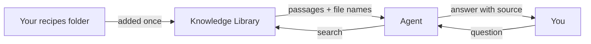

<picture>
  <source media="(prefers-color-scheme: dark)" srcset="../resources/logos/kirocrew-howto-logo-dark.svg">
  
</picture>

# Ask about your own documents

**Level:** Intermediate · **Time:** 25 minutes · **Surface:** Dashboard

You have notes, recipes and documents in folders on your computer. In this
module you add a folder to Kiro Crew's **Knowledge Library**. Then you ask a
question, and the agent answers from your own files and names the file the
answer came from.

## What you will learn

- What the Knowledge Library is, and what it is for.
- How to add a folder of notes on **Customize → Knowledge**.
- How to ask a question so the agent searches your library.
- How to check the source file an answer names.
- How to search the library yourself with `/kb`.
- When to use the Knowledge Library and when to use memory.

## Words to know

| Word | What it means |
|---|---|
| **Knowledge Library** | A searchable store of your own documents. Kiro Crew reads the files you add and can find passages by meaning, not only by exact words. |
| **Source** | One thing you added to the library: a folder, an uploaded file or a web page. |
| **Item** | One piece of a document in the library. A long file is split into several items so a match can be quoted in context. |
| **Citation** | The line in an answer that says where a fact came from. For a file inside a folder it starts with `**File:**`. |
| **Sync** | Read a source again so the library sees new or changed files. |
| **Embedding model** | A small model that turns text into numbers so "quick dinner" can match "15 minutes". Until it has downloaded, search still works, using exact words only. |

## Before you start

| You need | Check | You should see |
|---|---|---|
| Kiro Crew running | Open the dashboard | The **Sessions** list |
| [Module 4](../04-memory/README.md) done | You know how to save a rule with "Remember: ..." | — |
| A practice folder | `ls ~/my-project` in a terminal | Your practice files |
| The five sample recipes | This module's [`recipes/`](recipes/) folder | `pancakes.md`, `tomato-soup.md`, `stir-fry.md`, `overnight-oats.md`, `roast-chicken.md` |

Copy the sample recipes into your practice folder. **Surface: kiro-cli (terminal).** Run
this from the folder where you downloaded this guide:

```bash
mkdir -p ~/my-project/recipes
cp 08-knowledge-library/recipes/*.md ~/my-project/recipes/
```

Then print the folder's full path. You need it in Step 2.

**Surface: kiro-cli (terminal).**

```bash
cd ~/my-project/recipes && pwd
```

You should see a full path that starts with `/`, such as
`/home/you/my-project/recipes`.

## Step by step

### 1. See how it works



You add a folder once. Kiro Crew reads each file and stores it in small pieces.
When you ask a question, the agent searches those pieces and answers. Each
passage it found carries the name of the file it came from.

### 2. Add your recipes folder

**Surface: Dashboard.**

1. In the left rail, open **Customize → Knowledge**.
2. Choose the **Sources** tab.
3. Click **+ Add Source**, then **Local Folder**.
4. In **Folder path**, paste the full path from "Before you start". You can
   also click **Browse...** to pick the folder.
5. Leave **Include subdirectories (recursive)** ticked.
6. Click **Add Folder**.
7. The new row may say **Awaiting confirmation**. Click **Confirm** to start
   reading the files.

You should see something like:

```text
recipes      ● auto      5 items
```

The number can be a little higher than 5. A longer file can become more than
one item. **● auto** means Kiro Crew looks for changed files every 5 minutes.

> **Tip:** The top of the Knowledge page shows whether **Smart Search active**
> is on. If it says the embedding model is still downloading, search uses exact
> words for now. That is fine for this lesson.

### 3. Ask a question about your files

**Surface: Dashboard.** Open a new chat and type:

```text
Check my knowledge library: which recipe takes the least total time? Name the file.
```

Saying "my knowledge library" matters. The agent searches your library when you
point it there. It does not search it for every question.

You should see something like:

```text
The vegetable stir-fry takes the least total time: 15 minutes.

**File:** recipes/stir-fry.md
```

Behind the scenes the agent used a tool called `local_knowledge_search`. You do
not type that name. You just ask.

### 4. Check the source

An answer is only as good as its source. Open the file it named and look.

**Surface: kiro-cli (terminal).**

```bash
grep "Total time" ~/my-project/recipes/*.md
```

You should see five lines. `stir-fry.md` shows `15 minutes`, the smallest. If the
agent named a different file, ask it:
`Show me the line in that file that says the time.`

### 5. Ask what the library holds

**Surface: Dashboard.** In the same chat, type:

```text
What sources are in my knowledge library, and how many items does each have?
```

You should see your `recipes` source with its item count. Here the agent used
`knowledge_list_sources`, a tool that only counts. It changes nothing.

### 6. Search the library yourself with /kb

**Surface: Dashboard.** You can search without asking the agent. In the
message box, type `/kb` and a few words:

```text
/kb tomatoes
```

A list of matching passages appears above the box, each with its source. Tick
the ones you want and click **Inject Context**. They go to the agent with your
next message. Click **Dismiss** to close the list without using it.

> **In a terminal. Surface: kiro-cli (terminal).**
>
> You can count what the library holds from a terminal. This command only
> reads. It changes nothing.
>
> ```bash
> kirocrew knowledge stats
> ```
>
> You should see something like:
>
> ```text
> Knowledge Library: 1 source(s), 5 document(s), 5 item(s)
>
>   SOURCE   DOCS   ITEMS
>   recipes     5       5
> ```
>
> Add `--json` to get the same counts as JSON.

### 7. Knowledge or memory?

Both help the agent "know" things. They are for different jobs.

| Use | For | Example |
|---|---|---|
| **Knowledge Library** | Documents you already have, that you want searched with a source | "Which recipe uses basil?" |
| **Memory** ([Module 4](../04-memory/README.md)) | Short facts and preferences about you, learned from chats | "Remember: I am vegetarian." |

A good rule: if it lives in a file, add the file to the library. If it is a
sentence about you, tell the agent to remember it.

## Try it yourself

1. Make a folder of your own notes, for example `~/my-project/my-notes`. Put
   three or four short text or markdown files in it.
2. Put one fact in exactly **one** file. For example, in `garden.md`, write
   `The tomato seeds go in on April 12.`
3. Add the folder on **Customize → Knowledge → Sources**, as in Step 2.
4. In a new chat, ask:

   ```text
   Check my knowledge library: when do the tomato seeds go in? Which file says so?
   ```

5. Check that the file it names is the one where you wrote the fact.

Then change the date in that file, click **Sync** on the source row, and ask
again. The answer should use the new date.

## Check your work

- [ ] Your `recipes` folder shows on the **Sources** tab with an item count.
- [ ] The agent answered "which recipe takes the least total time?" and named
      `stir-fry.md`.
- [ ] You opened the named file and saw the answer there.
- [ ] You ran a `/kb` search and saw passages with their sources.
- [ ] You can say when to use the Knowledge Library and when to use memory.

## Common problems

| What you see | What to do |
|---|---|
| The source shows **0 items** | Check the folder path is a full path that starts with `/`. `~` may not work in this box. If the row says **Awaiting confirmation**, click **Confirm**. |
| The agent answers without naming a file | It may have answered from what it already knows. Start your message with `Check my knowledge library:` and ask it to name the file. |
| "Knowledge Library is not configured" | No source has been read yet. Add a folder and wait for the item count to appear. |
| The answer uses old text after you edited a file | Click **Sync** on the source row, or wait up to 5 minutes for **● auto** to notice. |
| A paraphrase finds nothing, but exact words work | The embedding model is still downloading. Exact words keep working; meaning search starts once **Smart Search active** shows. |
| You want to remove a source | Use **Remove source** on its row. This deletes the stored pieces for good. Your files on disk are not touched. |

## What you learned

- The **Knowledge Library** makes your own files searchable, with a source on
  every result.
- You add a folder once on **Customize → Knowledge → Sources**, and **Sync**
  reads it again.
- Say "check my knowledge library" so the agent searches it, and ask it to name
  the file.
- Always open the named file to check the answer.
- `/kb` searches the library yourself; `kirocrew knowledge stats` counts what it
  holds.
- Files go in the library. Facts about you go in memory.

## Next

Your notes now answer questions. Before the agent does more on its own, learn
how to keep your passwords and files safe in
[Module 9: Protect your secrets and your files](../09-protect-secrets-and-files/README.md).

---
**Last updated:** 2026-10-30
**Checked against:** Kiro Crew public source @ 2808e9478c (github.com/kirodotdev/KiroCrew) and kiro.dev/docs/cli
*Part of the [Kiro Crew How To](../) guide.*
