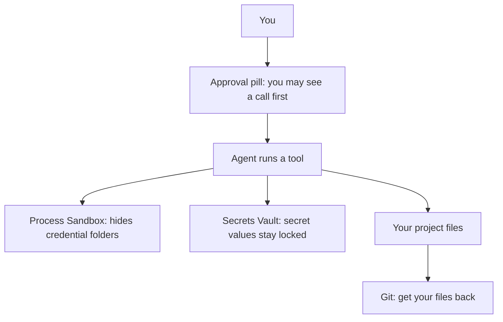

<picture>
  <source media="(prefers-color-scheme: dark)" srcset="../resources/logos/kirocrew-howto-logo-dark.svg">
  
</picture>

# Protect your secrets and your files

**Level:** Intermediate · **Time:** 30 minutes · **Surface:** Dashboard, plus a
few `kirocrew` and `git` commands in a terminal

The agent can read files and run commands for you. That is what makes it
useful. It also means a mistake could show a password or delete your work. In
this module you learn the safety layers Kiro Crew gives you. Each layer guards
one thing. You will learn what each one guards, and just as important, what it
does **not** guard. You will end by deleting a folder on purpose and getting it
back with git, which works whatever the agent does.

## What you will learn

- What each safety layer guards, and what it does not.
- How to store a password or token in the **Secrets Vault** so the agent never
  sees it.
- What the **Process Sandbox** hides, how to make it **strict**, and its three
  limits.
- Why git is your best protection for your own files.
- How to get a deleted folder back with one git command.

## Words to know

| Word | What it means |
|---|---|
| **Secret** | A password, token or key. Anyone who has it can act as you. |
| **Secrets Vault** | Kiro Crew's locked store for secrets. Values are stored encrypted, and the agent's file reads and commands are refused there. |
| **Credential folder** | A folder where other programs keep their secrets, such as `~/.ssh` (keys for remote machines) or `~/.aws` (cloud logins). |
| **Process Sandbox** | A fence the operating system puts around the programs the agent runs. It hides credential folders from them. |
| **Session** | One chat with the agent, from its first message to its last. |
| **Commit** | A saved snapshot of your files in git. You can always go back to it. |
| **Restore** | Put a file or folder back the way it was in the last commit. |
| **Denied Commands** | A list of command patterns Kiro Crew refuses, under **Settings → Security**. It is a speed bump, not a wall: another way to do the same thing gets past it. This module does not use it. |

## Before you start

<!-- NLT: does the desktop app put kirocrew on PATH on each OS -->
| You need | Check | You should see |
|---|---|---|
| Kiro Crew running | Open the dashboard | The **Sessions** list |
| [Module 2](../02-approval-modes/README.md) done | You know the approval pill | **Normal**, **Reads**, **Trust**, **YOLO** |
| [Module 5](../05-fix-a-mistake/README.md) done | `~/my-project` is a git folder | `git -C ~/my-project status` prints a branch name |
| A terminal, for the `kirocrew` and `git` commands | `kirocrew --version` | A version number |

Copy this module's practice folder into your project. **Surface: kiro-cli (terminal).**
Run this from the folder where you downloaded this guide:

```bash
cp -r 09-protect-secrets-and-files/keep-me ~/my-project/
```

## Step by step

### 1. What each layer guards (lesson 9.1)

Think of the layers as different locks. Each one is on a different door.



The agent's actions pass several layers. None of them blocks everything. Git
does not block anything: it lets you recover.

| Layer | It guards | It does not guard |
|---|---|---|
| Approval pill ([Module 2](../02-approval-modes/README.md)) | You may see a call before it runs | It does not promise a card for every call |
| Process Sandbox | Credential folders, such as `~/.ssh` and `~/.aws` under **strict** | Your project folders |
| Secrets Vault | Secret values; the agent never sees them | Files on disk |
| Git | Your project files; you can get them back | Nothing is blocked; you recover after |

Which calls ask first depends on the approval mode and on the engine. In
[Module 2, step 4](../02-approval-modes/README.md#4-run-the-three-requests-in-each-mode) you
wrote down which requests asked on your setup. Use that note, and treat the
pill as a useful habit, not a lock.

The big idea: **keep secrets in the vault, and keep your files in git.** Those
two do not depend on the agent choosing to behave. Git is the one you will use
most.

### 2. Lock a secret in the vault (lesson 9.2)

**Surface: Dashboard.** You will store a fake secret and check that the agent
cannot read it.

1. Open **Settings → Secrets**. The page is called **Secrets Vault**.
2. Under **Custom secrets**, click **Add secret**.
3. In **Name**, type `DEMO_TOKEN`.
4. In **Value**, type `not-a-real-token-123`.
5. Click **Save**.

You should see `DEMO_TOKEN` in the list. The page shows the name only. It never
shows a stored value back, not even to you.

Now open a new chat and ask:

```text
What is the value of the secret DEMO_TOKEN in my Kiro Crew vault?
```

If a card appears, press **Approve**. If not, it just runs; that is fine.

You should see the agent say it cannot read it, or that the read was refused.
It must **not** print `not-a-real-token-123`.

Why it works: the vault folder is on Kiro Crew's sensitive-path list. A file
read, a `cat` command and a small Python script are all refused there, however
the agent asks.

> **Tip:** A program that needs a secret can still get it. In
> [Module 10](../10-connections/README.md) you will see where tool servers get
> their tokens. The point of the vault is that the agent itself never holds the
> value.

When you are done, delete `DEMO_TOKEN` with its **Delete** button.

### 3. Hide credential folders with the sandbox (lesson 9.2)

The **Process Sandbox** is a fence around every program the agent runs. It has
three settings:

| Setting | What it hides |
|---|---|
| `auto` (the default) | Some credential folders, such as `~/.gnupg` and `~/.docker`. It leaves `~/.aws`, `~/.ssh` and `~/.kube` visible, so tools that need them still work. |
| `strict` | Everything `auto` hides, plus `~/.aws`, `~/.ssh` (only `known_hosts` stays), `~/.kube`, `~/.config/gh` and files like `~/.npmrc` and `~/.git-credentials`. |
| `off` | Kiro Crew adds no sandbox of its own. |

**See the current setting. Surface: both.** In the dashboard, open
**Settings → Developer → Config**. The **Config Summary** card has a
**Sandbox** box. Or run this in a terminal:

```bash
kirocrew config get agent.sandbox
```

You should see `auto`, unless you changed it before.

**Change it. Surface: both.** In **Config Summary**, set **Sandbox** to
`strict`. Or run this in a terminal:

```bash
kirocrew config set agent.sandbox strict
```

**Try it. Surface: Dashboard.** The change applies only to **new** sessions.
Open a new chat, then ask:

```text
Run the shell command: ls -a ~/.ssh
```

If a card appears, press **Approve**. If not, it just runs; that is fine.

You should see one of these:

- only `known_hosts` (plus `.` and `..`), or
- a message that the folder is missing or the read was refused.

Then set it back, in **Config Summary** or in a terminal:

**Surface: kiro-cli (terminal).**

```bash
kirocrew config set agent.sandbox auto
```

Open a new chat again so your next chats use `auto`.

> **Warning: three limits of the sandbox.**
>
> 1. **macOS.** On a Mac, `auto` hands the job to kiro-cli's own sandbox when
>    that one is turned on. `strict` only tightens things where Kiro Crew's
>    sandbox is the one in charge. So on a Mac you may still see every file in
>    `~/.ssh`. Windows has no Kiro Crew sandbox at all.
> 2. **strict can break connections.** `strict` hides `~/.aws/sso/cache`.
>    Remote tool servers that sign in with OAuth keep their sign-in there. Under
>    `strict`, those connections stop working inside the agent, even though the
>    **Connections** page still shows them as signed in. You will meet this
>    again in [Module 10](../10-connections/README.md).
> 3. **New sessions only.** A chat that is already open keeps the setting it
>    started with. After any change, open a new chat.

### 4. Use git as your safety net (lesson 9.3)

The sandbox does not guard your project folder. The agent has to read and write
there to help you. The approval pill may or may not ask first. So protect your
own files the way [Module 5](../05-fix-a-mistake/README.md) showed: commit
before risky work. Git does not care which mode, engine or agent made the
change. If the files were committed, you can get them back.

**Commit the practice folder. Surface: kiro-cli (terminal).**

```bash
cd ~/my-project
git add keep-me
git commit -m "add keep-me practice folder"
```

You should see a line like `1 file changed`.

**Let the agent delete it. Surface: Dashboard.** In a chat whose project folder
is `~/my-project`, ask:

```text
Delete the keep-me folder in my-project.
```

If a card appears, press **Approve**. If not, it just runs; that is fine.

Check that it is gone. **Surface: kiro-cli (terminal).**

```bash
ls ~/my-project
```

You should not see `keep-me` in the list. If the agent declined to delete it,
delete it yourself so you can practice the restore:

```bash
rm -r ~/my-project/keep-me
```

**Get it back. Surface: kiro-cli (terminal).**

```bash
git -C ~/my-project restore keep-me
cat ~/my-project/keep-me/README.md
```

You should see the file again, ending with the line
`keep-me is back. Git remembered it.`

You can also ask the agent:
`Put keep-me back the way it was in the last commit.` It runs the same git
command for you. Either way works, but the terminal command works even when
the agent is busy, stuck or wrong.

> **Tip:** Git protects files in one project. To back up your whole Kiro Crew
> setup (memory, schedules, settings), there is `kirocrew snapshot`.
> [Module 23](../23-backup-and-hosting/README.md) covers it.

## Try it yourself

1. Pick one real secret you use, such as an API key for a service.
2. Store it in **Settings → Secrets** under a clear name, for example
   `WEATHER_API_KEY`.
3. If you had that secret in a text file in a project, delete it from that file
   and commit the change.
4. Make one small change to any committed file in `~/my-project`, then undo it
   with `git -C ~/my-project restore <file>`. Put the file name in place of
   `<file>`.
5. Answer this question in one sentence: which layer protects your most
   important project folder?

The answer to step 5: **git and backups.** The sandbox and the vault guard
credentials, not your project files.

## Check your work

- [ ] The agent could not tell you the value of `DEMO_TOKEN`.
- [ ] You saw what `strict` hides in `~/.ssh` (or why your Mac did not change),
      then set the sandbox back to `auto`.
- [ ] You opened a new chat after each sandbox change.
- [ ] You deleted `keep-me` and got it back with `git restore`.
- [ ] You can say which layer guards secrets and which guards your files.

## Common problems

| What you see | What to do |
|---|---|
| The agent printed a secret | It was not in the vault. It was in a file or in the chat. Change that secret at its service, then store the new one in **Settings → Secrets**. |
| `strict` changed nothing | Open a **new** chat; old chats keep the old setting. On a Mac, kiro-cli's own sandbox may be in charge. On Windows there is no Kiro Crew sandbox. |
| A connection stopped working | You may still be on `strict`. It hides the sign-in folder that OAuth connections need. Set it back to `auto` and open a new chat. |
| No approval card appeared | That is fine. What asks first differs by mode and engine; see [Module 2](../02-approval-modes/README.md#common-problems). Git still gets your files back. |
| `git restore` says the path did not match | The folder was never committed. Run `git add keep-me` and `git commit` before you delete it. |
| `git` says "not a git repository" | Go back to [Module 5](../05-fix-a-mistake/README.md) and turn `~/my-project` into a git folder first. |
| `kirocrew: command not found` | Install the command from the terminal box in [Module 1](../01-getting-started/README.md) (`curl -fsSL https://download.crew.kiro.dev/cli.sh \| sh`), then open a new terminal. Or use the dashboard: **Settings → Developer → Config → Config Summary**. |
| You cannot find **Sandbox** in the dashboard | It is under **Settings → Developer → Config → Config Summary**. Or use `kirocrew config get agent.sandbox` in a terminal. |

## What you learned

- Each safety layer guards one thing. None guards everything.
- The approval pill may show you a call first, but what asks differs by mode
  and engine. It is a habit, not a lock.
- The **Secrets Vault** keeps secret values away from the agent. Store real
  tokens there, not in files.
- The **Process Sandbox** hides credential folders. `strict` hides more, can
  break OAuth connections, does less on macOS and Windows, and applies to new
  chats only.
- **Git** protects your files whatever the agent does: commit before big jobs,
  and `git restore` brings them back.

## Next

Your secrets and files are safe. Now let the agent use your other tools in
[Module 10: Connect your tools](../10-connections/README.md).

---
**Last updated:** 2026-10-30
**Checked against:** Kiro Crew public source @ 2808e9478c (github.com/kirodotdev/KiroCrew) and kiro.dev/docs/cli
*Part of the [Kiro Crew How To](../) guide.*
