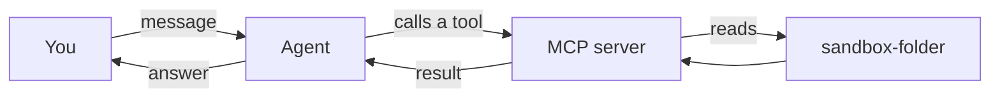

<picture>
  <source media="(prefers-color-scheme: dark)" srcset="../resources/logos/kirocrew-howto-logo-dark.svg">
  
</picture>

# Connect your tools

**Level:** Intermediate · **Time:** 30 minutes · **Surface:** Dashboard, plus
one file and one command in a terminal · **Needs:** Node.js with `npx`

Out of the box, the agent can read files, write files and run commands. In this
module you plug in **outside tools**: a code host, a task tracker, a database.
Kiro Crew calls each of these a **connection**. You will add one small tool
server that can only see one folder, check that it is healthy, and use it in a
chat.

## What you will learn

- What an MCP server is, in plain words.
- How to connect a ready-made service with one click on **Customize →
  Connections**.
- How to add your own server, from the dashboard or from a file.
- What the health badges mean: `ok`, `needs_auth`, `error`, `timeout`.
- Why a new tool shows up only after a restart and a **new** chat.
- How to keep tokens out of your files.

## Words to know

| Word | What it means |
|---|---|
| **MCP** | Model Context Protocol. A shared way to plug outside tools into an agent, a bit like USB for agent tools. |
| **MCP server** | A small program, or a web address, that offers tools to the agent. A file-system server offers tools like `list_directory` and `read_file`. |
| **Connection** | Kiro Crew's word for an MCP server or a signed-in outside service. |
| **Local server** | An MCP server that runs as a program on your computer. Its entry has a `command`. |
| **Remote server** | An MCP server on the internet. Its entry has a `url`. |
| **Probe** | A quick test that starts the server and asks it to list its tools. |
| **Health badge** | The label on a server's row that says what the last probe found. |
| **OAuth** | A sign-in where you approve access in your browser, instead of pasting a password. |
| **npx** | A command that comes with Node.js. It downloads a JavaScript program and runs it. Many MCP servers start this way. |
| **Environment variable** | A named value, such as `GITHUB_TOKEN`, that a program can read. A file can point at it with `${GITHUB_TOKEN}` instead of holding the secret. |

## Before you start

| You need | Check | You should see |
|---|---|---|
| Kiro Crew running | Open the dashboard | The **Sessions** list |
| [Module 9](../09-protect-secrets-and-files/README.md) done | You know where secrets go | **Settings → Secrets** |
| Node.js with `npx` | `node --version` and `npx --version` | Two version numbers |
| A folder the tool may see | `mkdir -p ~/my-project/sandbox-folder` | No output |

If `node --version` says "command not found", install the LTS version from
[nodejs.org](https://nodejs.org/), then open a new terminal.

Put two small files in the folder, so there is something to list:

**Surface: kiro-cli (terminal).**

```bash
echo "first note" > ~/my-project/sandbox-folder/one.txt
echo "second note" > ~/my-project/sandbox-folder/two.txt
```

## Step by step

### 1. See how a connection works



You ask in plain words. The agent picks a tool from the server, calls it, and
uses the result in its answer. You never type tool names yourself.

### 2. Look at the two kinds of server entry

Every server is a short block of JSON inside `mcpServers`. It uses exactly one
of two shapes.

**Local server.** This is this module's [`filesystem-mcp.json`](filesystem-mcp.json):

```json
{
  "mcpServers": {
    "filesystem": {
      "command": "npx",
      "args": [
        "-y",
        "@modelcontextprotocol/server-filesystem",
        "~/my-project/sandbox-folder"
      ]
    }
  }
}
```

- `filesystem` is the name you choose.
- `command` is the program to run, and `args` are the words after it.
- The last argument is the **only** folder this server may touch.

**Remote server.** This is [`github-mcp.json`](github-mcp.json):

```json
{
  "mcpServers": {
    "github": {
      "url": "https://api.githubcopilot.com/mcp/",
      "headers": {
        "Authorization": "Bearer ${GITHUB_TOKEN}"
      }
    }
  }
}
```

- `url` must start with `http://` or `https://`.
- `${GITHUB_TOKEN}` is a pointer to an environment variable, not the token
  itself. The file holds no secret.

This module ships four example files:

| File | What it holds |
|---|---|
| [`filesystem-mcp.json`](filesystem-mcp.json) | A local file-system server limited to `~/my-project/sandbox-folder`. Start here. |
| [`github-mcp.json`](github-mcp.json) | A remote code-host server that reads its token from `${GITHUB_TOKEN}`. |
| [`database-mcp.json`](database-mcp.json) | A local database server ([DBHub](https://github.com/bytebase/dbhub)) that reads the database address from `${DATABASE_URL}`. Use a database user that can only read. |
| [`multi-mcp.json`](multi-mcp.json) | All three in one file. The code host and the database start with `"disabled": true`, so nothing fails before you set their tokens. |

### 3. Add the file-system server in the dashboard

**Surface: Dashboard.**

1. In the left rail, open **Customize → Connections**.
2. Choose the **MCP Servers** tab.
3. Click **Add Custom**.
4. Paste the whole of [`filesystem-mcp.json`](filesystem-mcp.json).
5. Tick **Enable immediately**.
6. Click **Save**. The `filesystem` row appears in the table.
7. If the page shows pending changes, click **Apply**.
8. Click **Probe MCP servers** to test the server.

You should see the `filesystem` row with the badge **Online** and a count of
tools. The first probe can show **Unknown** while `npx` downloads the server.
Probe once more.

> **The file way. Surface: kiro-cli (terminal).** Instead of steps 1 to 8, you can put the
> same `mcpServers` block in `~/.kiro/settings/mcp.json`. If that file already
> has an `mcpServers` block, add `filesystem` inside it; do not paste a second
> block. Then restart Kiro Crew so it reads the file:
>
> ```bash
> kirocrew restart
> ```

### 4. Read the health badge

Each row shows what the last probe found. The Kiro Crew docs name each result
with a short status. The dashboard shows a friendlier label.

| Status | Dashboard label | Meaning | What to do |
|---|---|---|---|
| `ok` | **Online** | The server answered and listed its tools. | Nothing. |
| `needs_auth` | **Sign-in required** (or **Signed in**, **Not verified**) | The server works and wants you to sign in. This is not a failure. | Sign in (Step 6). |
| `error` | **Error** | Something is wrong: a bad command, a crash, a refused token. | Read the error text on the row. |
| `timeout` | **Unknown** | No answer in time. Often a first `npx` download. | Probe once more. |
| `disabled` | **Disabled** | You turned it off. | Nothing. |

Probe results are saved, so a row you just fixed can show an old badge until
you click **Probe MCP servers** again.

### 5. Use the server in a new chat

A chat that is already open does not see new tools. Kiro Crew also keeps
spare agent processes ready, and a new chat may pick up one of those. So:

1. At the top of the Connections page, click **Apply & Restart**. Or run
   `kirocrew restart` in a terminal.
2. Open a **new** chat.
3. Send:

   ```text
   Use the filesystem connection to list the files in sandbox-folder.
   ```

If an approval card appears, press **Approve**. If not, it just runs; that is
fine. Which calls ask first depends on your setup (see your table from
[Module 2](../02-approval-modes/README.md)).

You should see something like:

```text
sandbox-folder has two files: one.txt and two.txt.
```

### 6. Connect a ready-made service

**Surface: Dashboard.** For some popular services you write no JSON at all.

1. Open **Customize → Connections** and choose the **Services** tab.
2. Find a service you use, for example Notion, Linear, Atlassian, Stripe,
   Vercel or GitLab. Click **Connect**.
3. Approve access in your browser. On the approval page, **pick the right
   workspace or team** first. A sign-in to the wrong one works, but sees none
   of your data.
4. Open a new chat and ask something about that service.

If a chat shows a banner with a lock icon and an **Authorize** link, click it
and approve there.

To end access later, use the card's **Disconnect**. Deleting the server entry
alone does **not** cancel the sign-in.

> **Warning:** If you set the Process Sandbox to `strict` in
> [Module 9](../09-protect-secrets-and-files/README.md#3-hide-credential-folders-with-the-sandbox-lesson-92),
> OAuth sign-ins stop working inside the agent. `strict` hides the folder where
> they are kept, `~/.aws/sso/cache`. The Connections page may still say
> **Signed in**. Set the sandbox back to `auto` and open a new chat.

### 7. Keep tokens out of your files

Never paste a real token into a JSON file you share or save in git. Point at an
environment variable with `${NAME}`, as `github-mcp.json` does. If the variable
is missing, the text `${GITHUB_TOKEN}` is sent as it is, the server refuses it,
and the row shows **Sign-in required**. That is your sign the variable is not
set.

> **Risk:** A local server is a normal program. It runs with **your** rights on
> your computer. Add servers only from sources you trust, and give each one the
> smallest reach it needs: one folder, or a read-only database user.

> **In the terminal (kiro-cli)**
>
> kiro-cli reads the same `~/.kiro/settings/mcp.json` file. Inside
> `kiro-cli chat`, type `/mcp` to see the servers it loaded. In the dashboard,
> use the Connections page instead.

## Try it yourself

1. Open **Customize → Connections → Services**.
2. Pick **one** service you really use and click **Connect**.
3. Finish the sign-in in your browser.
4. Open the **MCP Servers** tab and click **Probe MCP servers**. Read its badge.
5. Click **Apply & Restart**, open a new chat, and ask it one read-only
   question about that service, such as "list my three newest items".

If you use none of the listed services, add the database example instead. DBHub
has a built-in demo database. Paste this with **Add Custom**, then ask
`How many employees are in the demo database?`

```json
{
  "mcpServers": {
    "dbhub-demo": {
      "command": "npx",
      "args": ["-y", "@bytebase/dbhub", "--transport", "stdio", "--demo"]
    }
  }
}
```

## Check your work

- [ ] `node --version` and `npx --version` print versions.
- [ ] The `filesystem` row shows **Online** (status `ok`).
- [ ] A **new** chat listed `one.txt` and `two.txt` through the connection.
- [ ] You know a chat that was open before may not see new tools.
- [ ] You know the sandbox's `strict` setting can break OAuth sign-ins
      ([Module 9](../09-protect-secrets-and-files/README.md)).

## Common problems

| What you see | What to do |
|---|---|
| **Unknown** on the first probe | The first `npx` run downloads the server. Probe again. |
| **Error** with "command not found" | Node.js is not installed, or not on your PATH. Run `node --version`. |
| **Error** about a folder | The folder in `args` must exist. Run `mkdir -p ~/my-project/sandbox-folder`. |
| The paste is refused | One bad entry stops the whole paste, and a name already in use is refused. Check commas and quotes, or pick another name. |
| The agent says it has no such tool | Click **Apply & Restart**, then open a **new** chat. |
| **Sign-in required** on a token server | The `${VAR}` it points at is not set for Kiro Crew. |
| A signed-in service stopped working | Check the sandbox is not `strict`. Then open a new chat. |
| A tool has a different name than the service's docs say | When two services share a tool name, Kiro Crew renames both to `<service>_<tool>`, for example `github_list_issues`. |

## What you learned

- An **MCP server** offers tools to the agent. Kiro Crew calls it a
  **connection**.
- Ready-made services connect from the **Services** tab; your own servers go on
  the **MCP Servers** tab or in `~/.kiro/settings/mcp.json`.
- The health badge tells you what the probe found: `ok`, `needs_auth`, `error`
  or `timeout`.
- New tools appear after a restart **and** a new chat.
- Point at tokens with `${NAME}`; never paste them into a file.
- The sandbox's `strict` setting can break OAuth sign-ins.

## Next

The agent can now use your tools. Next, let it use a website while you watch in
[Module 11: Let it use a website](../11-browser/README.md).

---
**Last updated:** 2026-10-30
**Checked against:** Kiro Crew public source @ 2808e9478c (github.com/kirodotdev/KiroCrew) and kiro.dev/docs/cli
*Part of the [Kiro Crew How To](../) guide.*
