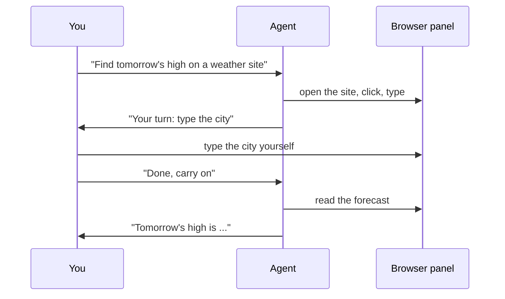

<picture>
  <source media="(prefers-color-scheme: dark)" srcset="../resources/logos/kirocrew-howto-logo-dark.svg">
  
</picture>

# Let it use a website

**Level:** Intermediate · **Time:** 20 minutes · **Surface:** Dashboard (the
desktop app)

Some jobs need a real web page: a search box to fill in, a button to press, a
page that only appears after it loads. In this module the agent opens a public
weather website in a **Browser** panel next to your chat. You watch it click
and type. Halfway through, you take over with your own mouse and keyboard, then
hand it back.

## What you will learn

- How to open the **Browser** panel beside a chat.
- How to ask the agent to drive a web page while you watch.
- How to take over for a step, then hand back.
- Why you always type passwords yourself.
- When a plain page read is enough, and when the browser is needed.
- Where the desktop-app setting **Computer Use** lives.

## Words to know

| Word | What it means |
|---|---|
| **Browser panel** | A small web browser inside the dashboard's side panel. The agent can drive it, and you can see every step. |
| **Side panel** | The area to the right of a chat. It has tabs such as **Git**, **Terminal** and **Browser**. |
| **Drive a page** | Open it, click, type, choose from lists and read the result, the way a person would. |
| **Take over** | Use your own mouse and keyboard in the Browser panel for a step, while the agent waits. |
| **Page read** | Fetching a page's text without clicking anything. Faster, but it cannot fill in a form. |
| **Computer use** | A separate, opt-in feature that lets the agent drive desktop apps, not web pages. |

## Before you start

| You need | Check | You should see |
|---|---|---|
| The Kiro Crew **desktop app** | You opened Kiro Crew as an app, not as a browser tab | The app window |
| [Module 2](../02-approval-modes/README.md) done | You know the approval pill | **Normal**, **Reads**, **Trust**, **YOLO** |
| A city name to look up | — | For example, your own town |

> **Note:** Only the desktop app has the built-in Browser panel. If you use
> the dashboard in a normal web browser, the agent uses a separate browser
> program instead (see Common problems).

## Step by step

### 1. See how it works



The agent works the page in the panel. You can watch every step. When a step
needs you, it stops, you do it, and it carries on.

### 2. Open the Browser panel

**Surface: Dashboard.**

1. Open a new chat.
2. In the side panel, click **Open side panel tab** (the **+** button).
3. Choose **Browser**.

You should see an empty browser area next to your chat.

### 3. Ask it to find tomorrow's high

**Surface: Dashboard.** Type:

```text
Use the Browser panel. Open a public weather website and go to its search box.
Stop there and tell me when it is my turn, so I can type the city myself.
After I say "done", find tomorrow's high temperature and tell me.
```

You should see the page load in the panel. The agent clicks into the search box
and tells you it is your turn.

If an approval card appears for a browser action, press **Approve**. If not,
it just runs; that is fine.

### 4. Take over, then hand back

1. Click inside the Browser panel. You are now driving it.
2. Type your city in the search box and press Enter, or pick it from the list.
3. Go back to the message box and type:

   ```text
   done
   ```

You should see the agent read the forecast page and answer, for example:

```text
Tomorrow's high in your city is 18 °C (64 °F), with light rain in the afternoon.
```

This is how you handle anything only you should do: a login, a two-factor
code, a "prove you are human" check. The agent stops, you do the step, and it
carries on.

> **Warning:** Always type passwords yourself. Never paste a password into the
> chat for the agent to type. Anything you send in chat is part of the
> conversation.

### 5. Driving a page or reading it

Driving a page is slow. Reading it is fast. Pick the right one.

| You want | Ask for | Why |
|---|---|---|
| The text of a public page | "Read the page at `https://example.com` and summarize it." | The agent fetches the text. No clicks, no panel needed. |
| A search, a form, a button, or a page that needs a login | "Use the Browser panel to ..." | Only a real browser can click, type and keep you signed in. |

Behind the scenes, a page read uses a tool called `web_fetch`, and driving uses
the `browser` tool. You do not type those names. Say what you want and, if it
matters, say "use the Browser panel".

> **Note:** The Browser panel opens public `http://` and `https://` sites only.
> It refuses `localhost` and private network addresses, because your own
> control pages (including this dashboard) live there.

### 6. Know where computer use lives

Kiro Crew can also drive **desktop apps**, not just web pages. That feature is
off by default. Turn it on yourself at **Settings → Computer Use → Enable
computer use**. This guide does not cover it further.

## Try it yourself

1. Pick a public place near you with its own website: a library, a museum, a
   swimming pool.
2. In a new chat, ask:

   ```text
   Use the Browser panel to find this week's opening hours on the website of <place>.
   ```

3. Watch the panel. Note how many clicks it took.
4. In another new chat, ask for a plain page read instead:

   ```text
   Read the opening-hours page at <page address> and tell me this week's hours. Do not use the Browser panel.
   ```

5. Compare. Which was faster? Which one could handle a menu or a search box?

## Check your work

- [ ] You saw the page move in the Browser panel while the agent worked.
- [ ] You took control, typed the city yourself, and handed back with "done".
- [ ] The agent told you tomorrow's high.
- [ ] You know you type passwords yourself.
- [ ] You can say when a page read is enough and when the browser is needed.

## Common problems

| What you see | What to do |
|---|---|
| There is no **Browser** choice in the side panel menu | Use the desktop app. A dashboard in a normal web browser has no built-in panel. |
| The agent says it is using `playwright-cli` | You are not in the desktop app. The agent drives a separate browser instead. Install it from **Settings → Browser** in one click, or use the desktop app. |
| The agent answered without opening the panel | It used a page read. Ask again and say "use the Browser panel". |
| The agent will not open a `localhost` address | That is on purpose. The panel opens public sites only. |
| A page asks you to sign in | Click into the panel and sign in yourself, then tell the agent "done". |
| The agent did not stop for your turn | Say in your first message exactly where it should stop and wait for you. |

## What you learned

- The **Browser** panel shows the agent driving a real web page.
- Ask it to stop at a step, take over with your own mouse and keyboard, then
  say "done".
- Type passwords and codes yourself, never in the chat.
- A page read is fast for plain text; the browser is for forms, buttons and
  logins.
- The built-in panel is in the desktop app only.
- **Settings → Computer Use → Enable computer use** turns on desktop-app
  control. It is off by default.

## Next

The agent can now reach websites and tools. Next, have it work for you on a
schedule in [Module 12: Get a daily summary](../12-scheduled-jobs/README.md).

---
**Last updated:** 2026-10-30
**Checked against:** Kiro Crew public source @ 2808e9478c (github.com/kirodotdev/KiroCrew) and kiro.dev/docs/cli
*Part of the [Kiro Crew How To](../) guide.*
