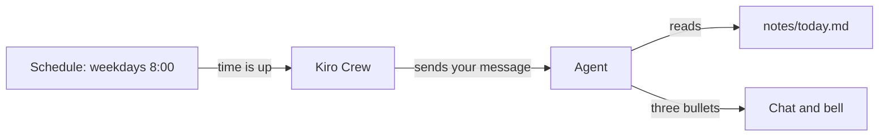

<picture>
  <source media="(prefers-color-scheme: dark)" srcset="../resources/logos/kirocrew-howto-logo-dark.svg">
  
</picture>

# Get a daily summary

**Level:** Intermediate · **Time:** 30 minutes · **Surface:** Dashboard, plus
agent tools you start by asking

So far the agent has worked only when you typed a message. In this module you
give it a **scheduled job**: "every weekday at 8am, read my notes and give me
three bullets." You make the job by asking in plain words, test it right away,
and then see, pause and edit it on the **Schedule** page.

## What you will learn

- How to make a scheduled job by asking in plain words.
- How to set the time zone, so 8am means **your** 8am.
- How to run a job now, to test it, without waiting for the time.
- How to see, pause, resume and edit a job on the **Schedule** page.
- Where to read a job's run history.
- How to make a one-time reminder.
- What happens to jobs when your computer sleeps.

## Words to know

| Word | What it means |
|---|---|
| **Scheduled job** | A message Kiro Crew sends to the agent by itself, at a time you choose. Also called a **cron job**. |
| **Cron expression** | Five fields that say when a job runs: minute, hour, day of month, month, day of week. `0 8 * * 1-5` means "at 8:00, Monday to Friday". |
| **Time zone** | The place whose clock a job uses, written like `Europe/London` or `America/New_York`. |
| **Trigger** | Run a job once, right now, whatever its schedule says. |
| **One-time job** | A job that runs once at a set time, then deletes itself. A reminder is one. |
| **Run history** | The list of times a job ran, and whether each run worked. |

## Before you start

| You need | Check | You should see |
|---|---|---|
| Kiro Crew running | Open the dashboard | The **Sessions** list |
| [Module 6](../06-prompts-and-steering/README.md) done | You can write a clear, reusable request | — |
| [Module 9](../09-protect-secrets-and-files/README.md) done | You know what each safety layer guards | — |
| Your time zone name | — | For example `Europe/London` |

Copy this module's sample notes into your practice folder. **Surface:
terminal.** Run this from the folder where you downloaded this guide:

```bash
mkdir -p ~/my-project/notes
cp 12-scheduled-jobs/notes/today.md ~/my-project/notes/today.md
```

Look at it once, so you know what the summary should say:

**Surface: kiro-cli (terminal).**

```bash
cat ~/my-project/notes/today.md
```

You should see two meetings, four to-do items and two things to remember.

## Step by step

### 1. See how it works



Kiro Crew keeps the clock. At the time you chose, it sends your message to the
agent, as if you had typed it. The agent does the work and the answer lands in
a chat for you to read.

### 2. Ask for the job

**Surface: Dashboard.** Open a new chat and type. Put your own time zone in
place of `Europe/London`:

```text
Every weekday at 8am Europe/London time, read ~/my-project/notes/today.md and give me three bullets: what is most urgent, what is due soon, and one thing to remember. Call the job morning-notes.
```

You should see the agent say it scheduled the job, with its name, its next run
time and an id. For example:

```text
Scheduled "morning-notes": weekdays at 08:00 (Europe/London). Next run: Monday 08:00.
```

Behind the scenes it used a tool called `cron_add`. You do not type that name.

> **Tip:** Always say the time zone. Without one, Kiro Crew uses the time zone
> in its settings, and if none is set, UTC. That can be hours away from yours.

### 3. Test it now

You do not need to wait until tomorrow at 8am. In the same chat, type:

```text
Trigger the morning-notes job now.
```

The agent uses a tool called `cron_trigger`. The job runs once, right away.

You should see a short summary like this, either in the chat or in a chat tab
named `Cron: morning-notes`:

```text
- Most urgent: the dentist at 14:30. Leave home by 14:00, and bring the blue folder.
- Due soon: pay the electricity bill by Friday.
- Remember: the library books are due back tomorrow.
```

If the agent cannot read the file, see Common problems.

### 4. See the job on the Schedule page

**Surface: Dashboard.** In the left rail, open **Schedule**. You can also go
straight there at `/schedule`.

You should see a row for `morning-notes`. It shows when it runs, its **Next
Run** and its **Last Run**. Check that the time zone is the one you asked for.

The **Schedule** page lists **every** job. A chat sees only the jobs it made.
If you ask a chat "list my jobs" and one is missing, look here.

### 5. Pause, resume and run it

**Surface: Dashboard.** On the `morning-notes` row:

1. Click **Pause**. The row now says **Paused**. The job will not run at 8am
   while it is paused.
2. Click **Resume**. It is back on the schedule.
3. Click **Run Now** to run it once more, the same as a trigger.

### 6. Edit the job

**Surface: Dashboard.** Click the job's name to open its form.

1. In the message, change "three bullets" to "five bullets".
2. Check the schedule and the **Timezone** box.
3. Click **Save**.

Click **Run Now** to see the new, longer summary.

You should see something like:

```text
- Buy milk on the way home.
- Call the dentist before noon.
- Send the trip photos to Sam.
- Water the balcony plants.
- Pay the phone bill by Friday.
```

You can also edit from chat:
`Change the morning-notes job to run at 7:30 instead.` The agent updates the same job, so its id and history stay.

### 7. Read the run history

**Surface: Dashboard.** On the **Schedule** page, open **Executions**. Each run
is a row with its **Status** (**OK**, **Error** or **Timeout**), its
**Duration** and a **Summary**.

You should see a row something like:

```text
OK  12s  Five bullets from today.md
```

If a run failed, the reason also goes to the bell in the top bar, so you hear
about it even if you do not open this page.

### 8. Keep your computer awake for long runs

A job can only run while your computer is on and awake, with Kiro Crew
running. If your computer is asleep at 8am, the job cannot run at 8am.

**Surface: Dashboard.** Open **Settings → Chat → Advanced** and turn on
**Prevent sleep while running**. This keeps your computer awake **while a task
is running**, so a long run is not cut off. It does not wake a computer that is
already asleep.

> **In a terminal. Surface: kiro-cli (terminal).**
>
> You can make, list and run jobs with the `kirocrew` command too.
>
> ```bash
> kirocrew cron add morning-notes "Read ~/my-project/notes/today.md and give me three bullets." --cron "0 8 * * 1-5" --timezone Europe/London
> kirocrew cron list
> kirocrew cron trigger <job-id>
> ```
>
> `cron add` prints the new job's id. Put that id in place of `<job-id>`.
> `cron list` shows every job and its id.
>
> A job made in the terminal belongs to no chat. So a chat cannot see or
> change it. Manage it on the **Schedule** page or with `kirocrew cron`
> (`pause`, `resume`, `remove`).

## Try it yourself

Make a one-time reminder.

1. In a new chat, type:

   ```text
   In 10 minutes, remind me to stand up and stretch.
   ```

2. Open **Schedule** and find the new job. Note its **Next Run** time.
3. Wait 10 minutes. You should see the reminder arrive in a chat, and a bell
   alert in the top bar.
4. Check **Schedule** again. A one-time job deletes itself after it runs, so
   the row is gone.

## Check your work

- [ ] `morning-notes` shows on the **Schedule** page with your time zone.
- [ ] A test run finished and gave you a short summary of `today.md`.
- [ ] You paused the job and resumed it.
- [ ] You changed the job's message and saw the new result.
- [ ] You found the job's runs under **Executions**.
- [ ] Your 10-minute reminder arrived, then left the list.

## Common problems

| What you see | What to do |
|---|---|
| The job ran at the wrong hour | The time zone is wrong or missing. Edit the job and set **Timezone**, or ask the agent to set it. |
| The agent says it cannot find `today.md` | Check the path: `ls ~/my-project/notes/today.md`. Use the full path in the job's message. |
| A chat says the job does not exist | A chat sees only its own jobs. Jobs from the terminal or the **Schedule** page belong to no chat. Use the **Schedule** page. |
| The job did not run this morning | Your computer may have been asleep, or Kiro Crew was not running. Check **Executions**, then **Run Now**. |
| A run shows **Timeout** | The job took too long. Shorten the request, or split it into two jobs. |
| You got the summary twice | You triggered it and also clicked **Run Now**. That is fine; each is one run. |

## What you learned

- Ask in plain words, "Every weekday at 8am ...", and the agent makes the job.
- Always give a time zone.
- Say "trigger that job now" to test it at once.
- The **Schedule** page shows every job, with **Pause**, **Resume**, **Run
  Now** and **Executions**.
- A one-time reminder runs once, then deletes itself.
- **Settings → Chat → Advanced → Prevent sleep while running** keeps a long run
  from being cut off by sleep.

## Next

A schedule runs at fixed times. Next, have the agent watch for a change and
speak up only when there is news, in
[Module 13: Tell me when something changes](../13-monitors/README.md).

---
**Last updated:** 2026-10-30
**Checked against:** Kiro Crew public source @ 2808e9478c (github.com/kirodotdev/KiroCrew) and kiro.dev/docs/cli
*Part of the [Kiro Crew How To](../) guide.*
