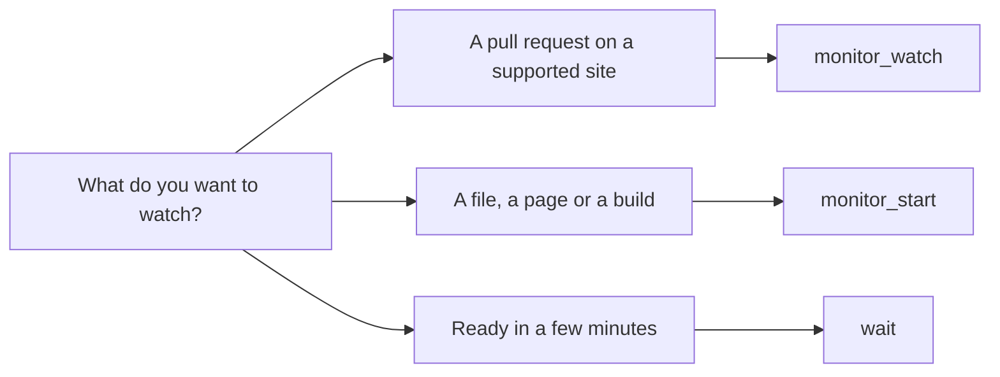

<picture>
  <source media="(prefers-color-scheme: dark)" srcset="../resources/logos/kirocrew-howto-logo-dark.svg">
  
</picture>

# Tell me when something changes

**Level:** Intermediate · **Time:** 30 minutes · **Surface:** Dashboard, plus agent tools you start by asking

In Module 12 a job ran at a fixed time. This module is about a different need:
"Keep an eye on this, and only speak up when there is news." You will make one
chat check for a file every five minutes, stay quiet while nothing changes, and
tell you once when the file appears.

## What you will learn

- Which tool fits which job: a pull-request watch, a timed re-check, or a short wait.
- How to ask for a timed re-check in plain words, with a limit on the number of checks.
- How to read and stop a loop with the 🎯 goal control in the message box.
- Where alerts land: the bell in the top bar and **Settings → Notifications**.
- How to watch a pull request without spending an agent turn on every check.
- How to stop any watch yourself.

## Words to know

| Word | What it means |
|---|---|
| **Monitor** | Something that keeps checking for a change for you. |
| **Monitor loop** | A chat that wakes itself up on a timer, checks something, and goes back to sleep. It stays in the same chat, so it remembers what it already found. |
| **Cycle** | One wake-up and check in a monitor loop. |
| **Interval** | The time between two cycles, for example 5 minutes. |
| **Cycle cap** | The most cycles a loop may run before it stops. It is a safety limit, not a sign of success. |
| **Pull request** | A proposed change to code on a site such as GitHub, waiting for review. Some sites call it a *merge request*. |
| **Review-ready** | A pull request whose checks and reviews say it can move on. |
| **Bell** | The bell icon in the dashboard's top bar. It opens your notifications. |
| **Notification** | A short alert in the bell, and optionally a banner and a sound. |

## Before you start

| What you need | How to check |
|---|---|
| Kiro Crew running (Module 1) | Open the dashboard. You see the **Sessions** list. |
| Module 12 done | You have made and triggered a scheduled job. |
| A practice folder with an `inbox` folder | In a terminal, run `mkdir -p ~/my-project/inbox`, then `ls ~/my-project`. You see `inbox`. |

Surface labels in this module:

- **Dashboard**: type it in the dashboard's message box, or click it in the dashboard.
- **Terminal**: type it in your computer's terminal, not inside `kiro-cli chat`.

## Step by step

### 1. Pick the right tool

You do not call these tools by name. You describe what you want, and the agent
picks one. It helps to know which one it should pick.

| You want to watch... | The agent uses | How it checks |
|---|---|---|
| A pull request on GitHub, GitLab, Azure DevOps Services or Bitbucket Cloud | `monitor_watch` | Asks the site directly. It wakes the chat **only** when a new change needs action. Checks with no news cost no agent turn. |
| Anything else: a file, a web page, a build | `monitor_start` | Wakes the same chat on a timer. Every check is a full agent turn. |
| Something that will be ready in a few minutes, inside this one answer | `wait` | Pauses the current answer for 1 to 30 minutes, then carries on. |



The diagram says the same as the table: a pull request goes to
`monitor_watch`, anything else goes to `monitor_start`, and a short pause inside
one answer goes to `wait`.

### 2. Start a loop that watches for a file

**Surface: Dashboard.** Open a new chat and type:

```text
Every 5 minutes, check whether ~/my-project/inbox/done.txt exists. Do at most 6 checks.
While it does not exist, say nothing. When it exists, send me a notification,
tell me here in one line, and stop checking.
```

Each part of the request does a job:

| Part | Why it is there |
|---|---|
| `Every 5 minutes` | The interval. |
| `at most 6 checks` | The cycle cap. Without it, a loop the agent starts stops after 24 cycles. |
| `say nothing` | Quiet checks should not fill the chat. |
| `send me a notification` | Puts the alert in the bell, so you see it from any page. |
| `stop checking` | The exit condition. The loop ends itself when the file shows up. |

You should see something like:

```text
I've asked for a check every 5 minutes, up to 6 checks. I'll tell you when
~/my-project/inbox/done.txt exists.
```

The loop starts after the agent's turn ends. Its first reply is a request, not
proof, so check the 🎯 control in the next step.

> **Tip:** a quiet check still runs a full agent turn. It reads the folder each
> time, and it uses credits each time.

If the check shows an approval card each time, approve it, or try another
mode on the approval pill. Your table from
[Module 2](../02-approval-modes/README.md) shows which mode reads a folder
without asking on your setup. If no card appears, the loop just runs.

### 3. Read the loop in the goal control

**Surface: Dashboard.** Look at the message box. A target-shaped button, the
**🎯 goal control**, shows that a loop is active. Open it.

You should see something like:

```text
Goal active (cycle 1)
Next cycle in 4m 52s
```

From this control you can change the seconds between cycles, change
**Max cycles**, or press **Pause loop**.

Your own messages in this chat do not reset the timer. If a check comes due
while you are chatting, it waits until your turn ends, then runs.

### 4. Make the change

Let two checks pass. Nothing new should appear in the chat. Then, in a
terminal, create the file:

**Surface: kiro-cli (terminal).**

```bash
touch ~/my-project/inbox/done.txt
```

At the next check, you should see one short message in the chat, such as:

```text
~/my-project/inbox/done.txt exists now. I've stopped checking.
```

The bell in the top bar shows a new notification. The 🎯 control no longer
shows an active loop.

### 5. Choose how alerts reach you

**Surface: Dashboard.** Open **Settings → Notifications**. These switches decide
how an alert gets your attention:

| Setting | What it does |
|---|---|
| **Show a banner for new notifications** | A banner slides in under the top bar, then tucks into the bell. |
| **Play sound on new notifications** | Plays a sound. |
| **Notify when a background chat finishes** | Alerts you when a chat you are not looking at ends a turn. |
| **Notify me even when Kiro Crew is closed** | Sends a desktop alert when the dashboard tab is closed. |

Click the bell to see the alert. The alert's **Go to Chat** button opens the chat
that sent it.

### 6. Stop a loop yourself

You can stop a loop at any time, three ways:

1. Say `stop checking` in the chat (**Dashboard**). The agent ends the loop.
2. Open the 🎯 control and press **Pause loop** (**Dashboard**).
3. For a pull-request watch, ask "stop watching that pull request". The agent
   calls `monitor_stop`.

A chat holds **one** watch at a time. If you ask for a second one while the first
is active, the agent is refused and tells you. Stop the first one, then ask again.

### 7. Watch a pull request the cheap way

If you have a pull request on GitHub, GitLab, Azure DevOps Services or Bitbucket
Cloud, the agent can watch it with `monitor_watch`. This kind of watch checks
the site itself and wakes the chat only when a new change needs action. A check
with no news costs no agent turn.

**Surface: Dashboard.** Use the full web address of your own pull request:

```text
Watch https://github.com/<your-name>/<your-repo>/pull/<number> until it is review-ready.
```

Replace `<your-name>`, `<your-repo>` and `<number>` with your own values.

Unless you ask for other limits, the watch uses these:

| Limit | Default |
|---|---|
| Time between checks | 5 minutes |
| Longest it runs | 4 hours |
| Errors from the site in a row | 3 |

Good to know:

- Start it from the dashboard, Slack or Discord.
- When the pull request becomes review-ready, the **dashboard** shows the
  result. The chat itself does not get a final message.
- If you need a final message in the chat, or you watch comments rather than
  checks and reviews, ask for a timed loop instead (step 2).

### 8. A short wait inside one answer

Sometimes you only need to wait a few minutes. The `wait` tool pauses the
agent's current answer for 1 to 30 minutes, then lets it carry on in the same
turn.

**Surface: Dashboard.**

```text
Wait 2 minutes, then tell me whether ~/my-project/inbox/later.txt exists.
```

While it waits, the chat shows an **End wait** button. Press it to stop waiting
early.

## Try it yourself

Pick one:

1. **If you have a pull request** on a supported site, ask the agent to watch it
   until it is review-ready (step 7). Open the 🎯 control and see what it shows.
2. **If you do not**, watch a public web page for a word. In a new chat
   (**Dashboard**), type:

   ```text
   Every 10 minutes, check https://example.com for the word "Example". Do at most 3 checks.
   When you find it, send me a notification and stop.
   ```

   The word is already on that page, so the first check should find it, alert
   you and stop.

Then clean up the practice file (**Terminal**):

**Surface: kiro-cli (terminal).**

```bash
rm ~/my-project/inbox/done.txt
```

## Check your work

- [ ] The 🎯 control showed the loop and its cycle number.
- [ ] Quiet checks added no message for you to read.
- [ ] You got one message and one bell alert when the file appeared.
- [ ] The loop stopped by itself after the file appeared.
- [ ] You can say which tool fits a pull request and which fits a file.

## Common problems

| What you see | What to do |
|---|---|
| The 🎯 control shows no loop | The loop starts after the agent's turn ends. Wait a moment, then open the control again. If it is still empty, ask "is a loop running in this chat?" |
| The agent says a loop is already running | A chat holds one watch at a time. Say `stop checking`, then ask again. |
| The loop stopped before the file appeared | It reached its cycle cap. Ask again with a larger number of checks. |
| No alert in the bell | Ask for a notification in your request ("send me a notification"). Check **Settings → Notifications**. |
| Every check shows an approval card | Switch the approval pill to **Reads** (Module 2) for this chat. |
| A loop started from a scheduled job was refused | Loops work in dashboard chats, Slack threads, Discord direct messages and Webex. From a scheduled job, use a schedule instead (Module 12). |

## What you learned

- `monitor_watch` watches a pull request on a supported site and spends no
  agent turn until something needs action.
- `monitor_start` re-checks anything else on a timer, in the same chat.
- `wait` pauses one answer for a few minutes.
- The 🎯 goal control shows a loop's cycle and next check, and can pause it.
- Alerts land in the bell. **Settings → Notifications** decides banners and sounds.

## Next

Go on to [Module 14: reach it from your phone or chat app](../14-phone-and-chat-apps/README.md).

---
**Last updated:** 2026-10-30
**Checked against:** Kiro Crew public source @ 2808e9478c (github.com/kirodotdev/KiroCrew) and kiro.dev/docs/cli
*Part of the [Kiro Crew How To](../) guide.*
