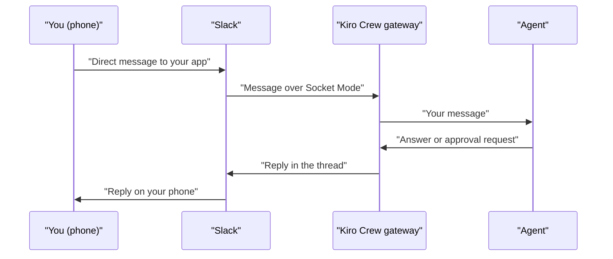

<picture>
  <source media="(prefers-color-scheme: dark)" srcset="../resources/logos/kirocrew-howto-logo-dark.svg">
  
</picture>

# Reach it from your phone or chat app

**Level:** Intermediate · **Time:** 60 minutes · **Surface:** Dashboard, Terminal and Slack

So far you have talked to the agent at your desk. In this module you connect
**Slack**, so you can send it a message from your phone, get an answer, and
approve its work with one tap. At the end you will also see how to open the
dashboard itself on your phone, and which other chat apps work.

Slack is taught in full here. The other chat apps get one line each, with a link
to their own setup guide.

## What you will learn

- How Kiro Crew talks to Slack, and why only you can use your bot.
- How to create your own Slack app from a ready-made manifest.
- How to give Kiro Crew the two Slack tokens, from the dashboard or the terminal.
- How to chat from the Slack app on your phone, and answer an approval there.
- How to ask the agent to message you in Slack with `send_message`.
- How to open the dashboard on your phone with **Connect your phone**.
- Which other chat apps work, and which of them show buttons.

## Words to know

| Word | What it means |
|---|---|
| **Channel** | A chat app you can use instead of the dashboard, such as Slack or Telegram. |
| **Slack app** | Your own small program inside Slack. Kiro Crew speaks through it. You create it once. |
| **Workspace** | One Slack group, with its own members and channels. Your app lives in one workspace. |
| **Manifest** | A short settings file that tells Slack what your app needs. Kiro Crew writes it for you. |
| **Socket Mode** | A way for a Slack app to connect out from your computer. You need no public web address. |
| **Token** | A long secret string that proves who you are to a service. Treat it like a password. |
| **App token** | Your Slack app's token for Socket Mode. It starts with `xapp-`. |
| **Bot token** | Your Slack app's token for sending and reading messages. It starts with `xoxb-`. |
| **Member ID** | Slack's ID for you, such as `U0123ABC456`. Kiro Crew answers only this person. |
| **Thread** | Replies grouped under one message in Slack. One thread is one chat with the agent. |
| **Tailscale** | A service that joins your own devices into a private network, called a *tailnet*. |

## Before you start

| What you need | How to check |
|---|---|
| Kiro Crew running (Module 1) | Open the dashboard. You see the **Sessions** list. |
| [Module 2](../02-approval-modes/README.md) and Module 12 done | You know the approval pill, and you have one scheduled job. |
| A Slack workspace where you may add apps | You own the workspace, or an admin lets you install apps. A free workspace you own works. |
| The Slack app on your phone | Install it from your phone's app store and sign in to that workspace. |
| A terminal on the computer that runs Kiro Crew | `kirocrew status` prints the gateway state. |
| For the phone dashboard (step 10 only): a Tailscale account | `tailscale status` prints your devices. |

Surface labels in this module:

- **Dashboard**: type it in the dashboard's message box, or click it in the dashboard.
- **Terminal**: type it in your computer's terminal, not inside `kiro-cli chat`.
- **Slack**: type it in a direct message to your Slack app.

> **Tip:** use a personal or test workspace the first time. You can make the app
> again in another workspace later.

## Step by step

### 1. See how it fits together

Kiro Crew connects to Slack with **Socket Mode**. Your computer opens the
connection, so there is nothing to host and no public web address. Messages go
from your phone, through Slack, to the Kiro Crew gateway on your computer, and
back.



The diagram shows one round trip: your message goes through Slack to the
gateway and the agent, and the answer comes back the same way.

> **Risk:** your Slack bot acts with **your** computer's files and accounts. That
> is why Kiro Crew on Slack answers only one person: the owner you set in step 6.
> Nobody else in the workspace can use it.

Your computer must be on and Kiro Crew must be running for Slack to work.

### 2. Create your Slack app from the manifest

You can start from the dashboard or from the terminal. Both make the same app.

**Surface: Dashboard.** Open **Settings → Messaging Channels → Slack**. Under
**Get your credentials**, press **Create Slack app**. A Slack page opens with
every setting already filled in. If the link does not work, press
**Copy manifest YAML** instead, then in Slack choose **Create New App →
From a manifest** and paste it.

> **In a terminal. Surface: kiro-cli (terminal).**
>
> This prints the same one-click link:
>
> ```bash
> kirocrew manifest --url
> ```
>
> You should see something like:
>
> ```text
> 🔗 Click to create your Slack app:
> https://api.slack.com/apps?new_app=1&manifest_yaml=...
> ```
>
> It also prints a `kirocrew config set slack.command ...` line. Run that line
> exactly as printed, so Kiro Crew answers your app's slash command.

On the Slack page:

1. Pick your workspace from the list.
2. Press **Create**.

### 3. Make the app token

In your new app's Slack settings page:

1. Open **Settings → Socket Mode**.
2. Turn the switch **off**, then **on** again. This opens the token box.
3. Add the scope `connections:write`, then press **Generate**.
4. Copy the token that starts with `xapp-`. This is your **app token**.

Why off and on? The manifest turns Socket Mode on, but Slack only makes the app
token by hand. The toggle brings up the box.

### 4. Install the app and copy the bot token

1. Open **Features → OAuth & Permissions**.
2. Press **Install to Workspace**, then approve.
3. Copy the token that starts with `xoxb-`. This is your **bot token**.

If your workspace needs an admin to approve new apps, ask them, or use a
workspace you own.

### 5. Find your member ID

In Slack, click your profile picture, then **Profile**, then the **⋮** menu,
then **Copy member ID**. It looks like `U0123ABC456`.

Your member ID is different in every workspace. Use the one from the workspace
where you installed the app.

### 6. Give Kiro Crew the tokens

Pick one way.

**Surface: Dashboard.** In **Settings → Messaging Channels → Slack**:

1. Paste the bot token into **Slack bot token**.
2. Paste the app token into **Slack app token**.
3. Paste your member ID into **Owner Slack member ID**.
4. Press **Save Slack settings**.

You should see something like:

```text
Verified with Slack and saved. Restart the gateway to connect.
```

Kiro Crew checks each token with Slack before it saves it. The tokens are saved
in a private file on your computer, never in `config.json`. You can only edit
these fields from the computer that runs Kiro Crew.

> **In a terminal. Surface: kiro-cli (terminal).**
>
> This asks for the same three values, one at a time:
>
> ```bash
> kirocrew setup --slack
> ```

Then restart the gateway, so it connects (**Surface: kiro-cli (terminal)**):

```bash
kirocrew restart
```

Check that it worked (**Surface: kiro-cli (terminal)**):

```bash
kirocrew doctor
```

Read its Slack section and fix anything it marks as a problem. Back in
**Settings → Messaging Channels → Slack**, the panel should say **Connected**.

### 7. Chat from your phone

Open the Slack app on your phone. Find your new app in the **Apps** section and
open a direct message with it.

**Surface: Slack.** Send:

```text
What files are in ~/my-project?
```

The reply arrives in a **thread** under your message. If **Phase reactions** is
on in the Slack panel, an emoji on your message shows progress, for example 👀
when the message is queued and 🤔 while the agent thinks.

Two rules about threads:

- **Reply inside the thread** to keep talking in the same chat.
- A **new top-level message** starts a new chat.

Now ask about your schedule. **Surface: Slack.** Send this keyword on its own:

```text
cron list
```

You should see your scheduled jobs, including the one from Module 12.

Handy Slack commands (**Surface: Slack**):

| Type this | What it does |
|---|---|
| `status` | Shows how Kiro Crew is doing: uptime, chats, jobs. |
| `sessions` | Lists your recent dashboard chats, with **Resume** buttons. |
| `!stop` | Stops the agent's current turn in this thread. |

### 8. Approve work from your phone

**Surface: Slack.** In your direct message, send:

```text
Create ~/my-project/from-phone.txt with the words "hello from my phone".
```

If the agent asks first, Slack shows three buttons under the request:
**Approve**, **Trust session** and **Reject**. Tap **Approve**. The agent
writes the file and tells you so in the thread.

If no buttons appear, the agent just wrote the file. That is fine. Which
actions ask first depends on your setup (your table from
[Module 2](../02-approval-modes/README.md)).

| Button | What it does |
|---|---|
| **Approve** | Allows this one action. |
| **Trust session** | Allows the rest of this chat's actions without asking. |
| **Reject** | Says no. The agent does not do it. |

Good to know:

- When buttons appear, the same request also shows in the dashboard.
  Answer it in either place.
- If nobody taps a button within 10 minutes, the request is rejected. That limit
  is the setting `agent.tool_approval_timeout_secs` (default `600` seconds).

Check the file on your computer (**Surface: kiro-cli (terminal)**):

```bash
cat ~/my-project/from-phone.txt
```

You should see:

```text
hello from my phone
```

### 9. Get a message from the agent

The agent can message you first. It uses the `send_message` tool.

**Surface: Dashboard.** In a dashboard chat, type:

```text
Send me a Slack message that says "Test from the dashboard".
```

The message arrives in your Slack direct message with the app.

You can also follow a dashboard chat from Slack. In **Settings → Messaging
Channels → Slack**, turn on **Connect new sessions to Slack automatically**. From
then on, each new dashboard chat opens a Slack thread on its first message, in
your private direct message with the bot.

### 10. Open the dashboard on your phone (optional)

Slack lets you chat. To see the **whole dashboard** on your phone, Kiro Crew can
publish it inside your own Tailscale network. Only your own devices can reach it,
not the public internet.

**Surface: Dashboard.** In the left rail, press **Connect your phone**. You can
also open **Settings → Overview → Phone access**. The card checks that Tailscale
is installed and signed in. When it is ready, press **Set up & show QR** and scan
the code with your phone's camera.

> **In a terminal. Surface: kiro-cli (terminal).**
>
> The same steps by hand:
>
> ```bash
> kirocrew config set dashboard.tailscale.enabled true
> kirocrew restart
> kirocrew tailnet up
> kirocrew token
> ```
>
> `kirocrew tailnet up` publishes the dashboard on your tailnet.
> `kirocrew token` prints the sign-in link to open on your phone.
> `kirocrew tailnet status` shows what is set up, and `kirocrew tailnet down`
> stops publishing.

> **Warning:** the link from `kirocrew token` signs you in. Treat it like a
> password. Do not paste it into a chat or a shared document.

If the card says **Tailnet is off by policy**, your setup is managed by a policy
that does not allow it. Use Slack instead.

### 11. Other chat apps

Kiro Crew works with nine more chat apps. Each has its own setup guide in the
[public Kiro Crew repository](https://github.com/kirodotdev/KiroCrew), under
`src/kiro_crew/docs/`. You set them up in **Settings → Messaging Channels**.

| Chat app | Buttons for choices and approvals? | One line about it |
|---|---|---|
| Discord | Yes | Chat in direct messages; approvals show **Approve** and **Deny** buttons. |
| Telegram | Yes | Chat with a bot; choices show as tappable buttons under the message. |
| Teams | Yes | Choices and approvals show as cards, up to 5 choices. |
| Webex | Yes | Choices and approvals show as cards, up to 5 choices. |
| WhatsApp | No buttons | Approvals can still be answered; choices arrive as text. |
| iMessage | No buttons | Choices arrive as a numbered list; reply with the number. |
| WeCom | No buttons | Choices arrive as a numbered list; reply with the number. |
| Weixin | No buttons | Choices arrive as a numbered list; reply with the number. |
| Feishu | No buttons | Choices arrive as a numbered list; it only replies, never writes first. |

## Try it yourself

Make your Module 12 job send its summary to Slack too.

**Surface: Dashboard.** Open the chat where you made the Module 12 job, and type:

```text
Change my daily summary job so it also sends the summary to me in Slack.
```

Then type `trigger that job`. You should see the summary arrive in your Slack
direct message.

## Check your work

- [ ] **Settings → Messaging Channels → Slack** says **Connected**.
- [ ] A reply came to your phone, in a thread under your message.
- [ ] You asked for a file from your phone, and the file exists.
- [ ] A `send_message` test arrived in Slack.
- [ ] You can name two chat apps that show buttons and one that does not.

## Common problems

| What you see | What to do |
|---|---|
| The panel says **Needs setup** or **Not connected** | Check that both tokens are pasted, press **Save Slack settings**, then run `kirocrew restart`. |
| `Slack rejected the stored tokens (invalid_auth)` | A token is wrong or old. Copy fresh ones from steps 3 and 4, paste them, save, and restart. |
| **Install to Workspace** is greyed out | Use **Features → OAuth & Permissions → Install to Workspace**, not the **Install App** page. |
| The bot never answers your message | Check that `kirocrew doctor` passes and the gateway is running. Check that the member ID is yours, from this workspace. |
| The bot answers you but not a teammate | That is by design. Kiro Crew on Slack answers only its owner. |
| A new message forgot what you said before | Reply inside the thread. A new top-level message starts a new chat. |
| The approval timed out | You have 10 minutes to tap a button. Ask again. |
| You cannot edit the Slack panel | You opened the dashboard from another machine. Edit it on the computer that runs Kiro Crew. |
| The card says **Tailnet is off by policy** | A policy blocks phone access to the dashboard. Use Slack instead. |

## What you learned

- Kiro Crew reaches Slack with Socket Mode, from your own computer, and answers
  only you.
- **Settings → Messaging Channels → Slack** or `kirocrew setup --slack` stores the
  app token, bot token and your member ID. `kirocrew manifest --url` makes the app.
- In Slack, a thread is one chat. You can approve actions with a tap.
- The agent can message you first with `send_message`.
- **Connect your phone** or `kirocrew tailnet up` puts the whole dashboard on your
  phone, inside your own tailnet.
- Discord, Telegram, Teams and Webex show buttons. Other apps use text.

## Next

Go on to [Module 15: many tasks at once](../15-parallel-helpers/README.md).

---
**Last updated:** 2026-10-30
**Checked against:** Kiro Crew public source @ 2808e9478c (github.com/kirodotdev/KiroCrew) and kiro.dev/docs/cli
*Part of the [Kiro Crew How To](../) guide.*
