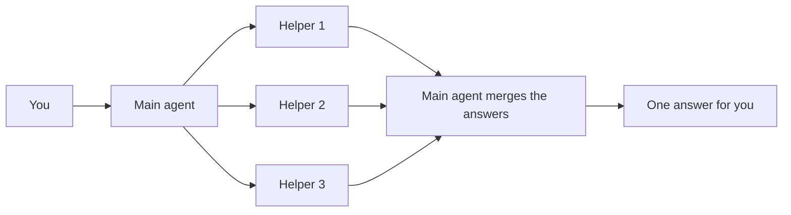

<picture>
  <source media="(prefers-color-scheme: dark)" srcset="../resources/logos/kirocrew-howto-logo-dark.svg">
  
</picture>

# Many tasks at once

**Level:** Advanced · **Time:** 30 minutes · **Surface:** Dashboard, plus agent tools you start by asking, and Terminal

Some jobs are really several small jobs that do not depend on each other. In
this module the agent hands three look-ups to three **helpers** that work at the
same time, then puts their answers into one table for you.

## What you will learn

- What a helper (subagent) is, and when splitting work is worth it.
- How to ask for helpers in plain words.
- How to watch helpers in the **Subagents** panel.
- How to ask what helpers are running, and read one helper's full answer.
- How to check whether your computer has room for more helpers.
- Why the agent may say no to splitting a small task.
- How to start a helper from the terminal with `kirocrew spawn`.

## Words to know

| Word | What it means |
|---|---|
| **Helper** | A second agent that the main agent starts to do one part of the work. Kiro Crew's docs call it a *subagent*. |
| **Main agent** | The agent you are chatting with. It starts the helpers and merges their answers. |
| **In parallel** | At the same time, instead of one after another. |
| **Independent** | A task that does not need another task's result to start. |
| **Completion event** | The message a finished helper sends back to the main agent with its answer. |
| **Transcript** | The full record of what a helper did and said. |
| **Headroom** | Free memory and processor time on your computer. Each helper needs some. |

## Before you start

| What you need | How to check |
|---|---|
| Kiro Crew running (Module 1) | Open the dashboard. You see the **Sessions** list. |
| Module 12 done | You have made a scheduled job, so you know agent tools by name. |
| Internet access for the agent | Ask in a chat "fetch https://example.com and tell me its title". You get `Example Domain`. |
| A terminal (step 6 only) | `kirocrew status` prints the gateway state. |

Surface labels in this module:

- **Dashboard**: type it in the dashboard's message box, or click it in the dashboard.
- **Terminal**: type it in your computer's terminal, not inside `kiro-cli chat`.

## Step by step

### 1. Know when splitting helps

The main agent can start helpers with the `spawn_run` tool. Each helper is its
own agent with its own chat. It works in the background. When it finishes, it
sends its answer back to the main agent.



The diagram shows the main agent handing three parts to three helpers, then
merging what they send back into one answer.

Splitting is worth it when:

- the work breaks into **two or more independent tasks**, or
- one step would bury the chat in a lot of output, and you only need the short result.

Splitting is **not** worth it for one small task. Starting a helper takes time,
so one task is faster done in the main chat.

### 2. Ask for three helpers

**Surface: Dashboard.** Open a new chat and type:

```text
Use three helpers in parallel. Each helper looks up today's opening hours of one
museum on that museum's own website: the Louvre in Paris, the Rijksmuseum in
Amsterdam, and the Metropolitan Museum of Art in New York. Then give me one table
with the columns Museum, Opening hours today and Source link.
```

Saying **"use three helpers in parallel"** matters. It tells the agent you want
the work split. Naming three separate look-ups gives it three independent tasks.

You should see something like:

```text
I've started three helpers, one per museum. I'll merge their answers when they
are all back.
```

The main agent then ends its turn and waits for the helpers.

### 3. Watch the helpers in the Subagents panel

**Surface: Dashboard.** Open the chat's side panel and choose the **Subagents**
tab. You can also press **Open Subagents panel** when the chat offers it.

You should see three helper cards, one per museum. Each card shows whether the
helper is running or done, and how long it took.

When all three are done, the main agent posts one message with the table, for
example:

```text
| Museum | Opening hours today | Source link |
|---|---|---|
| Louvre | <hours> | <link> |
| Rijksmuseum | <hours> | <link> |
| Metropolitan Museum of Art | <hours> | <link> |
```

The real hours and links come from the museums' websites on the day you run it.

### 4. Ask about helpers in plain words

You can ask the main agent about its helpers at any time. Each request uses a
different tool.

| Surface: Dashboard. Type this | The agent uses | What you get |
|---|---|---|
| `What helpers are running right now?` | `spawn_list` | Running, waiting and finished helpers. |
| `Show me the full answer from the Louvre helper.` | `spawn_status` | That helper's whole transcript, not just its summary. |
| `Do you have room to run more helpers right now?` | `resource_status` | Free memory, processor load, and how many helpers can run now. |

A full transcript is kept for about an hour after the helper finishes. Read it
then, instead of asking a helper to do the work again.

### 5. Know the limits

- **Memory comes first.** Each helper needs free memory. If there is not enough,
  a new helper waits in a queue instead of failing. It starts when memory frees up.
- **Time.** A helper can run for up to 3 hours by default.
- **Results are checked.** A helper saying "done" is not proof. The main agent
  should read each result before it reports success. If one helper failed, it
  should tell you, not hide it.

### 6. Start a helper from the terminal

You can also start a helper without opening a chat. The gateway must be running.

**Surface: kiro-cli (terminal).** Start one and wait for its answer:

```bash
kirocrew spawn run "List three facts about the Rijksmuseum"
```

Start one and get your prompt back right away:

```bash
kirocrew spawn run --async "List three facts about the Louvre"
```

List the helpers:

**Surface: kiro-cli (terminal).**

```bash
kirocrew spawn list
```

You should see the helpers you started, with their state.

## Try it yourself

Ask for a split on a task that is far too small.

**Surface: Dashboard.** In a new chat, type:

```text
Use two helpers in parallel to add 2 and 3.
```

Read the reply. The agent may decline and just answer `5`, and say that one small
task is faster done in one chat. Or it may agree because you asked. Either way,
read **why** it chose what it did.

Then ask the opposite: three different look-ups of your own choice, in one
message, with "use three helpers in parallel". Compare the two replies.

## Check your work

- [ ] Three helpers ran for the museum task.
- [ ] You saw them in the **Subagents** panel.
- [ ] One combined table came back.
- [ ] You read one helper's full answer with a plain-words request.
- [ ] You can say when **not** to split work.

## Common problems

| What you see | What to do |
|---|---|
| The agent did all three look-ups itself | Say "use three helpers in parallel" in the request, and give it three separate tasks. |
| A helper card says it is waiting for memory | Your computer is short on free memory. Close other programs, or wait. It starts by itself. |
| One museum's hours are missing | That helper may not have reached the website. Ask "show me the full answer from that helper" to see why, then ask again. |
| The table names a source you cannot open | Ask the agent to check that link again. Do not trust hours without a working source. |
| `kirocrew spawn run` fails to connect | The gateway is not running. Start it with `kirocrew gateway` in another terminal. |
| A helper result is gone | Full transcripts are kept for about an hour. Ask sooner next time. |

## What you learned

- Helpers (subagents) let the agent do independent tasks at the same time.
- Ask for them in plain words: "use three helpers in parallel".
- The **Subagents** panel shows each helper.
- `spawn_list`, `spawn_status` and `resource_status` answer "what's running",
  "what did it say" and "is there room".
- One small task is faster done in one chat, so the agent may decline to split it.
- `kirocrew spawn run` and `kirocrew spawn list` do the same from the terminal.

## Next

Go on to [Module 16: work while you're away](../16-task-runner/README.md).

---
**Last updated:** 2026-10-30
**Checked against:** Kiro Crew public source @ 2808e9478c (github.com/kirodotdev/KiroCrew) and kiro.dev/docs/cli
*Part of the [Kiro Crew How To](../) guide.*
