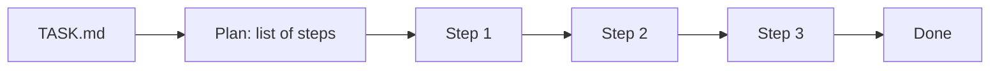

<picture>
  <source media="(prefers-color-scheme: dark)" srcset="../resources/logos/kirocrew-howto-logo-dark.svg">
  
</picture>

# Work while you're away

**Level:** Advanced · **Time:** 40 minutes · **Surface:** Dashboard and Terminal

Give the agent a short to-do list in a file, and let it work through the list
step by step. In this module you run a three-step task from the **Task Runner**
page, then run your own two-step task from the terminal with nobody there to
click **Approve**.

## What you will learn

- What the task runner does with a task file.
- How to plan and run a task from the **Task Runner** page.
- How to read the plan it makes before it starts.
- How to run a task file from the terminal with `kirocrew run`.
- Why a terminal run refuses every tool you have not allowed ahead of time.
- How to keep Kiro Crew running after your computer restarts.
- How to ask a long chat "where are we?" and get an answer that survives.

## Words to know

| Word | What it means |
|---|---|
| **Task runner** | The part of Kiro Crew that reads a task file, splits it into steps, and does them one at a time. |
| **Task file** | A text or markdown file that describes the work, often called `TASK.md`. People also call it a *spec*. |
| **Plan** | The list of steps the task runner makes from your file, before any work starts. |
| **Run** | One go at a task, from the first step to the last. |
| **Unattended** | Running with nobody watching or clicking buttons. |
| **Deny by default** | Every tool is refused unless you allowed it ahead of time. |
| **Allowlist** | The list of tools you allow ahead of time. Here it is the setting `hooks.auto_approve_tools`. |
| **Service** | A program your computer starts by itself when it boots. |
| **Session ledger** | A small saved record of a long chat's goal and next step. It survives when old messages are trimmed. |

## Before you start

| What you need | How to check |
|---|---|
| Kiro Crew running (Module 1) | Open the dashboard. You see the **Sessions** list. |
| [Module 9](../09-protect-secrets-and-files/README.md) done | You know how to protect your files and recover them with git. |
| A practice folder | `ls ~/my-project` works. |
| The full path of that folder | `echo ~/my-project` prints it. You will paste it in step 2. |
| This tutorial's files | From the tutorial folder, `ls 16-task-runner/examples` shows `TASK.md` and `two-item-TASK.md`. |
| Module 14 (optional) | Only if you want to answer an approval from your phone. |

Surface labels in this module:

- **Dashboard**: type it in the dashboard's message box, or click it in the dashboard.
- **Terminal**: type it in your computer's terminal, not inside `kiro-cli chat`.

## Step by step

### 1. Read the task file

Open [examples/TASK.md](examples/TASK.md). It asks for three small steps:

1. Make a folder named `reading-list`.
2. Write a `README.md` inside it.
3. Write a `test-list.md` with three checks.

It ends with a **Done when** list. That list tells the agent, and you, how to
know the work is finished.

You do not need a special format. Any text file works. Numbered steps and a
"done when" list just make the plan better.



The diagram shows the task runner turning the file into a plan, then doing each
step in order.

### 2. Plan the task on the Task Runner page

**Surface: Dashboard.** In the left rail, open **Task Runner**. You can also press
**Alt+P** (**Option+P** on a Mac).

1. Press **New Task**.
2. Choose the **From Spec** tab.
3. Paste the contents of `examples/TASK.md`, or upload the file.
4. In **Workspace folder**, paste the full path you got from `echo ~/my-project`.
   The task runs in that folder.
5. Leave the **Agent** choice on the default agent.
6. Press **Plan**.

You should see a line such as `Generating execution plan`, then a list of steps.
Read it. Each step should match one item in the file.

> **Tip:** the **Compose** tab lets you describe a task in plain words instead.
> **Refine into Spec** turns your words into a task file first.

### 3. Run it and answer approvals

Press **Run**.

When a step needs a tool, such as writing a file, an approval card may
appear. If one does, press **Approve**. If not, the step just runs; that is
fine.

**Optional:** if you did Module 14 and a card appears, try answering it from
Slack on your phone instead.

The page lists the run with its state (running, completed, failed, cancelled or
planned) and its step progress. When it says completed, check the files
(**Surface: kiro-cli (terminal)**):

```bash
ls ~/my-project/reading-list
cat ~/my-project/reading-list/test-list.md
```

You should see `README.md` and `test-list.md`, and three lines that start with
`- [ ]`.

After a run completes, press **Chat** to keep talking about its results in an
ordinary chat. To stop a run early, press **Cancel** on it.

> **Risk:** the page also offers **Run unattended**, which approves every tool
> call in that run without asking. Only use it for a task file you wrote and
> trust, in a folder you can restore with git (Module 9).

### 4. Run a task from the terminal

The terminal can run a task file too. The command is `kirocrew run`.

**Surface: kiro-cli (terminal).** Copy the starter file into your practice folder:

```bash
cp 16-task-runner/examples/two-item-TASK.md ~/my-project/TASK.md
```

Before you run it, read the next box.

> **Important:** a terminal run has nobody to click **Approve**. So it is
> **deny by default**: every tool is refused unless it is in your allowlist,
> `hooks.auto_approve_tools`. A refused tool is logged with the reason
> `headless_no_authorization`.

Open the settings file in your editor (**Surface: kiro-cli (terminal)**):

```bash
kirocrew config edit
```

Add only the tools this task needs:

```json
{
  "hooks": {
    "auto_approve_tools": ["read", "Reading *", "fs_write", "Running: mkdir *"]
  }
}
```

Each entry matches the title of a tool call. `*` matches anything.

> **Warning:** never add `"*"` on its own. That allows every tool, with nobody
> watching. Keep the list to what this one task needs, and remove it when you
> are done.

Check what you saved (**Surface: kiro-cli (terminal)**):

```bash
kirocrew config get hooks.auto_approve_tools
```

Now run the task (**Surface: kiro-cli (terminal)**):

```bash
cd ~/my-project
kirocrew run TASK.md
```

Useful options:

| Option | What it does |
|---|---|
| `--fresh` | Start from the beginning, ignoring saved progress. |
| `--no-test` | Skip the test check after each step. |
| `--timeout 3600` | Stop the whole run after 3600 seconds (one hour). `0` means no limit. |
| `--name NAME` | Give the run a name. Otherwise it comes from the file. |

When it finishes, check the result (**Surface: kiro-cli (terminal)**):

```bash
cat ~/my-project/trip-notes/packing.md
```

You should see `# Packing list` and five lines that start with `- [ ]`.

If a run stops halfway, run the same command again. It picks up where it left
off. Add `--fresh` to start over.

### 5. Keep Kiro Crew running after a restart

Work while you're away only happens if the gateway is running. If your computer
restarts, the gateway stops unless it is a **service**.

**Surface: kiro-cli (terminal).** Install and start the service:

```bash
kirocrew service install
```

On Linux this asks for your password, because it needs `sudo`. Check it
(**Surface: kiro-cli (terminal)**):

```bash
kirocrew service status
```

To remove it later, run `kirocrew service uninstall`.

### 6. Ask a long chat "where are we?"

In a very long chat, old messages are trimmed to make room. A **session ledger**
keeps the important part: the goal, the current step, what was tried, and what
comes next. It is saved on disk, so it survives trimming and restarts.

The agent writes it with `session_ledger_record` and reads it with
`session_ledger_read`. You do not open it on a page. You ask.

**Surface: Dashboard.** In a long-running chat, type:

```text
Record in your session ledger where we are: the goal, the current step and the next step.
```

Later, in the same chat, type:

```text
Where are we on this?
```

The answer comes from the ledger, not from scrolling back.

The ledger is only for long work, such as a task that spans hours. A one-message
request does not need one.

## Try it yourself

Write your own two-step task file and run it from the terminal.

1. Copy [examples/two-item-TASK.md](examples/two-item-TASK.md) and change the two
   steps to something you want, such as a shopping list.
2. Keep a **Done when** list that you can check by hand.
3. Add only the tools it needs to `hooks.auto_approve_tools`.
4. Run it with `kirocrew run TASK.md` from `~/my-project`.
5. Check each **Done when** line yourself.
6. Remove the entries you added to `hooks.auto_approve_tools`.

## Check your work

- [ ] The three-step task shows **completed** on the **Task Runner** page.
- [ ] You read the plan it made before it ran.
- [ ] `~/my-project/reading-list/test-list.md` has three checks.
- [ ] Your own two-step task ran from the terminal.
- [ ] You can say why a terminal run needs tools allowed ahead of time.

## Common problems

| What you see | What to do |
|---|---|
| `kirocrew run` finishes but nothing changed, and the log shows `headless_no_authorization` | A tool was refused. Add that tool's title pattern to `hooks.auto_approve_tools`, or run the task from the **Task Runner** page instead. |
| An allowed shell command is still refused | The task runner also checks that the program is the real one on your system. A program inside your project folder needs a dashboard approval instead. |
| The files appeared in a folder you did not expect | Set **Workspace folder** on the page, or `cd` into the folder before `kirocrew run`. |
| The plan does not match your file | Make the steps numbered and short. Add a **Done when** list. Press **Plan** again. |
| A run stopped halfway | Run `kirocrew run TASK.md` again to resume. Use `--fresh` to start over. |
| Nothing ran overnight | The gateway was not running. Install it as a service (step 5). Make sure the computer did not sleep. |

## What you learned

- The task runner turns a task file into a plan, then does each step.
- The **Task Runner** page: **New Task**, **From Spec**, **Plan**, **Run**.
- `kirocrew run TASK.md` runs a task from the terminal, with `--fresh`,
  `--no-test` and `--timeout`.
- A terminal run is deny by default. Allow only the tools it needs in
  `hooks.auto_approve_tools`.
- `kirocrew service install` keeps the gateway running after a restart.
- A session ledger answers "where are we?" in a long chat.

## Next

Go on to [Module 17: long jobs that can restart from a step](../17-workflows/README.md).

---
**Last updated:** 2026-10-30
**Checked against:** Kiro Crew public source @ 2808e9478c (github.com/kirodotdev/KiroCrew) and kiro.dev/docs/cli
*Part of the [Kiro Crew How To](../) guide.*
