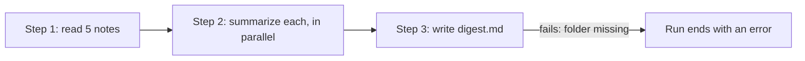

<picture>
  <source media="(prefers-color-scheme: dark)" srcset="../resources/logos/kirocrew-howto-logo-dark.svg">
  
</picture>

# Long jobs that can restart from a step

**Level:** Advanced · **Time:** 45 minutes · **Surface:** Dashboard, plus agent tools you start by asking, and Terminal

A big job often has steps: gather, then work on each piece, then put it all
together. If the last step fails, you do not want to redo the first two. A
**workflow** runs a job in steps, shows each step as it goes, and can re-run
from the step that failed. In this module you build a notes digest, break its
last step on purpose, fix it, and re-run only that step.

## What you will learn

- What a workflow is, and when to pick it over helpers or the task runner.
- How to start a workflow in plain words.
- How to watch it in the chat's **Workflows** tab.
- How to ask for its status and its full result.
- How to re-run a workflow from one step, reusing the steps before it.
- Where saved workflows live, and how to run one with `/workflow`.
- How long a workflow may run, and how to raise the limit.

## Words to know

| Word | What it means |
|---|---|
| **Workflow** | A job in steps (also called *phases*) that runs in the background. You can watch it and re-run part of it. |
| **Step** | One part of a workflow, such as "read the notes" or "write the digest". |
| **Run** | One go at a workflow. Each run has its own **run id**. |
| **Re-run from a step** | Start a new run that reuses the saved results of the earlier steps, and only does the later steps again. |
| **Digest** | One short summary made from several longer notes. |
| **Library** | The place where saved workflows live, so you can run them again by name. |
| **Timeout** | The longest a run may take before it is stopped. |

## Before you start

| What you need | How to check |
|---|---|
| Kiro Crew running (Module 1) | Open the dashboard. You see the **Sessions** list. |
| Module 15 done | You have asked for helpers and read their merged answer. |
| A practice folder | `ls ~/my-project` works. |
| This tutorial's files | From the tutorial folder, `ls 17-workflows/notes` shows five `.md` files. |

Surface labels in this module:

- **Dashboard**: type it in the dashboard's message box, or click it in the dashboard.
- **Terminal**: type it in your computer's terminal, not inside `kiro-cli chat`.

## Step by step

### 1. Know which tool fits

| You want... | Use | Module |
|---|---|---|
| A few independent look-ups, answered once | Helpers (`spawn_run`) | 15 |
| A to-do list from a file, step after step | Task runner (`kirocrew run`) | 16 |
| A job in steps that you can watch, and re-run from one step | Workflow (`workflow_run`) | 17 |

A workflow costs more to set up than helpers. Pick it when a step might fail, or
when you expect to change one step and run again.

### 2. Copy the sample notes

**Surface: kiro-cli (terminal).** From the tutorial folder:

```bash
cp -r 17-workflows/notes ~/my-project/workflow-notes
ls ~/my-project/workflow-notes
```

You should see:

```text
bike.md  budget.md  garden.md  kitchen.md  library.md
```

### 3. Start a workflow that will fail at step 3

The last step writes into a folder that does not exist yet, and the request tells
the agent not to make it. So step 3 fails. That is on purpose.

**Surface: Dashboard.** Open a new chat and type:

```text
Use a workflow with three steps.
Step 1: read the five notes in ~/my-project/workflow-notes.
Step 2: summarize each note in one line, all five in parallel.
Step 3: write one digest with a heading and the five lines to
~/my-project/digest-out/digest.md. Do not create any folder. If the folder is
missing, fail this step.
```

You do not write the workflow yourself. The agent turns your words into a
workflow, starts it with `workflow_run`, and gives you a run id right away.

You should see something like:

```text
Started the workflow. Run id: <run-id>. I'll post the result here when it finishes.
```



The diagram shows the three steps in order, and step 3 failing because its
folder is missing.

### 4. Watch it run

**Surface: Dashboard.** Open the chat's side panel and choose the **Workflows**
tab, next to **Subagents**. You should see the run with each step as it starts
and finishes.

You can also ask in plain words:

| Surface: Dashboard. Type this | The agent uses | What you get |
|---|---|---|
| `What is the status of that workflow?` | `workflow_status` | Running, finished, failed or cancelled, and how many agents it used. |
| `Show me the full result of that workflow.` | `workflow_result` | Every step, each agent's outcome, and why a step failed. |
| `List my recent workflow runs.` | `workflow_list` | Newest runs first, with their status. |
| `Cancel that workflow.` | `workflow_cancel` | The run stops. |

When the run ends, the agent posts the result in the chat. Steps 1 and 2 should
show as done. Step 3 should show as failed, because
`~/my-project/digest-out` does not exist.

Even a failed run keeps the results of the steps that worked. That is what makes
the next step cheap.

### 5. Fix the problem

**Surface: kiro-cli (terminal).** Make the missing folder:

```bash
mkdir -p ~/my-project/digest-out
```

### 6. Re-run from step 3 only

**Surface: Dashboard.** In the same chat, type:

```text
Re-run that workflow from step 3 only. Reuse steps 1 and 2.
```

The agent uses `workflow_rerun_subtree`. Steps 1 and 2 are **replayed** from the
saved results: no new model calls, no new reading. Only step 3 runs again.

You should see something like:

```text
Re-ran from step 3. Steps 1 and 2 came from the earlier run. New run id: <new-run-id>.
```

Each re-run gets a **new run id**. The first run's record stays as it was.

Check the digest (**Surface: kiro-cli (terminal)**):

```bash
cat ~/my-project/digest-out/digest.md
```

You should see a heading and five lines, one per note, such as a line about the
bike's slow puncture and a line about the library books due back.

### 7. Run a saved workflow by name

A workflow saved in the **library** can run again by name, without being written
again from your words.

**Surface: Dashboard.** Open **Customize → Workflows**. This is the library. It
creates, edits and runs reusable workflows. The chat's **Workflows** tab shows live
runs; **Customize → Workflows** shows saved ones.

In a chat, these commands work with saved workflows (**Surface: Dashboard**):

| Command | What it does |
|---|---|
| `/workflow` | Lists your saved workflows. |
| `/workflow <name> [input]` | Runs a saved workflow by its name. The rest of the line is its input. |

### 8. Know the time limit

A workflow run stops after **one hour** (3600 seconds) by default. The limit can
go from 60 seconds up to **6 hours** (21600 seconds). It cannot be turned off.
When a run hits the limit, every step that already finished keeps its result.

**Surface: kiro-cli (terminal).** Raise it to two hours:

```bash
kirocrew config set agent.workflow_run_timeout_secs 7200
```

It applies to the next run. For a job longer than 6 hours, re-run it from the step
where it stopped. Each re-run gets a fresh limit.

## Try it yourself

Turn the Module 15 museum look-up into a workflow, then change only the last step.

**Surface: Dashboard.** In a new chat, type:

```text
Use a workflow with two steps.
Step 1: in parallel, look up today's opening hours of the Louvre, the Rijksmuseum
and the Metropolitan Museum of Art, each on its own website.
Step 2: give me one table with the columns Museum, Opening hours today and Source link.
```

When it finishes, type:

```text
Re-run that workflow from step 2 only, and add a column "City" to the table.
```

Check that the new table has the extra column, and that step 1 was reused, not
looked up again.

## Check your work

- [ ] The **Workflows** tab showed each step of the digest run.
- [ ] The first run failed at step 3, and steps 1 and 2 were done.
- [ ] The re-run reused steps 1 and 2 and only ran step 3.
- [ ] `~/my-project/digest-out/digest.md` has a heading and five lines.
- [ ] You know the default time limit, the highest one, and how to raise it.

## Common problems

| What you see | What to do |
|---|---|
| The agent did the job without a workflow | Start the request with "Use a workflow". |
| Step 3 did not fail the first time | The agent made the folder anyway. Delete `~/my-project/digest-out`, then ask again and keep "Do not create any folder". |
| The re-run did all three steps again | Ask again, naming the step: "Re-run from step 3 only. Reuse steps 1 and 2." |
| The **Workflows** tab is empty | Open the chat that started the workflow. The tab shows that chat's runs. |
| A long run stopped after an hour | It hit the time limit. Raise `agent.workflow_run_timeout_secs`, then re-run from the step that stopped. |
| `/workflow <name>` says it cannot find the workflow | Run `/workflow` to see the exact names. |

## What you learned

- A workflow is a job in steps that you can watch and re-run from one step.
- Start one by saying "use a workflow to ...". The agent uses `workflow_run`.
- `workflow_status`, `workflow_result` and `workflow_list` show how runs went.
- `workflow_rerun_subtree` reuses earlier steps and redoes only the later ones,
  under a new run id.
- **Customize → Workflows** and `/workflow` work with saved workflows.
- `agent.workflow_run_timeout_secs` sets the time limit: 3600 by default, 21600 at most.

## Next

Go on to Module 18: keep and improve what it made. Find it in the module list in
the [guide's main page](../README.md).

---
**Last updated:** 2026-10-30
**Checked against:** Kiro Crew public source @ 2808e9478c (github.com/kirodotdev/KiroCrew) and kiro.dev/docs/cli
*Part of the [Kiro Crew How To](../) guide.*
