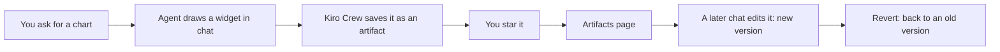

<picture>
  <source media="(prefers-color-scheme: dark)" srcset="../resources/logos/kirocrew-howto-logo-dark.svg">
  
</picture>

# Keep and improve what it made

**Level:** Advanced · **Time:** 25 minutes · **Surface:** Dashboard, plus agent tools you start by asking, plus an optional terminal check

The agent can draw things for you: a chart, a small web page, a checklist. Most
of them scroll away with the chat. This module shows how to **keep** one, change
it later in a different chat, and go back to an older version when an edit goes
wrong.

## What you will learn

- What an artifact is, and why a kept artifact outlives its chat.
- How to star a chart the agent drew, so it is kept for good.
- How to find it again on the **Artifacts** page.
- How to change it from a brand-new chat, which makes a new version.
- How to go back to an older version, from chat or from the page.
- How to list artifacts and versions from the terminal.
- How to get a copy of a file as a download.

## Words to know

| Word | What it means |
|---|---|
| **Artifact** | Something the agent made that Kiro Crew keeps for you: a chart, an HTML page, a document. It has a stable name, so you can come back to it later. |
| **Widget** | A small interactive picture the agent draws inside a chat message, such as a chart you can hover over. Every widget is saved as an artifact automatically. |
| **Star** | Marks an artifact as one you want to keep. Unstarred automatic entries are cleaned up when there are many of them. |
| **Slug** | The short, fixed name of an artifact, such as `step-count-chart`. Commands use it. |
| **Version** | A saved state of an artifact. Every edit the agent makes adds a new version, like a save point. |
| **Live** | The version you see now. |
| **Revert** | Make an older version the live one again. Kiro Crew records the revert as a new version, so nothing is lost. |

## Before you start

| What you need | How to check |
|---|---|
| Kiro Crew running (Module 1) | Open the dashboard. You see **Sessions** in the left rail. |
| Module 5 done | You know that rewinding a chat does not undo files ([Module 5](../05-fix-a-mistake/README.md)). |
| A practice folder | In a terminal, run `mkdir -p ~/my-project`, then `ls ~/my-project`. No error means it exists. |
| The sample data in that folder | Copy [step-counts.csv](step-counts.csv) from this module folder into `~/my-project/`. Then run `cat ~/my-project/step-counts.csv`. You see seven dates and step counts. |
| A normal chat, not a private one | Look at the memory chip above the message box. It must say **Persistent**. |

> **Warning:** **Incognito** and **Temporary** chats never keep a widget, and
> they refuse to save one. That is their job: nothing is left behind. Use a
> **Persistent** chat for this module ([Module 4](../04-memory/README.md)).

Surface labels in this module:

- **Dashboard**: type it in the dashboard's message box, or click it in the dashboard.
- **Terminal**: type it in your computer's terminal, not inside `kiro-cli chat`.

## Step by step

### 1. How keeping works



You ask for a chart. The agent draws it as a widget, and Kiro Crew files it as
an artifact on its own. You star it so it stays. Any later chat can open it by
name and change it. Each change adds a version, and you can always go back.

### 2. Ask for a chart

**Surface: Dashboard.** Open a new chat and type:

```text
Read ~/my-project/step-counts.csv and draw a small interactive bar chart of my
steps per day. Call it "Step count chart".
```

You should see something like:

```text
Here is your step count chart for 2026-10-19 to 2026-10-25.
```

Under the text, a bar chart appears inside the message. Hover over a bar to see
its number.

> **Tip:** if an approval card asks to read the file, approve it. The agent
> needs to read the data to draw the chart.

### 3. Star it so it is kept

**Surface: Dashboard.** Move the pointer over the chart. Click the star (or
bookmark) icon in its corner. Its tip reads **Star as artifact**. After you
click it, the tip changes to say the chart is starred.

Why star it? The chart is already saved as an artifact, but unstarred automatic
entries are removed once there are many of them. A star keeps it for good.

### 4. Find it on the Artifacts page

**Surface: Dashboard.** Click **Artifacts** in the left rail.

You should see the **Your Artifacts** list with your chart in it. The
**Starred** filter shows only starred ones.

Click the chart to open it. At the top you see:

| Part | What it does |
|---|---|
| **Version** | A list of versions: **Live**, then `v1`, `v2` and so on. |
| **Star** / **Starred** | Star or unstar it. |
| **Iterate** | Chat with the agent about this artifact. |
| **More** | A menu with **Show comments**, **Download** and more. |

Right now the version list shows **Live** and `v1`.

### 5. Change it from a new chat

A kept artifact is not tied to the chat that made it. Any chat can open it.

**Surface: Dashboard.** Open a **new** chat and type:

```text
Open my "Step count chart" artifact and make the bars green.
Save the change to the same artifact.
```

The agent looks the artifact up by name, reads it, and saves a changed copy.

You should see something like:

```text
I updated "Step count chart". The bars are green now. This is version 2.
```

Open the chart on the **Artifacts** page again. The bars are green, and the
**Version** list now has `v2`.

### 6. Go back to version 1

Suppose you liked the old color better. There are two ways back.

**Surface: Dashboard (chat).** In the same chat, type:

```text
Go back to version 1 of the "Step count chart" artifact.
```

You should see something like:

```text
I reverted "Step count chart" to version 1. The revert is saved as version 3.
```

**Surface: Dashboard (page).** On the chart's page, pick `v1` in the **Version**
list, then press **Revert**. Its tip reads `Revert to v1`.

Either way, the bars are the old color again, and a new version is added. A
revert never deletes the green version: it sits in the list in case you want it
back.

### 7. Look from the terminal (optional)

> **In a terminal. Surface: kiro-cli (terminal).**
>
> The `kirocrew artifact` commands read the same artifacts. They ask the
> running gateway, so Kiro Crew must be running.

**Surface: kiro-cli (terminal).**

```bash
kirocrew artifact list
```

You should see one line per artifact: its slug, its newest version, its kind
and its name. Something like:

```text
step-count-chart                          v3   widget      Step count chart
```

Use the slug from that list in the next commands:

**Surface: kiro-cli (terminal).**

```bash
kirocrew artifact versions step-count-chart
```

You should see the version numbers, such as `1`, `2` and `3`.

**Surface: kiro-cli (terminal).**

```bash
kirocrew artifact show step-count-chart --version 1 --meta
```

This prints the details of version 1 as JSON instead of its content. Your slug
may differ: always copy it from `kirocrew artifact list`.

### 8. Get a copy as a download

**Surface: Dashboard.** On the chart's page, open **More** and choose
**Download**.

You can also ask the agent. It has a tool, `file_send`, that sends a file to you
with a download link:

```text
Save the step count chart as an HTML file in ~/my-project and send it to me
as a download.
```

You should see a download link in the chat.

## Try it yourself

1. In a **Persistent** chat, ask:
   `Make a one-page checklist artifact called "Weekend jobs" with five chores.`
2. Star it, then open it on the **Artifacts** page.
3. In a new chat, ask: `Add "water the plants" to my "Weekend jobs" artifact.`
4. Then ask: `Mark the first item as done in "Weekend jobs".`
5. Ask: `List the versions of "Weekend jobs".`

You should see three versions: the first list, the one with the plants, and the
one with an item marked done.

## Check your work

- [ ] The step count chart is on the **Artifacts** page, and it is starred.
- [ ] Its **Version** list shows `v1` and `v2` after the green change.
- [ ] A revert brought back the version 1 look, and added a new version.
- [ ] You changed an artifact from a chat that did not make it.
- [ ] Your "Weekend jobs" checklist has three versions.

## Common problems

| What you see | What to do |
|---|---|
| The agent says it cannot save in this chat | The chat is **Incognito** or **Temporary**. Open a **Persistent** chat and ask again. |
| No star icon on the chart | The agent answered in plain text, not a widget. Ask again: "draw it as an interactive chart". |
| The chart is gone from the Artifacts page later | It was not starred, and it was cleaned up. Star the next one. |
| The agent made a new artifact instead of changing the old one | Name the artifact in quotes and say "save the change to the same artifact". |
| `kirocrew artifact show` says it is not found | You typed the display name. Use the slug from `kirocrew artifact list`. |
| The version list did not change | Reload the artifact page. |

## Going further (expert)

- **Folders.** On the **Artifacts** page, **New folder** files artifacts into
  folders. Moving one does not change its content.
- **Comments.** **More → Show comments** opens comment threads. The agent can
  reply and mark a thread as ready for your review, but only you can resolve it.
- **Deploy.** Kiro Crew can also publish a web artifact to a public address.
  It is a Feature Preview that spends money in your own cloud account and puts
  the page on the open internet, so this guide does not teach it.

## What you learned

- Widgets the agent draws are saved as artifacts on their own. A star keeps one
  for good.
- The **Artifacts** page lists them, and each one has a **Version** list.
- Any later chat can open an artifact by name and change it. Each change is a
  new version.
- **Revert** brings back an old version and records that as a new version.
- `kirocrew artifact list`, `versions` and `show` read the same artifacts from
  the terminal.

## Next

Go on to [Module 19: named specialists with their own memory](../19-mates-and-agents/README.md).

---
**Last updated:** 2026-10-30
**Checked against:** Kiro Crew public source @ 2808e9478c (github.com/kirodotdev/KiroCrew) and kiro.dev/docs/cli
*Part of the [Kiro Crew How To](../) guide.*
