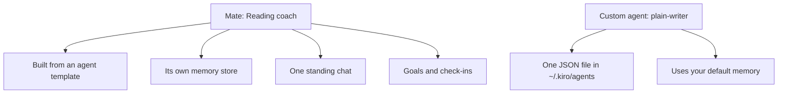

<picture>
  <source media="(prefers-color-scheme: dark)" srcset="../resources/logos/kirocrew-howto-logo-dark.svg">
  
</picture>

# Named specialists with their own memory

**Level:** Advanced · **Time:** 45 minutes · **Surface:** Dashboard first, plus an optional terminal box

So far every chat has shared one memory. This module gives you a **mate**: a
named helper with its own memory, its own standing chat, and its own goals. You
will make a "Reading coach" that remembers your reading list for weeks. Then you
will make a lighter thing, a **custom agent**, and learn when to pick which.

This module has three short lessons:

| Lesson | You do | Time |
|---|---|---|
| 19.1 Make a mate | Turn on the preview, create the Reading coach, tell it your books | 15 min |
| 19.2 Give it a goal | Set a goal and a weekly report | 15 min |
| 19.3 Mate vs custom agent | Make a "Plain writer" custom agent and compare | 15 min |

## What you will learn

- What a mate is, and how its memory is kept apart from your other chats.
- How to turn on the **Mates** Feature Preview.
- How to create a mate and talk to it in its standing chat.
- How to give a mate a goal and a weekly report on its **Goals** tab.
- What a custom agent is, and how to make and pick one.
- When to use a mate and when a custom agent is enough.

## Words to know

| Word | What it means |
|---|---|
| **Mate** | A named helper you keep. It has its own memory, its own workspace folder and one standing chat. |
| **Standing chat** | The one chat you have with a mate. It is the same chat every time you open it, even a week later. Mate chats do not appear in **Sessions**. |
| **Memory store** | The place a mate keeps what it learned. Each new mate gets its own, so one mate's notes stay out of another's. |
| **Goal** | One paragraph about what the mate works toward. You confirm each goal on a card. |
| **Check-in** | A scheduled time when the mate reviews its goal: a daily reminder, a weekly report or a monthly review. |
| **Custom agent** | A small file (JSON) that gives the agent a name, instructions and a list of tools. It changes how a chat behaves. It has no memory of its own. |
| **Agent template** | Another name for a custom agent's file. A mate is "built from" one. |
| **Feature Preview** | A feature that is still being finished. It is hidden until you switch it on. |

## Before you start

| What you need | How to check |
|---|---|
| Kiro Crew running (Module 1) | Open the dashboard. You see **Sessions** in the left rail. |
| Module 4 done | You saved a rule with "Remember: ..." ([Module 4](../04-memory/README.md)). |
| Module 12 done | You made a scheduled job ([Module 12](../12-scheduled-jobs/README.md)). |
| The sample agent file | This module folder has [agents/plain-writer.json](agents/plain-writer.json). |

Surface labels in this module:

- **Dashboard**: type it in the dashboard's message box, or click it in the dashboard.
- **Terminal**: type it in your computer's terminal, not inside `kiro-cli chat`.

> **Tip:** check-ins and a mate's own wake-ups run agent turns, and each run uses
> credits. Turn on only the ones you want.

## Step by step

### 19.1 Make a mate

#### 1. Turn on the Mates preview

Mates is a Feature Preview, so it is off until you turn it on.

**Surface: Dashboard.**

1. Open **Settings → Developer → Feature Previews**.
2. Find the **Mates** card. Its text says the Mates page is still being built.
3. Optional: press **See what it looks like** to preview the page first.
4. Switch **Mates** on.

You should see a new **Mates** row in the left rail, under **Sessions**.

> **Why it is per device:** this switch lives in your browser, not in Kiro
> Crew's settings file. Its settings-page id is `developer.mates`. The
> switch itself is the browser flag `mc-preview-crew`, not a `kirocrew config`
> key. If you open the dashboard in
> another browser, turn it on there too. Turning it off only hides the page.
> Your mates are kept.

#### 2. Create the Reading coach

**Surface: Dashboard.**

1. Click **Mates** in the left rail.
2. Press **New mate**. On an empty list it is the big button. Once you have a
   mate, it is in the **+** menu at the top of the list.
3. In **Name**, type `Reading coach`.
4. Press **Create**.

Do not change **Advanced settings** for now. It holds what the mate is **Built
from** (the agent template it copies, `kirocrew` by default), its workspace and
its model.

You should see the mate's chat open. The mate speaks first, for example:

```text
Hi, I'm Reading coach. What would you like me to look after?
```

This first question comes from Kiro Crew, not from you.

#### 3. Tell it your books

**Surface: Dashboard.** In the mate's chat, type:

```text
You help me read more. I am reading three books right now:
"The Hobbit", "Atomic Habits" and "A Short History of Nearly Everything".
Keep track of them for me.
```

You should see something like:

```text
Got it. I'm tracking three books for you: The Hobbit, Atomic Habits and
A Short History of Nearly Everything.
```

#### 4. Close it and come back

Click **Sessions**, then click **Mates** and open **Reading coach** again.

You should see the same chat, with your books message still there. A mate's
chat is a standing chat: closing it, or restarting Kiro Crew, does not start a
new one.

### 19.2 Give it a goal

#### 5. Open the Goals tab

**Surface: Dashboard.** In the mate's chat, click the name pill at the top of
the chat. It opens the mate's **Profile** card. The card has four tabs:
**Profile**, **Schedules**, **Sessions** and **Goals**.

Open **Goals**.

#### 6. Create a goal

1. Press **Create a goal** at the end of the list.
2. Press **Tell Reading coach what to aim for**. This sends an opening message
   to the mate's chat.
3. The mate asks what matters. Answer:

```text
Finish one book a month.
```

You should see the mate write the goal down and show it on a card with a
button. Nothing is saved until you press it. Press the button.

Back on the **Goals** tab, the goal is listed with a number. The mate may also
suggest **milestones**: readings that show progress, such as "books finished
this month". You can confirm or skip them.

#### 7. Turn on a weekly report

The **Goals** tab has three check-in switches. They share one time of day, and
each is off by default:

| Switch | What happens |
|---|---|
| **Daily Goal Reminder** | Each day the mate takes fresh readings, then carries on. |
| **Weekly report** | On a weekday you pick, the mate writes a short report. |
| **Monthly review** | On a day of the month you pick, the mate reviews the goal itself. |

Switch on **Weekly report**. Pick a weekday and a time.

The weekly report is saved as an artifact, filed under
`Crewmates/<name>/Reports` on the **Artifacts** page
([Module 18](../18-artifacts/README.md)), and the bell shows a notification
that links to it.

> **Tip:** these check-ins do not show on the **Schedule** page. The switches on
> the **Goals** tab are their only controls.

#### 8. Ask what's next

**Surface: Dashboard.** Later, in the mate's chat, type:

```text
Which book should I read next, and why?
```

You should see an answer that names one of your three books and mentions your
goal of one book a month.

### 19.3 Mate vs custom agent

#### 9. What a custom agent is

A custom agent is a JSON file in `~/.kiro/agents/`. It gives a chat new
instructions and a tool list. It has no memory store of its own and no standing
chat. Here is the one in this folder:

```json
{
  "name": "plain-writer",
  "description": "Rewrites text in plain words and short sentences. Use when you want something easier to read.",
  "prompt": "You are a plain-language writer. ...",
  "tools": ["fs_read", "fs_write"],
  "allowedTools": ["fs_read"]
}
```

| Field | What it does |
|---|---|
| `name` | The name you pick it by. |
| `description` | One line shown in the agent picker. |
| `prompt` | The instructions. They replace the default agent's instructions for that chat. |
| `tools` | The tools it may use. `fs_read` reads files and `fs_write` writes them. |
| `allowedTools` | The tools it may use without asking you first. |

#### 10. Add the Plain writer

Pick one way.

**Surface: Dashboard.** Open **Customize → Custom agents**, press **New custom
agent**, name it `plain-writer`, and press **Create and edit**. Paste the
`prompt` text from [agents/plain-writer.json](agents/plain-writer.json) into
its prompt, and add the tools `fs_read` and `fs_write`.

**Surface: kiro-cli (terminal).** Or copy the file into place:

```bash
mkdir -p ~/.kiro/agents
cp 19-mates-and-agents/agents/plain-writer.json ~/.kiro/agents/
```

Run that from the folder where you downloaded this guide. A new file in
`~/.kiro/agents/` shows up in the dashboard by itself.

You should see `plain-writer` listed on **Customize → Custom agents**.

#### 11. Use it in a chat

**Surface: Dashboard.** Open a new chat. Pick **plain-writer** in the agent
picker at the top of the chat, or type:

```text
/agent plain-writer
```

Then type:

```text
Rewrite this: "Notwithstanding the aforementioned considerations, the committee
has elected to postpone the deliberations until a subsequent juncture."
```

You should see something like:

```text
The committee has put off the talks until later.
I shortened 1 sentence.
```

A name that no agent answers to is refused, so a typo does not quietly run the
default agent.

#### 12. Pick the right one

| You want... | Use | Why |
|---|---|---|
| A helper that remembers one topic for weeks | **Mate** | It has its own memory store and a standing chat. |
| Goals, check-ins and reports | **Mate** | Only mates have a **Goals** tab. |
| A different style or tool list for one chat | **Custom agent** | It changes how a chat behaves, and uses your normal memory. |
| A fixed role you share with others as a file | **Custom agent** | It is one small JSON file. |



A mate points at a template, and adds its own memory, chat and goals. A custom
agent is only the file.

> **In a terminal. Surface: kiro-cli (terminal).**
>
> `kirocrew agent` manages **mates**, not custom agent files. These match what
> you did on the Mates page:
>
> ```bash
> kirocrew agent list
> kirocrew agent create --name reading-coach-2 --display-name "Reading coach 2" --kiro-agent kirocrew
> ```
>
> `kirocrew chat --agent` picks a **custom agent** for a terminal chat:
>
> ```bash
> kirocrew chat --agent plain-writer -m "Rewrite this in plain words: we shall endeavour to ascertain the facts."
> ```

## Try it yourself

1. Make your own custom agent from one of the sample files in
   [agents/](agents/), for example [code-reviewer.json](agents/code-reviewer.json)
   or [debugger.json](agents/debugger.json). Copy it into `~/.kiro/agents/`.
2. Pick it with `/agent <name>` in a new chat and give it a small job in
   `~/my-project`.
3. Open a normal chat in **Sessions** (not the mate) and ask:
   `What books am I reading?`

You should see that the normal chat does not know your books. The Reading coach
keeps them in its own memory.

The other sample files are personas you can start from:

| File | Role |
|---|---|
| [code-reviewer.json](agents/code-reviewer.json) | Reviews your latest changes. Read-only. |
| [clean-code-reviewer.json](agents/clean-code-reviewer.json) | Checks names, function size and duplication. |
| [secure-reviewer.json](agents/secure-reviewer.json) | Security review that can only read files. |
| [test-engineer.json](agents/test-engineer.json) | Writes and runs tests. |
| [debugger.json](agents/debugger.json) | Finds the cause of an error and makes the smallest fix. |
| [documentation-writer.json](agents/documentation-writer.json) | Writes docs a beginner can follow. |
| [data-scientist.json](agents/data-scientist.json) | Answers questions with queries and explains the numbers. |
| [performance-optimizer.json](agents/performance-optimizer.json) | Measures, speeds up the slowest part, measures again. |
| [implementation-agent.json](agents/implementation-agent.json) | Builds a feature from a written description, with tests. |

## Check your work

- [ ] **Mates** shows in the left rail.
- [ ] The Reading coach has its own chat, and it is the same chat after you leave and come back.
- [ ] The mate remembers your three books in a later turn.
- [ ] The goal "Finish one book a month" shows on the **Goals** tab, with **Weekly report** on.
- [ ] A normal chat does not know your books.
- [ ] `plain-writer` is on **Customize → Custom agents**, and `/agent plain-writer` uses it.

## Common problems

| What you see | What to do |
|---|---|
| No **Mates** row in the rail | Turn the preview on in **Settings → Developer → Feature Previews**, in this browser. |
| **Create** is refused | The name is blank, already used, or looks like a password or link. Pick another name. |
| The check-in switches are greyed out | A mate needs a goal first. Finish step 6. |
| You cannot find the mate's chat in **Sessions** | That is normal. Mate chats live only on the **Mates** page. |
| `/agent plain-writer` is refused | The file is not in `~/.kiro/agents/`, or its `name` field differs. Check **Customize → Custom agents**. |
| The custom agent asks before every file read | Add `fs_read` to `allowedTools`. |

## Going further (expert)

- **Heartbeat.** The mate's **Schedules** tab has a **Heartbeat** switch. When it
  is on, the mate wakes in its own chat on a timer, does work toward its goal,
  and writes only when it needs you. It uses credits on every wake.
- **Notes.** The **Profile** tab opens **Notes**: what the mate has learned and
  its own standing notes.
- **Editing.** **Customize → Mates** is another place to change a mate's name,
  template, model and workspace.

## What you learned

- A mate is a named helper with its own memory store, standing chat and goals.
- Mates are a Feature Preview: **Settings → Developer → Feature Previews → Mates**.
- Goals are confirmed on a card. Check-ins are switches on the **Goals** tab.
- A custom agent is one JSON file in `~/.kiro/agents/`. Pick it with the agent
  picker or `/agent <name>`.
- Use a mate for memory and goals. Use a custom agent for a style or tool list.

## Next

Go on to [Module 20: your own automatic checks: hooks](../20-hooks/README.md).

---
**Last updated:** 2026-10-30
**Checked against:** Kiro Crew public source @ 2808e9478c (github.com/kirodotdev/KiroCrew) and kiro.dev/docs/cli
*Part of the [Kiro Crew How To](../) guide.*
