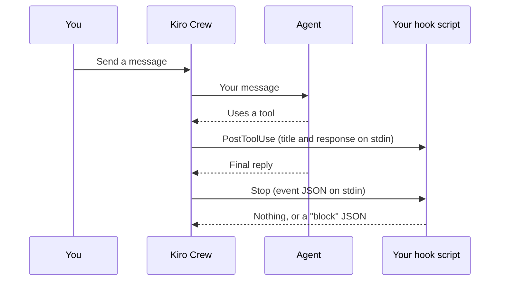

<picture>
  <source media="(prefers-color-scheme: dark)" srcset="../resources/logos/kirocrew-howto-logo-dark.svg">
  
</picture>

# Your own automatic checks: hooks

**Level:** Expert · **Time:** 30 minutes · **Surface:** Dashboard, with a terminal to read the log

The agent can forget a step. A **hook** cannot: it is your own script, and Kiro
Crew runs it at a fixed moment in every turn. In this module you add two hooks.
The first keeps a diary of the agent's tool calls. The second asks the agent to
check its work once more before it stops.

## What you will learn

- What a hook is, and the two events this module uses.
- How to add, test, turn off and delete a hook on the Hooks tab.
- What a `PostToolUse` hook gets: the call's title and its response.
- How a `Stop` hook asks for one more turn with a small JSON reply.
- Why that hook needs a loop guard, and how one field gives you one.

## Words to know

| Word | What it means |
|---|---|
| **Hook** | A shell command that Kiro Crew runs by itself when an event happens. |
| **Event** | The moment a hook runs, such as "the turn ended". |
| **`PostToolUse`** | The event after the agent used a tool. |
| **`Stop`** | The event at the end of each agent turn. |
| **Matcher** | A filter that decides which calls a hook runs for. Empty means all of them. |
| **Standard input (stdin)** | The text a program reads when it starts. Kiro Crew sends each hook a JSON description of the event this way. |
| **Standard output (stdout)** | The text a program prints. A `Stop` hook can use it to answer. |
| **Exit code** | A number a program returns when it ends. `0` means it worked. |
| **Loop guard** | A check in a script that stops it from making the agent repeat forever. |

## Before you start

| What you need | How to check |
|---|---|
| Kiro Crew running (Module 1) | Open the dashboard. You see **Customize** in the left rail. |
| Module 9 done | You know which layer guards what ([Module 9](../09-protect-secrets-and-files/README.md)). |
| macOS or Linux | Hooks run in your computer's own shell, so these `bash` scripts do not run on Windows. Run `bash --version` to check. |
| A folder for your hooks | Run `mkdir -p ~/my-hooks`. |

Surface labels in this module:

- **kiro-cli (terminal)**: type it in your computer's terminal.
- **Dashboard**: click it in the dashboard, or type it in its message box.

> **Warning:** a hook is a real program that runs on your computer, many times a
> day, with your user's rights. Only add scripts you have read and understand.

> **Warning: hooks are not a safety lock.** This module's hooks watch and nudge.
> They do not stop anything. To guard secrets and files, use
> [Module 9](../09-protect-secrets-and-files/README.md).

## Step by step

### 1. How a hook runs



After each tool call, Kiro Crew runs your `PostToolUse` hooks. When the turn
ends, it runs your `Stop` hooks. Each hook gets the event as JSON on standard
input. A `Stop` hook may print a reply; Kiro Crew ignores what a `PostToolUse`
hook prints.

### 2. Copy the sample scripts

**Surface: kiro-cli (terminal).** From the folder where you downloaded this guide:

```bash
cp 20-hooks/post-tool-log.sh 20-hooks/stop-check-once.sh ~/my-hooks/
chmod +x ~/my-hooks/*.sh
ls ~/my-hooks
```

You should see:

```text
post-tool-log.sh  stop-check-once.sh
```

Read both scripts before you use them. Each one starts with a comment that says
its event, its matcher and what it does.

### 3. Add a hook that logs tool calls

[post-tool-log.sh](post-tool-log.sh) adds one line to
`~/hook-logs/tool-calls.log` after every tool call. It also saves the whole last
event to `~/hook-logs/last-event.json`, so you can see every field it got.

**Surface: Dashboard.**

1. Open **Customize → Hooks**.
2. Press **+ New Hook**.
3. Fill in the form:

   | Box | Type |
   |---|---|
   | **Hook name** | `tool-log` |
   | **Event** | `PostToolUse` |
   | Command (the box that shows `echo 'hook fired'`) | `~/my-hooks/post-tool-log.sh` |
   | Matcher (the box that starts with **Matcher**) | leave it empty |

4. Press **Save**.

You should see `tool-log` in the list. A new hook is **on as soon as you save
it**. The switch on its row turns it off and on.

> **Tip:** the matcher box suggests names such as `fs_write`. Leave it empty
> anyway. The matcher is compared with the call's title, which the agent
> writes, so a tool name such as `shell` may never match.

### 4. Watch it log

**Surface: Dashboard.** Open a new chat and send:

```text
Use a shell command to print the word hello.
```

**Surface: kiro-cli (terminal).**

```bash
cat ~/hook-logs/tool-calls.log
```

You should see one line per tool call, something like:

```text
[2026-10-30 09:01:40] Print hello
```

Look at that line. `Print hello` is not the command the agent ran. It is
`tool_name`, a short **title** the agent wrote for the call. Now look at the
whole event:

```bash
cat ~/hook-logs/last-event.json
```

You should see `tool_name` and `tool_response` (what the command printed). You
will not see `tool_input`: the hook never gets the command itself. So a
`PostToolUse` hook can keep a diary, but it cannot check what a command was.

If the log stays empty, see [Common problems](#common-problems).

### 5. A Stop hook that asks for one more check

A `Stop` hook can ask for one more turn. If its stdout is exactly this JSON and
it exits `0`, Kiro Crew sends the reason to the agent as a new message, and the
agent takes another turn:

```json
{"decision": "block", "reason": "Check your last answer once more."}
```

Any other output is ignored.

There is a catch. The extra turn also ends, so the `Stop` hook runs again. A
hook that always prints the JSON would ask again, and again. Every turn costs
credits. That is why this hook needs a **loop guard**.

Kiro Crew helps: each `Stop` event carries a field named `stop_hook_active`. It
is `false` on a turn you started, and `true` on a turn that a `Stop` hook asked
for. [stop-check-once.sh](stop-check-once.sh) asks only when it is `false`:

```bash
INPUT=$(cat)
FLAT=$(printf '%s' "$INPUT" | tr '\n' ' ')

if printf '%s' "$FLAT" | grep -Eq '"stop_hook_active"[[:space:]]*:[[:space:]]*false'; then
  echo '{"decision": "block", "reason": "Check your last answer once more. If you find a mistake, fix it. If it is correct, say so in one sentence."}'
fi
```

| Turn | `stop_hook_active` | Script prints | Agent |
|---|---|---|---|
| You send a message | `false` | the block JSON | takes one more turn to check |
| The check turn | `true` | nothing | stops |
| The field is missing | (none) | nothing | stops |

The last row is on purpose. If the field is not there, the script does nothing,
so it can never loop.

### 6. Add the Stop hook

**Surface: Dashboard.** On **Customize → Hooks**, press **+ New Hook**:

| Box | Type |
|---|---|
| **Hook name** | `check-once` |
| **Event** | `Stop` |
| Command | `~/my-hooks/stop-check-once.sh` |
| Matcher | leave it empty |

Press **Save**. Then press **Test** on its row. The test is real: the command
runs.

You should see the **Test Result** panel with exit code `0` and an empty
stdout. A test is not a turn, so it sends no `stop_hook_active`, and the guard
says nothing. That shows the safe default working.

### 7. Watch the extra turn

**Surface: Dashboard.** Open a new chat and send:

```text
What is 17 times 3?
```

<!-- NLT: with stop-check-once.sh, the agent takes exactly one extra turn after the block reply, then stops because stop_hook_active is true -->
You should see the agent answer, then go on by itself: the hook's reason shows
up as a new message, and the agent checks its answer. Then it stops. Send one
more message, and the same thing happens once more: the guard resets on every
turn you start.

### 8. Turn the hooks off

Both hooks run on every chat, and the `Stop` hook adds a turn to each of your
messages. When you are done, turn them off or delete them.

**Surface: Dashboard.** On **Customize → Hooks**, for `tool-log` and
`check-once`, either:

- flip the switch on the row to turn the hook off, or
- press **Delete**, then press it again to confirm.

**Surface: kiro-cli (terminal).** To remove the log files:

```bash
rm -r ~/hook-logs
```

## Try it yourself

1. Change the reason in `~/my-hooks/stop-check-once.sh` to
   `Before you stop, list in one line what you changed.` Turn `check-once` on
   again, ask the agent to create a small file, and see its one-line list.
2. Edit `~/my-hooks/post-tool-log.sh` so it writes the length of the event too.
   Add `${#INPUT}` to the `printf` line. Send a chat that lists files, and see
   which calls carry the biggest responses.
3. Turn both hooks off again when you finish.

## Check your work

- [ ] `~/hook-logs/tool-calls.log` got one line per tool call.
- [ ] You saw that `tool_name` is a title the agent wrote, not the command.
- [ ] You found `tool_response` in `last-event.json`, and no `tool_input`.
- [ ] **Test** on `check-once` showed exit code `0` and an empty stdout.
- [ ] With `check-once` on, the agent took exactly one extra turn, then stopped.
- [ ] Both hooks are off or deleted.

## Common problems

| What you see | What to do |
|---|---|
| `~/hook-logs/tool-calls.log` does not exist | Check that `tool-log` is on, its **Event** is `PostToolUse`, and the matcher box is empty. Then send a chat that needs a tool, such as "list the files in my home folder". A reply without tools logs nothing. |
| The log has a line with `(no tool_name)` | That line came from **Test**, which is not a real tool call. Lines from a chat show a title. |
| A hook with a matcher such as `shell` never runs | The matcher is compared with the call's title. Clear the matcher box and save. |
| **Test Result** shows `Permission denied` | Run `chmod +x ~/my-hooks/*.sh`. |
| **Test Result** shows `No such file or directory` | Check the path in the command box. Run `ls ~/my-hooks`. |
| The agent never takes the extra turn | Check that `check-once` is on and its **Event** is `Stop`. Open its row to read the last error. The JSON must be on one line, and the script must exit `0`. |
| The agent keeps taking extra turns | Turn `check-once` off. Then check that the script still tests `stop_hook_active` for `false`. |
| The script works in your terminal but fails as a hook | Hooks get only a short list of environment variables (such as `PATH` and `HOME`). Use full paths inside the script. |
| Nothing happens on Windows | Hooks run in the computer's own shell. These `bash` scripts are for macOS and Linux. |

## Going further (expert)

- **Timeout.** Each hook has a **Timeout** from 1 to 300 seconds, 30 by default.
  Keep hooks fast: a slow hook slows every turn.
- **Where hooks live.** Hooks you add on this tab are stored in
  `~/.kiro/crew/hooks.json`.
- **A backstop for broken Stop hooks.** The setting
  `agent.max_stop_hook_nudges` (100 by default) halts a run after that many
  `Stop` extra turns in a row. It is a backstop, not a loop guard: 100 turns
  cost a lot. Write your own guard, as in step 5.
- **Why not `PreToolUse`?** The Hooks tab also lists `PreToolUse` (before a tool
  runs). This guide does not teach it, because it did not fire in testing. To
  block risky actions, use approval modes
  ([Module 2](../02-approval-modes/README.md)) and the sandbox and git
  ([Module 9](../09-protect-secrets-and-files/README.md)).
- **Not the same as `register_hook`.** `register_hook` is an agent tool for
  webhooks. [Module 21](../21-webhooks/README.md) covers it.

## What you learned

- A hook is your own script that Kiro Crew runs at a fixed event.
- A `PostToolUse` hook with an empty matcher runs after every tool call. It gets
  the call's title as `tool_name` and the result as `tool_response`, but not
  the command.
- A `Stop` hook's `{"decision": "block", "reason": ...}` reply asks for one
  more turn.
- `stop_hook_active` tells the hook whether it already asked, which makes a
  simple loop guard.
- Hooks are not a safety lock. Turn them off when you are done.

## Next

Go on to [Module 21: let another program start a job](../21-webhooks/README.md).

---
**Last updated:** 2026-10-30
**Checked against:** Kiro Crew public source @ 2808e9478c (github.com/kirodotdev/KiroCrew) and kiro.dev/docs/cli
*Part of the [Kiro Crew How To](../) guide.*
