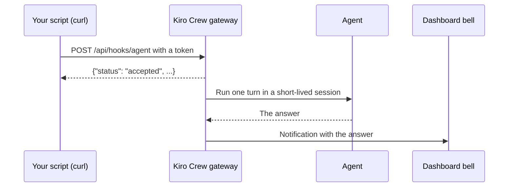

<picture>
  <source media="(prefers-color-scheme: dark)" srcset="../resources/logos/kirocrew-howto-logo-dark.svg">
  
</picture>

# Let another program start a job

**Level:** Expert · **Time:** 35 minutes · **Surface:** kiro-cli (terminal) first, with the Dashboard as the check

So far you started every job: you typed in a chat, or a schedule fired. A
**webhook** lets another program start one. When your build server finishes, it
can send Kiro Crew a message such as "summarize the build log", and the agent
does it. In this module you play the build server with one `curl` command.

## What you will learn

- What a webhook is, and what happens to the answer.
- How to turn on the **Webhooks** Feature Preview.
- How to create a webhook source and its token.
- How to send a job with `curl`, and where the answer shows up.
- How a wrong token and a paused source are refused.
- How the agent can leave notes for the next call with `register_hook`.

## Words to know

| Word | What it means |
|---|---|
| **Webhook** | A web address another program sends a message to, so that something happens. Here, the message starts one agent turn. |
| **POST** | The kind of web request that sends data. `curl -X POST` makes one. |
| **Source** | One outside caller you set up on the Webhooks page, such as "Build server". It has its own token and its own agent. |
| **Token** | A long secret. The caller sends it with every request to prove who it is. It is shown only once. |
| **Bearer token** | A token sent in the `Authorization: Bearer <token>` header. |
| **Request signing** | An extra check where the caller also signs each request with a second secret. New sources ask for it by default. |
| **Ephemeral session** | A short-lived session that runs one turn and is then thrown away. Webhook turns run in one. |
| **Bell** | The bell icon in the dashboard's top bar. It opens your notifications. |

## Before you start

| What you need | How to check |
|---|---|
| Kiro Crew running (Module 1) | Open `http://localhost:5476`. You see the dashboard. |
| Module 16 done | You have let the agent work unattended ([Module 16](../16-task-runner/README.md)). |
| `curl` | Run `curl --version`. You see a version number. |
| The sample log in your practice folder | Copy [build.log](build.log) into `~/my-project/`. Then run `tail -n 2 ~/my-project/build.log`. You see `Build FAILED after 35 seconds`. |
| The sample script | This module folder has [post-job.sh](post-job.sh). |

Surface labels in this module:

- **Terminal**: type it in your computer's terminal, not inside `kiro-cli chat`.
- **Dashboard**: click it in the dashboard, or type it in its message box.

> **Risk:** anyone who has your token can start agent turns on your computer.
> Keep it like a password. Never put it in a file you share, a chat, or a public
> repository.

## Step by step

### 1. How a webhook job runs



The caller gets back only "accepted". The agent then runs one turn in an
ephemeral session, and that session is thrown away when the turn ends. The
answer goes to your notifications. It is **not** sent back to the caller, and
it is **not** a new row in **Sessions**.

> **Tip:** the turn is unattended. Nobody is there to approve a tool call, so it
> runs with the approval rules Kiro Crew already has. Reading a file is allowed
> by default, which is all this job needs.

### 2. Turn on the Webhooks preview

The webhook address works on its own, but the page that manages it is a Feature
Preview.

**Surface: Dashboard.**

1. Open **Settings → Developer → Feature Previews**.
2. Find the **Webhooks** card. Its text says the API works and the page is not
   finished.
3. Switch **Webhooks** on.
4. Press **Open Webhooks** on the same card.

You should see the **Webhooks** page. It is also at
`http://localhost:5476/webhooks`, and under **Settings → Webhooks** once the
preview is on. There is no rail row.

> **Why it is per device:** this switch lives in your browser, not in Kiro
> Crew's settings file. Its settings-page id is `developer.webhooks`. The
> switch itself is the browser flag `mc-preview-webhooks`, not a
> `kirocrew config` key. Turning it off only hides the page. Your tokens are
> kept.

### 3. Create a source and copy its token

**Surface: Dashboard.** On the Webhooks page:

1. Press **New**. The right side shows **Let an outside system wake up your
   agent**.
2. In the **Source** label box (it shows `Label, e.g. Review Bot`), type
   `Build server`.
3. In **Agent**, pick the default agent, `kirocrew`.
4. Switch **Require request signing** off. This makes a bearer-only token, which
   is simpler for a first try. Step 9 explains signing.
5. Press **Generate token**.

You should see the token and the warning **Copy this token now — it is shown
once**. Copy it.

Kiro Crew keeps only a fingerprint (a hash) of the token, so it can never show
it again. If you lose it, revoke the source and make a new one.

### 4. Put the token in your terminal

**Surface: kiro-cli (terminal).** Paste your token between the quotes:

```bash
export KIROCREW_WEBHOOK_TOKEN='paste-your-token-here'
```

This keeps the token in this terminal window only. It is not saved in a file.

### 5. Send the job

[post-job.sh](post-job.sh) sends one POST. The important part:

**Surface: kiro-cli (terminal).**

```bash
curl -sS -X POST "http://127.0.0.1:5476/api/hooks/agent" \
  -H "Origin: http://127.0.0.1:5476" \
  -H "Authorization: Bearer ${TOKEN}" \
  -H "Content-Type: application/json" \
  -d '{
        "message": "Summarize ~/my-project/build.log in three bullets: what passed, what failed, and the first thing to fix.",
        "sessionKey": "hook:build:my-project",
        "name": "Build server"
      }'
```

| Part | What it does |
|---|---|
| `Authorization: Bearer ...` | Proves who is calling. |
| `Origin: ...` | Says which dashboard the call is for. Kiro Crew checks it before the token. |
| `message` | What you want the agent to do. Required. |
| `sessionKey` | A label for the job. It must start with `hook:`. |
| `name` | The name shown in the notification title. |

**Surface: kiro-cli (terminal).** From the folder where you downloaded this guide:

```bash
bash 21-webhooks/post-job.sh
```

You should see:

```text
{"status": "accepted", "sessionKey": "hook:build:my-project"}
```

This only means the job was **accepted**. It says nothing about the answer.

### 6. Read the answer in the bell

**Surface: Dashboard.** Wait a minute, then click the bell in the top bar.

You should see a notification from **Build server** with something like:

```text
- Passed: lint (2 warnings) and 13 of 14 tests.
- Failed: tests/report.test.js, "report totals: expected 120 but got 119".
- Fix first: the report total in src/report.js.
```

Now open **Sessions**. There is no new chat for this job. That is expected: the
session was thrown away when the turn ended.

### 7. See the run on the Activity tab

**Surface: Dashboard.** On the Webhooks page, open **Activity**.

You should see your call under **Recent runs**, with its source, its status
(**Completed** when it worked), when it started and how long it took. Every
accepted, refused and unauthorized call lands here.

### 8. Try a wrong token, then a paused source

**Surface: kiro-cli (terminal).** Send the job with a wrong token:

```bash
KIROCREW_WEBHOOK_TOKEN=wrong-token bash 21-webhooks/post-job.sh
```

You should see:

```text
{"error": "unauthorized"}
```

**Surface: Dashboard.** Select **Build server** in the list. Its badge says
**Active**. Press **Turn off**. The badge now says **Paused**.

**Surface: kiro-cli (terminal).** Send the job again with the right token:

```bash
bash 21-webhooks/post-job.sh
```

You should see a reply that contains `"code": "source_disabled"`. A paused
source is refused after its token is checked and before its message is read.
Other sources keep working.

Press **Turn on** to resume it. Both refused calls are listed on the
**Activity** tab.

| You see | Status | Why |
|---|---|---|
| `accepted` | 200 | The job was queued. |
| `unauthorized` | 401 | No token matched. |
| `source_disabled` | 503 | This source is paused. |
| `inbound webhooks are disabled` | 503 | All webhooks are switched off. |
| `hook capacity reached (6)` | 429 | Six jobs are already running. Try again later. |

### 9. Signed requests (for real callers)

New sources ask for **request signing** by default. A signed call also sends
`X-KiroCrew-Timestamp` and `X-KiroCrew-Signature` headers. The signature is made
from the time and the exact body, with a second secret you copy when you create
the source. It proves the message was not changed, and a copied request cannot
be sent again later.

Use a bearer-only source for practice on your own computer. Use a signed source
for a real build server. The Webhooks page shows a ready **Request example** for
each source.

## Try it yourself

Let the agent leave a note for the next call.

1. **Surface: Dashboard.** In a normal (**Persistent**) chat, type:

   ```text
   Use register_hook with hook_id "build:my-project" and this context summary:
   "The team cares most about failing tests. Always name the failing test file first."
   ```

   You should see the agent report the hook id, the session key
   `hook:build:my-project`, and the webhook address.

2. **Surface: kiro-cli (terminal).** Run `bash 21-webhooks/post-job.sh` again. The
   `sessionKey` in the script is `hook:build:my-project`, so this call gets your
   note.
3. **Surface: Dashboard.** Read the new notification. You should see the failing
   test file named first.
4. On the Webhooks page, open **Activity** → **Registered contexts**. Your note
   is listed as **Fresh**.

A note stays **Fresh** for 1 hour. Up to 24 hours it is **Stale**: the agent
still gets it, with a warning that it may be out of date. After 24 hours it is
**Expired** and dropped. `register_hook` is refused in **Incognito** and
**Temporary** chats.

## Check your work

- [ ] The POST came back with `"status": "accepted"`.
- [ ] A bell notification from **Build server** held the summary.
- [ ] No new row appeared in **Sessions**.
- [ ] The run is listed on the Webhooks **Activity** tab.
- [ ] A wrong token got `unauthorized`.
- [ ] A paused source got `source_disabled`.

## Common problems

| What you see | What to do |
|---|---|
| `curl: (7) Failed to connect` | Kiro Crew is not running, or uses another port. Check `http://localhost:5476`, or set `KIROCREW_PORT`. |
| `unauthorized` with the right token | The token has a space or a line break. Copy it again. Or the source requires signing: make a bearer-only one for practice. |
| A plain `Forbidden` page | The `Origin` header is missing or does not match the gateway's address. Keep the script's `Origin` line. |
| `accepted`, but no notification | Wait a little longer. Then check the **Activity** tab for the run's status. |
| The token is lost | It cannot be shown again. Revoke the source and create a new one. |
| `session_busy` | A job with the same `sessionKey` is still running. Wait for it. |

## Going further (expert)

- **Who can reach it.** Kiro Crew listens on your own computer only
  (`127.0.0.1`). A program on another machine reaches it through an SSH tunnel,
  for example `ssh -NL 5476:127.0.0.1:5476 <your-computer>`, run on that other
  machine.
- **More fields.** `deliver: false` runs the turn but sends no notification.
  `timeoutSeconds` sets how long the turn may run (60 to 3593, default 599).
- **Turn it all off.** The Webhooks page has one **Turn off** switch for every
  source at once. Tokens and history are kept, so turning it back on restores
  everything.

## What you learned

- A webhook lets another program start one agent turn with a POST to
  `/api/hooks/agent`.
- The caller gets only "accepted". The answer arrives in the bell, and no chat
  is kept.
- Each source has its own token and agent. Its token is shown once.
- A wrong token gets `unauthorized`, and a paused source gets `source_disabled`.
- `register_hook` leaves a note that the next call with the same hook id reads first.

## Next

Go on to [Module 22: build a small app](../22-apps/README.md).

---
**Last updated:** 2026-10-30
**Checked against:** Kiro Crew public source @ 2808e9478c (github.com/kirodotdev/KiroCrew) and kiro.dev/docs/cli
*Part of the [Kiro Crew How To](../) guide.*
