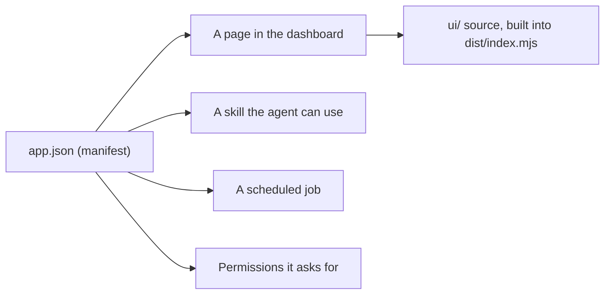

<picture>
  <source media="(prefers-color-scheme: dark)" srcset="../resources/logos/kirocrew-howto-logo-dark.svg">
  
</picture>

# Build a small app

**Level:** Expert · **Time:** 60 minutes · **Surface:** kiro-cli (terminal) first, with the Dashboard as the check

An **app** packs several Kiro Crew pieces into one thing you can turn on, turn
off and share. In this module you build a "Habit Tracker" app with three parts:
a page that lists your habits, a skill that helps you pick a new one, and a
scheduled job that reminds you each morning. Then you install it, trust it,
turn it on and pin it.

## What you will learn

- What an app is, and what it can bring with it.
- How to browse apps on **Discover** and manage them in **Library**.
- How to start an app with `kirocrew app init`.
- What `app.json` says, part by part.
- How to build, install, trust and enable your own app.
- How to pin an app's page to the sidebar, and turn the app off.
- Why an enabled app is trusted like Kiro Crew itself.

## Words to know

| Word | What it means |
|---|---|
| **App** | An add-on for Kiro Crew. It can bring pages, skills, agents, scheduled jobs and its own background program. |
| **Manifest** | The app's `app.json` file. It lists everything the app brings and what it is allowed to do. |
| **Scaffold** | A starter folder a command writes for you, with the right files already in place. |
| **Discover** | The app store page in the dashboard, at `/apps`. |
| **Library** | Your installed apps, at `/apps/library`. Each tile has the actions for that app. |
| **Enable** | Turn an installed app on. A disabled app brings nothing. |
| **Third-party app** | Any app that did not ship with Kiro Crew, including one you wrote. It is blocked until you trust it. |
| **Pin** | Show an enabled app's page in the sidebar. Pinning does not turn anything on or off. |
| **Build** | Turn the page's source code into the one file the dashboard loads. |

## Before you start

| What you need | How to check |
|---|---|
| Kiro Crew running (Module 1) | Open the dashboard. You see **Discover** and **Library** in the rail's **Apps** part. |
| Modules 7 and 12 done | You have made a skill ([Module 7](../07-skills/README.md)) and a scheduled job ([Module 12](../12-scheduled-jobs/README.md)). |
| Node.js 22.12 or newer | Run `node --version`. You see `v22.12` or higher. Version 24 is recommended. |
| npm | Run `npm --version`. You see a version number. |
| The sample app | This module folder has [habit-tracker/](habit-tracker/). |

Surface labels in this module:

- **Terminal**: type it in your computer's terminal, not inside `kiro-cli chat`.
- **Dashboard**: click it in the dashboard, or type it in its message box.

> **Warning:** **an enabled app runs with the same power as Kiro Crew itself.**
> Its code is loaded into Kiro Crew, and there is no separate sandbox around it.
> Only enable apps you trust. That is why Kiro Crew blocks every third-party
> app, including yours, until you say you trust it.

## Step by step

### 1. Look around Discover and Library

**Surface: Dashboard.** In the left rail, find the **Apps** part and click
**Discover**.

You should see the app store: featured apps, categories and every app on offer.
Most apps that ship with Kiro Crew are already on your computer, so they need
**Enable**, not install.

Click **Library**. You should see your installed apps as tiles. **Task Runner**
and **Command Bar** are on from a fresh install. Click a tile's name to open its
detail page.

### 2. What an app is made of



One manifest, `app.json`, names everything. When you enable the app, Kiro Crew
adds its page, skill and job. When you disable it, they go away again.

### 3. See what the scaffold makes

`kirocrew app init` writes a starter app. You do not need to run it for this
module, because [habit-tracker/](habit-tracker/) is ready. But this is how it
started:

**Surface: kiro-cli (terminal).**

```bash
mkdir -p ~/my-apps
cd ~/my-apps
kirocrew app init my-first-app --ui --cron
```

You should see something like:

```text
✅ Scaffolded app: ~/my-apps/my-first-app
```

| Flag | Adds |
|---|---|
| `--ui` | A `ui/` folder for a page, built with Vite (a build tool). |
| `--cron` | A sample scheduled job in `app.json`. |
| `--backend` | A background program stub. This module does not use one. |

The scaffold also adds a sample agent and a sample skill. Open its `app.json` and
compare it with the Habit Tracker's below. Replace the `author` value with your
own name.

### 4. Read the Habit Tracker manifest

Here is [habit-tracker/app.json](habit-tracker/app.json):

```json
{
  "name": "habit-tracker",
  "version": "0.1.0",
  "displayName": "Habit Tracker",
  "description": "List a few daily habits, get help choosing a new one, and get a reminder each morning.",
  "author": "Your Name",
  "iconPath": "assets/icon.png",
  "skills": ["skills/add-habit"],
  "tags": ["example"],
  "ui": {
    "entry": "dist/index.mjs",
    "pages": [
      { "route": "/apps/habit-tracker", "label": "Habit Tracker", "icon": "Package" }
    ]
  },
  "crons": [
    {
      "name": "habit-tracker-morning-reminder",
      "cron_expr": "0 8 * * *",
      "timezone": "America/New_York",
      "message": "Remind me, in one friendly line, to open the Habit Tracker page and tick off today's habits."
    }
  ],
  "permissions": { "cron": true }
}
```

| Part | What it does |
|---|---|
| `name` | The app's id, in kebab-case. Commands use it. |
| `displayName`, `description` | What the store and Library show. |
| `skills` | Folders that hold a `SKILL.md`. Here, [add-habit](habit-tracker/skills/add-habit/SKILL.md). |
| `ui.entry` | The built page file, inside `ui/`. |
| `ui.pages` | The page's address and its sidebar label. |
| `crons` | The scheduled job. `0 8 * * *` means 08:00 every day. |
| `timezone` | The time zone the job's time is read in. Without it, 08:00 means 08:00 UTC. |
| `permissions.cron` | Required for any app that has `crons`, so you can see it runs jobs on its own. |

Change `America/New_York` to your own time zone name, such as `Europe/London`.

The page, [App.tsx](habit-tracker/ui/src/App.tsx), keeps the habit list in your
browser. Its **Ask the agent to help me pick a habit** button opens a new chat
with a draft message, which the `add-habit` skill picks up.

### 5. Copy and build it

Work on a copy, so the guide's folder stays clean.

**Surface: kiro-cli (terminal).** From the folder where you downloaded this guide:

```bash
mkdir -p ~/my-apps
cp -R 22-apps/habit-tracker ~/my-apps/
cd ~/my-apps/habit-tracker/ui
npm install
npm run build
```

You should see something like:

```text
dist/index.mjs  3.68 kB │ gzip: 1.37 kB
✓ built in 49ms
```

The page imports React and Kiro Crew's app toolkit (`@kirocrew/app-sdk`), but
you do not install those. The dashboard gives them to the page when it loads.
The build leaves them out on purpose.

### 6. Install it

**Surface: kiro-cli (terminal).**

```bash
kirocrew app install ~/my-apps/habit-tracker
kirocrew app list
```

You should see `habit-tracker` in the list. It is installed but not on yet.

### 7. Trust it and turn it on

**Surface: Dashboard.** Open **Library**. Find the **Habit Tracker** tile and
press **Enable**.

Because this is a third-party app, Kiro Crew asks first. You should see a dialog
that starts with **Trust “Habit Tracker” to run its own code?** and lists what
the app would get. It says the trust applies to this app only. Read it, then
press **Trust this app and enable**.

> **In a terminal. Surface: kiro-cli (terminal).**
>
> `kirocrew app enable habit-tracker` refuses an app you have not trusted yet.
> After you trust it in the dialog, `kirocrew app enable` and
> `kirocrew app disable` work on it. You can take the trust back in
> **Settings → Security → Third-party apps**.

### 8. Open the page, and pin or unpin it

An app with a page gets a sidebar row when it is enabled.

**Surface: Dashboard.** Click **Habit Tracker** in the sidebar. You should see
the page with **Habits** and **Done today** at the top.

1. Type `Drink a glass of water` in the box and press **Add**.
2. Tick its box. **Done today** shows `1 of 1`.

Now try the pin. Go back to **Library**. The tile's badge says **In sidebar**.
Use **Unpin** on the tile: the row leaves the sidebar, but the app stays on.
Use **Pin** to bring it back.

### 9. Use the skill and the job

**Surface: Dashboard.** On the Habit Tracker page, press **Ask the agent to help
me pick a habit**. A new chat opens with the message ready. Press send.

You should see the agent offer up to three small habits, each starting with a
verb, and end with one line to paste into the page.

Now the job. Open **Schedule** in the rail. You should see
`habit-tracker-morning-reminder`. Press **Run Now** on it. A minute later the
bell shows a one-line reminder.

### 10. Turn it off

**Surface: kiro-cli (terminal).**

```bash
kirocrew app disable habit-tracker
```

You should see the Habit Tracker row leave the sidebar, and its job leave the
**Schedule** page. A disabled app brings no pages, skills or jobs. Its data is
kept, so `kirocrew app enable habit-tracker` brings it all back.

## Try it yourself

1. In **Library** or **Discover**, pick a shipped app you have not used, such as
   **Notes** or **Files**. Press **Enable**. Shipped apps are trusted like Kiro
   Crew itself, so no trust dialog appears.
2. Open its page from the sidebar.
3. On its Library tile, use **Unpin**, then **Pin**.
4. Disable it again if you do not want it.

## Check your work

- [ ] `npm run build` made `ui/dist/index.mjs`.
- [ ] `kirocrew app list` shows `habit-tracker`.
- [ ] You trusted the app in the dialog, and it shows in **Library** as on.
- [ ] Its page opens from the sidebar after you pin it in **Library**.
- [ ] The morning job is on the **Schedule** page, and **Run Now** sent a reminder.
- [ ] Disabling the app removed its page from the sidebar.

## Common problems

| What you see | What to do |
|---|---|
| `npm install` fails with a 404 for `@kirocrew/app-sdk` | Remove its `peerDependencies` block from `ui/package.json`. The dashboard provides that package. The sample already has it removed. |
| `vite: command not found` | `npm install` did not finish. Run it again in the `ui/` folder. |
| `kirocrew app enable` is refused | Trust the app first, from the **Enable** dialog in **Library**. |
| The install is refused and mentions `cron` | An app with `crons` must have `"cron": true` under `permissions`. |
| The page is blank | Run `npm run build` again, then use **Update** on the app's Library tile and reload the dashboard. |
| The reminder came at the wrong hour | Set `timezone` in `app.json` to your zone, then reinstall or update the app. |

## Going further (expert)

- **Live reload while you edit.** `kirocrew app dev habit-tracker` turns on dev
  mode: the dashboard reloads the page when files in the app's `ui/` folder
  change. `kirocrew app dev habit-tracker --off` turns it off.
- **Import a plugin.** Some other AI tools ship add-ons as plugin packages.
  `kirocrew app import` converts one into an app folder. It reads JSON and
  copies files, and runs nothing from the plugin. Try it on
  [import-demo/](import-demo/):

  **Surface: kiro-cli (terminal).**

  ```bash
  kirocrew app import 22-apps/import-demo --out ~/my-apps/docs-helper
  ```

  You should see a report like:

  ```text
  mapped:
    skills -> app.json skills -- 2 skill(s) copied

  not mapped:
    (nothing)
  ```

  Then `kirocrew app install ~/my-apps/docs-helper`, and trust and enable it as
  in step 7.
- **Uninstall.** `kirocrew app uninstall habit-tracker` removes an app you
  installed and keeps its data. Adding `--purge-data` deletes the data too, and
  that cannot be undone.
- **The full reference.** The App Kit docs in the public Kiro Crew repository
  cover every `app.json` field.

## What you learned

- An app is one package of pages, skills, agents and scheduled jobs, named in
  `app.json`.
- **Discover** is the store. **Library** is where you enable, pin and unpin.
- `kirocrew app init` writes a starter app. `npm run build` builds its page.
- `kirocrew app install` installs it. A third-party app must be trusted before
  it can be enabled.
- An enabled app runs with Kiro Crew's own power, so trust only apps you know.
- Disabling an app removes everything it added and keeps its data.

## Next

Go on to [Module 23: back up, move, or host it](../23-backup-and-hosting/README.md).

---
**Last updated:** 2026-10-30
**Checked against:** Kiro Crew public source @ 2808e9478c (github.com/kirodotdev/KiroCrew) and kiro.dev/docs/cli
*Part of the [Kiro Crew How To](../) guide.*
