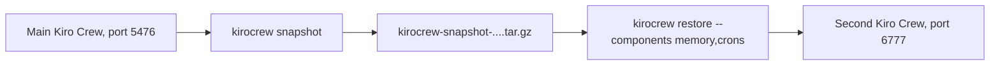

<picture>
  <source media="(prefers-color-scheme: dark)" srcset="../resources/logos/kirocrew-howto-logo-dark.svg">
  
</picture>

# Back up, move, or host it

**Level:** Expert · **Time:** 50 minutes · **Surface:** kiro-cli (terminal) first, with the Dashboard as the check

Everything Kiro Crew has learned about you lives in one data folder: memory,
saved rules, scheduled jobs, settings. This module shows how to pack it into one
backup file, unpack parts of it into a second, separate copy of Kiro Crew, and
check that your Module 4 rule came along. Then it shows how to keep Kiro Crew
up to date, reach one on another machine, and run it in a container.

## What you will learn

- What a snapshot is, and what is inside it.
- How to make a snapshot and list your snapshots.
- How to restore only some parts with `--components`.
- How to run a second Kiro Crew on the same computer, with its own data folder and port.
- How to read and change settings with `kirocrew config`.
- How to update Kiro Crew.
- Where to start for another machine (**Remote Crew**) or a container.

## Words to know

| Word | What it means |
|---|---|
| **Snapshot** | One `.tar.gz` file that holds a copy of your Kiro Crew data, ready to restore. |
| **Restore** | Unpack a snapshot into a Kiro Crew data folder. |
| **Component** | One part of a snapshot, such as `memory` or `crons`. You can restore some parts and skip others. |
| **Data folder** | Where Kiro Crew keeps your data. By default `~/.kiro/crew`. The `KIROCREW_HOME` environment variable points it somewhere else. |
| **Port** | The number in the dashboard address, such as `5476` in `http://localhost:5476`. `KIROCREW_PORT` changes it. |
| **Instance** | One running copy of Kiro Crew. Two instances need different data folders and ports. |
| **Environment variable** | A named value your terminal hands to the programs it starts, such as `KIROCREW_HOME`. |
| **Container** | A sealed box that runs a program and everything it needs, often on a server. |

## Before you start

| What you need | How to check |
|---|---|
| Kiro Crew running (Module 1) | Open `http://localhost:5476`. You see the dashboard. |
| Module 4 done | You saved a rule such as "always answer me in bullet points" ([Module 4](../04-memory/README.md)). |
| At least one scheduled job (Module 12) | Open **Schedule**. You see a job. |
| macOS or Linux terminal | The commands below use `bash` or `zsh`. |
| About 1 GB of free disk space | Run `df -h ~`. |

Surface labels in this module:

- **Terminal**: type it in your computer's terminal, not inside `kiro-cli chat`.
- **Dashboard**: click it in the dashboard, or type it in its message box.

> **Risk: read this before you start.**
>
> - **A snapshot holds every secret the original holds**: tokens, keys, chat
>   app logins, private notes. Store it like a password. Never send it over a
>   chat app or put it in a shared folder.
> - **A copy with the same chat app tokens can connect the same bot twice.**
>   Those tokens live in the `config` component. This module restores only
>   `memory` and `crons`, so the copy has no chat app logins.
> - **Delete the snapshot when you are done.** Step 9 shows how.

## Step by step

### 1. How the move works



You pack the main instance into one file. You unpack two parts of it into a new
data folder. A second Kiro Crew runs on that folder, on another port, so the two
never touch each other's data.

### 2. See what a snapshot can hold

**Surface: kiro-cli (terminal).**

```bash
kirocrew restore --list-components
```

You should see a list that includes:

| Component | What it holds |
|---|---|
| `memory` | Your memory, saved rules (lessons) and knowledge files. |
| `crons` | Your scheduled jobs. |
| `config` | Your settings, including chat app tokens and hooks. |
| `skills` | Your skills folder. |
| `workspace` | The agent's workspace folders. |
| `notifications` | Notification history. |
| `artifacts` | Your artifact library. |
| `uploads` | Files you uploaded in the dashboard. |

Your saved rule from Module 4 is a lesson, so it is in `memory`.

### 3. Make a snapshot

**Surface: kiro-cli (terminal).**

```bash
mkdir -p ~/my-snapshots
kirocrew snapshot ~/my-snapshots
```

You should see something like:

```text
✅ Snapshot created: ~/my-snapshots/kirocrew-snapshot-<date-and-time>.tar.gz (<size>)
```

List your snapshots:

**Surface: kiro-cli (terminal).**

```bash
kirocrew snapshot --list ~/my-snapshots
```

Copy the snapshot's full file name. The next steps call it `<snapshot-file>`.

> **Tip:** with no folder, `kirocrew snapshot` writes to the data folder's
> `snapshots` folder. `--keep 3` keeps only the newest three. Kiro Crew does not
> take snapshots by itself: schedule one if you want regular backups.

### 4. Open a terminal for the copy

Open a **new** terminal window. Everything for the copy happens in this window,
so your main Kiro Crew is never touched.

**Surface: kiro-cli (terminal), in the new window.**

```bash
export KIROCREW_HOME="$HOME/kirocrew-copy"
export KIROCREW_PORT=6777
echo "$KIROCREW_HOME on port $KIROCREW_PORT"
```

You should see your home path followed by `/kirocrew-copy on port 6777`.

`KIROCREW_HOME` gives the copy its own data folder. `KIROCREW_PORT` gives it its
own port. Both are needed to run two instances safely.

### 5. Preview the restore

**Surface: kiro-cli (terminal), in the new window.** Replace `<snapshot-file>` with the file
name from step 3:

```bash
kirocrew restore ~/my-snapshots/<snapshot-file> --components memory,crons --dry-run
```

`--dry-run` shows what would be restored and writes nothing. Check that only
`memory` and `crons` are listed.

### 6. Restore memory and jobs into the copy

**Surface: kiro-cli (terminal), in the new window.**

<!-- NLT: restore into a second KIROCREW_HOME with --components memory,crons, while the main gateway runs on another port -->
```bash
kirocrew restore ~/my-snapshots/<snapshot-file> --components memory,crons
```

The copy's folder has no memory yet, so the restore runs in **replace** mode.
You should see the restore finish with a line such as:

```text
✅ Replace complete.
```

> **Tip:** restore refuses to run while a gateway is using the same data. That
> is why the copy is not started yet.

### 7. Start the copy and check your rule

**Surface: kiro-cli (terminal), in the new window.**

```bash
kirocrew gateway
```

Leave it running. It is the copy.

**Surface: Dashboard.** Open `http://localhost:6777`. This is the copy's
dashboard. It may ask you to sign in first, as on a new computer.

1. Open **Schedule**. You should see the same jobs as on your main instance.
2. In a new chat, ask: `What rules have you learned about me?`

You should see your Module 4 rule, for example "always answer me in bullet
points".

> **Warning:** the copy's jobs are real. They run on their own schedule. Pause
> them on the copy's **Schedule** page, or stop the copy soon (step 8).

Open **Settings → Messaging Channels** on the copy. No chat app is connected,
because `config` was not restored. So no bot connects twice.

### 8. Stop the copy and check the original

**Surface: kiro-cli (terminal), in the new window.** Press `Ctrl+C` to stop the copy's
gateway. Then clear the two settings:

```bash
unset KIROCREW_HOME KIROCREW_PORT
```

**Surface: Dashboard.** Open `http://localhost:5476`. Your main instance is
unchanged: same chats, same jobs, same settings.

### 9. Delete the snapshot and the copy

**Surface: kiro-cli (terminal).**

```bash
rm ~/my-snapshots/<snapshot-file>
```

> **Warning:** the next command deletes the copy's whole data folder. Check the
> path twice. It must say `kirocrew-copy`, never `.kiro/crew`.

**Surface: kiro-cli (terminal).**

```bash
rm -r "$HOME/kirocrew-copy"
```

You should see no output. Run `ls ~/my-snapshots` to check the snapshot is gone.

### 10. Read and change settings

`kirocrew config` reads and writes Kiro Crew's settings file
(`config.json` in the data folder).

**Surface: kiro-cli (terminal).**

```bash
kirocrew config get dashboard.url
```

You should see the dashboard address, such as `http://localhost:5476`.

To change a setting, give its key and new value. For example, to let a workflow
run for two hours ([Module 17](../17-workflows/README.md)):

**Surface: kiro-cli (terminal).**

```bash
kirocrew config set agent.workflow_run_timeout_secs 7200
```

`kirocrew config get` with no key prints every setting. Many settings also have
a switch on the **Settings** page.

### 11. Keep it up to date

How you update depends on how you installed Kiro Crew.

| You installed | Update with |
|---|---|
| The desktop app | **Update available** in the dashboard's top bar, when it shows. |
| The terminal installer, or a source checkout | `kirocrew update`, then `kirocrew restart`. |

**Surface: kiro-cli (terminal).**

```bash
kirocrew update
kirocrew restart
```

`kirocrew update` never restarts a running gateway by itself. The restart is
what makes the new version live. Take a snapshot first if you are unsure about
an update.

## Try it yourself

1. Run `kirocrew restore --list-components`.
2. Pick the components you would move to a new laptop. Write them down, and why.
3. For each one you left out, say what you would set up again by hand.

A good answer for most people: `memory`, `crons`, `skills`, `artifacts` and
`workspace`. Leave out `config` if the old laptop keeps running, so a chat app
bot does not connect twice. Sign in to your chat apps again on the new laptop.

## Check your work

- [ ] `kirocrew snapshot` made a `kirocrew-snapshot-...tar.gz` file.
- [ ] The second dashboard at `http://localhost:6777` showed your jobs and your Module 4 rule.
- [ ] No chat app was connected on the copy.
- [ ] Your main dashboard at `http://localhost:5476` was unchanged.
- [ ] The snapshot file and the copy's folder are gone.

## Common problems

| What you see | What to do |
|---|---|
| Restore refuses because a gateway is running | You are in the main window, or the copy is already running. Use the new window, check `echo $KIROCREW_HOME`, and stop the copy first. |
| The copy opens your main dashboard | `KIROCREW_PORT` was not set in that window. Run step 4 again, then start the copy. |
| The copy does not know your rule | `memory` was left out of `--components`. Run the restore again with `memory,crons`. |
| A chat app bot answers twice | A copy has the same chat app tokens. Stop the copy, then restore without `config`. |
| `kirocrew update` changed nothing | The new version is live only after `kirocrew restart`. |
| The snapshot is very large | Snapshot only what you need, for example `kirocrew snapshot --components memory`. |

## Going further (expert)

- **Another machine: Remote Crew.** One dashboard can reach a Kiro Crew running
  on another computer you can `ssh` into. Turn it on in **Settings → Remote
  Crew**, or with:

  **Surface: kiro-cli (terminal).**

  ```bash
  kirocrew config set instances.enabled true
  kirocrew restart
  ```

  The remote's dashboard never opens a port to the network. Your dashboard
  reaches it through an SSH tunnel.
- **A container.** Kiro Crew publishes a public container image for always-on
  use on a server. A first run looks like this:

  **Surface: kiro-cli (terminal).**

  ```bash
  docker run -d --name kirocrew -p 127.0.0.1:5476:5476 -v kirocrew-home:/home/kirocrew ghcr.io/kirodotdev/kirocrew:stable
  ```

  `127.0.0.1:` keeps the dashboard on that computer only. The Docker guide in
  the public Kiro Crew repository covers first-run sign-in, updates and the
  sandbox.
- **Run it after a reboot.** `kirocrew service install` starts Kiro Crew when the
  computer starts ([Module 16](../16-task-runner/README.md)).

## What you learned

- `kirocrew snapshot` packs your Kiro Crew data into one file. It holds every
  secret, so treat it like a password and delete it when done.
- `kirocrew restore --components` restores only the parts you pick, and
  `--list-components` shows them.
- `KIROCREW_HOME` and `KIROCREW_PORT` run a second, separate instance.
- Leaving out `config` keeps a copy from connecting the same chat app bot.
- `kirocrew config get` and `set` read and change settings.
- `kirocrew update` then `kirocrew restart` updates a terminal install.

## Next

You have finished the modules. Put them together in the
[capstone: My morning desk](../capstone-morning-desk/README.md).

---
**Last updated:** 2026-10-30
**Checked against:** Kiro Crew public source @ 2808e9478c (github.com/kirodotdev/KiroCrew) and kiro.dev/docs/cli
*Part of the [Kiro Crew How To](../) guide.*
