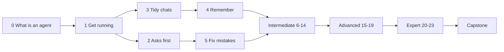

<picture>
  <source media="(prefers-color-scheme: dark)" srcset="resources/logos/kirocrew-howto-logo-dark.svg">
  
</picture>

# Learning roadmap

This page shows the order of the modules, what each one needs first, and how
to check you are ready for the next level. If you are new to AI agents, start
at [Module 0](00-what-is-an-agent/README.md) and go in order.

## Table of contents

- [Find your level](#find-your-level)
- [The four levels](#the-four-levels)
- [The path](#the-path)
- [Every module, with what it needs first](#every-module-with-what-it-needs-first)
- [Novice: Modules 0-5](#novice-modules-0-5)
- [Intermediate: Modules 6-14](#intermediate-modules-6-14)
- [Advanced: Modules 15-19](#advanced-modules-15-19)
- [Expert: Modules 20-23](#expert-modules-20-23)
- [Capstone](#capstone)
- [Why this order](#why-this-order)

---

## Find your level

Tick each line you have really done. If unsure, start one level lower.

**First, two questions:**

- [ ] I have asked an AI a question and checked its answer.
- [ ] I know an AI can be wrong.

If you ticked neither, start at [Module 0](00-what-is-an-agent/README.md).

**Then, eight things you may have done in Kiro Crew:**

- [ ] I opened the dashboard and chatted with the agent (Module 1).
- [ ] I switched the approval mode on purpose (Module 2).
- [ ] I saved a rule that the agent now follows (Module 4).
- [ ] I used a saved prompt or a skill (Modules 6-7).
- [ ] I stored a secret in the Secrets Vault (Module 9).
- [ ] I scheduled a job (Module 12).
- [ ] I ran parallel helpers or a workflow (Modules 15-17).
- [ ] I wrote a hook or an app (Modules 20-22).

| Lines ticked | Your level | Start at |
|---|---|---|
| 0-2 | 🟢 Novice | The first module you have not done, from [Module 0](00-what-is-an-agent/README.md) |
| 3-5 | 🔵 Intermediate | [Module 6](06-prompts-and-steering/README.md) |
| 6-8 | 🟣 Advanced | [Module 15](15-parallel-helpers/README.md), or [Module 20](20-hooks/README.md) if you ticked all eight |

For a fuller check that scores each area and builds a path for you, run the
**self-assessment** skill ([how](README.md#check-your-level-and-quiz-yourself)).

## The four levels

| Level | Who you are | After this level you can... |
|---|---|---|
| 🟢 **Novice** (0-5) | Never used an AI agent, or only a chat website. You may not use a terminal. | Install the desktop app, chat, ask it about itself, choose how often it asks first, keep chats tidy, make it remember a preference, keep a chat private, and recover from a bad answer. |
| 🔵 **Intermediate** (6-14) | You use it most days and want it to fit your work. | Give it standing rules, saved prompts and skills; search your own documents; protect secrets and files; connect outside tools; let it use a website; get a daily summary; be told when something changes; reach it from your phone. |
| 🟣 **Advanced** (15-19) | You hand it bigger jobs. A terminal does not scare you. | Run tasks in parallel, leave a task list running, restart a long job from a failed step, keep and version what it makes, and set up named specialists with their own memory and goals. |
| 🔴 **Expert** (20-23) | You build on top of it. You live in the terminal. | Add your own scripts at fixed moments, let other programs start jobs, build a small app, and back up, move or host your whole setup. |

Novice modules are **Dashboard first** and need no terminal. Expert modules are
**terminal first**, with the dashboard as the check.

## The path

Novices go from 0 to 5 in order. The intermediate, advanced and expert levels
are blocks: inside a block, take the modules in any order once you have done
what each one needs first. The capstone comes last. On the website, green is
novice, blue is intermediate, purple is advanced and red is expert.

## Every module, with what it needs first

| # | Module | Level | Time | Needs |
|---|---|---|---|---|
| 0 | [What is an AI agent?](00-what-is-an-agent/README.md) | 🟢 | 15 min | — |
| 1 | [Get it running and say hello](01-getting-started/README.md) | 🟢 | 45 min | 0 |
| 2 | [Decide how often it asks first](02-approval-modes/README.md) | 🟢 | 20 min | 1 |
| 3 | [Keep chats tidy and pick up where you left off](03-sessions/README.md) | 🟢 | 20 min | 1 |
| 4 | [Make it remember you, or not](04-memory/README.md) | 🟢 | 30 min | 3 |
| 5 | [Fix a mistake](05-fix-a-mistake/README.md) | 🟢 | 30 min | 2, 3 |
| 6 | [Standing rules and reusable prompts](06-prompts-and-steering/README.md) | 🔵 | 30 min | 4 |
| 7 | [Teach it a procedure: skills](07-skills/README.md) | 🔵 | 35 min | 6 |
| 8 | [Ask about your own documents](08-knowledge-library/README.md) | 🔵 | 25 min | 4 |
| 9 | [Protect your secrets and your files](09-protect-secrets-and-files/README.md) | 🔵 | 30 min | 2, 5 |
| 10 | [Connect your tools](10-connections/README.md) | 🔵 | 30 min | 9 |
| 11 | [Let it use a website](11-browser/README.md) | 🔵 | 20 min | 2 |
| 12 | [Get a daily summary](12-scheduled-jobs/README.md) | 🔵 | 30 min | 6, 9 |
| 13 | [Tell me when something changes](13-monitors/README.md) | 🔵 | 30 min | 12 |
| 14 | [Reach it from your phone or chat app](14-phone-and-chat-apps/README.md) | 🔵 | 60 min | 2, 12 |
| 15 | [Many tasks at once](15-parallel-helpers/README.md) | 🟣 | 30 min | 12 |
| 16 | [Work while you're away](16-task-runner/README.md) | 🟣 | 40 min | 9 (14 optional) |
| 17 | [Long jobs that can restart from a step](17-workflows/README.md) | 🟣 | 45 min | 15 |
| 18 | [Keep and improve what it made](18-artifacts/README.md) | 🟣 | 25 min | 5 |
| 19 | [Named specialists with their own memory](19-mates-and-agents/README.md) | 🟣 | 45 min | 4, 12 |
| 20 | [Your own automatic checks: hooks](20-hooks/README.md) | 🔴 | 30 min | 9, 16 |
| 21 | [Let another program start a job](21-webhooks/README.md) | 🔴 | 35 min | 16 |
| 22 | [Build a small app](22-apps/README.md) | 🔴 | 60 min | 7, 12 |
| 23 | [Back up, move, or host it](23-backup-and-hosting/README.md) | 🔴 | 50 min | 4 |
| — | [Capstone: My morning desk](capstone-morning-desk/README.md) | All | 2-3 h | 4, 6, 7, 8, 9, 12, 13, 14, 18 |

Totals: novice about 2.7 hours, intermediate about 5 hours, advanced about 3.1
hours, expert about 3.2 hours.

Two modules use **Feature Previews**, which you switch on in **Settings →
Developer → Feature Previews** (Dashboard): **Mates** for
[Module 19](19-mates-and-agents/README.md) and **Webhooks** for
[Module 21](21-webhooks/README.md). Each module shows how.

---

## Novice: Modules 0-5

**Goal:** chat safely, keep your preferences, and undo a mistake.

**Prerequisites check:** none. Start here.

| Milestone | You can... | Module |
|---|---|---|
| 1 | Spot a tool call and a guess in a chat | [0](00-what-is-an-agent/README.md) |
| 2 | Install the app, chat, and use and undo a change card | [1](01-getting-started/README.md) |
| 3 | Know how to approve or reject a card, and test which actions ask first | [2](02-approval-modes/README.md) |
| 4 | Put chats in a folder and reopen a closed one | [3](03-sessions/README.md) |
| 5 | Save a rule, remove it, and keep a chat private | [4](04-memory/README.md) |
| 6 | Rewind a chat and restore a file with git | [5](05-fix-a-mistake/README.md) |

**Ready for intermediate when** you can say "rewind fixes the chat, git fixes
the files", and you know the difference between **Incognito** and
**Temporary**.

## Intermediate: Modules 6-14

**Goal:** make the agent fit your work, safely.

**Prerequisites check:**

- [ ] I chat in the dashboard and know where **Settings** is ([Module 1](01-getting-started/README.md)).
- [ ] I know how to approve or reject a card, and I tested which actions ask first ([Module 2](02-approval-modes/README.md)).
- [ ] I can find an old chat ([Module 3](03-sessions/README.md)).
- [ ] I saved and removed a lesson ([Module 4](04-memory/README.md)).
- [ ] I committed a folder with git and restored a file ([Module 5](05-fix-a-mistake/README.md)).

| Milestone | You can... | Module |
|---|---|---|
| 1 | Send a saved prompt with `@name` and add a steering rule | [6](06-prompts-and-steering/README.md) |
| 2 | Make a skill and load it with `$name` | [7](07-skills/README.md) |
| 3 | Ask about your own notes and check the cited file | [8](08-knowledge-library/README.md) |
| 4 | Keep a secret in the vault and get a folder back with git | [9](09-protect-secrets-and-files/README.md) |
| 5 | Add a connection and use it in a new chat | [10](10-connections/README.md) |
| 6 | Watch the agent drive a web page, and take over | [11](11-browser/README.md) |
| 7 | Schedule a weekday job and trigger it now | [12](12-scheduled-jobs/README.md) |
| 8 | Get one alert when a file appears | [13](13-monitors/README.md) |
| 9 | Ask and approve from Slack on your phone | [14](14-phone-and-chat-apps/README.md) |

**Ready for advanced when** you can pick a prompt, a steering file or memory
for a given need, and say which safety layer guards what.

## Advanced: Modules 15-19

**Goal:** hand it bigger jobs.

**Prerequisites check:**

- [ ] I made a skill ([Module 7](07-skills/README.md)).
- [ ] I know what the Process Sandbox and the Secrets Vault guard ([Module 9](09-protect-secrets-and-files/README.md)).
- [ ] I scheduled a job and triggered it ([Module 12](12-scheduled-jobs/README.md)).

| Milestone | You can... | Module |
|---|---|---|
| 1 | Get three helpers' answers in one table | [15](15-parallel-helpers/README.md) |
| 2 | Run a task file from the **Task Runner** page and the terminal | [16](16-task-runner/README.md) |
| 3 | Re-run a workflow from the step that failed | [17](17-workflows/README.md) |
| 4 | Change an artifact and revert it | [18](18-artifacts/README.md) |
| 5 | Make a mate with a goal, and a custom agent | [19](19-mates-and-agents/README.md) |

**Ready for expert when** you can say when **not** to split work, and why a
terminal task run needs its tools allowed ahead of time.

## Expert: Modules 20-23

**Goal:** build on top of Kiro Crew.

**Prerequisites check:**

- [ ] I can get a deleted folder back with git restore ([Module 9](09-protect-secrets-and-files/README.md)).
- [ ] I ran a task file from the terminal ([Module 16](16-task-runner/README.md)).
- [ ] I am comfortable with a terminal and JSON.

| Milestone | You can... | Module |
|---|---|---|
| 1 | Add a `Stop` hook with a loop guard | [20](20-hooks/README.md) |
| 2 | Start a job with a POST and read the answer in the bell | [21](21-webhooks/README.md) |
| 3 | Build, install, enable and pin an app | [22](22-apps/README.md) |
| 4 | Restore memory and jobs into a second instance | [23](23-backup-and-hosting/README.md) |

## Capstone

[My morning desk](capstone-morning-desk/README.md): every weekday, a helper
reads your notes, checks your to-do list, and sends a short briefing to your
phone, with a chart you keep. It uses Modules 4, 6, 7, 8, 9, 12, 13, 14 and 18,
plus 19 if Mates is on. Stretch goals use 15, 17 and 20.

## Why this order

- What a module needs comes first.
- Safety ([Module 9](09-protect-secrets-and-files/README.md)) comes before
  anything that runs unattended or reaches outside your computer.
- The dashboard comes before the terminal.
- The goals people have most often come early.

---
**Last updated:** 2026-10-30
**Checked against:** Kiro Crew public source @ 2808e9478c (github.com/kirodotdev/KiroCrew) and kiro.dev/docs/cli
*Part of the [Kiro Crew How To](README.md) guide.*
