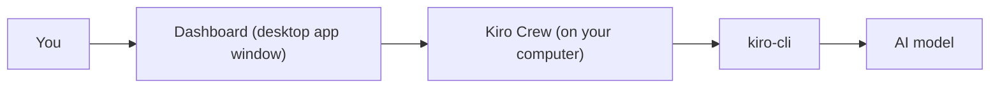
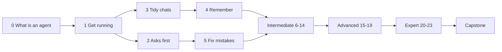

<picture>
  <source media="(prefers-color-scheme: dark)" srcset="resources/logos/kirocrew-howto-logo-dark.svg">
  
</picture>

[](LICENSE)

# Kiro Crew How To

Learn Kiro Crew from zero: a hands-on tutorial for people new to AI agents.

> kirocrew-howto is adapted from [claude-howto](https://github.com/luongnv89/claude-howto)
> by Luong Nguyen ([@luongnv89](https://github.com/luongnv89)), released under the MIT
> License. The idea of a goal-by-goal tutorial with a quiz comes from that
> project. This version teaches [Kiro Crew](https://github.com/kirodotdev/KiroCrew)
> instead of Claude Code.

Kiro Crew How To is a community tutorial and is not an official Kiro product.

**[Quick start (15 minutes)](#quick-start-15-minutes)** | **[The modules](#the-modules)** | **[Learning roadmap](LEARNING-ROADMAP.md)** | **[Glossary](GLOSSARY.md)** | **[Coming from Claude Code?](COMING_FROM_CLAUDE_CODE.md)**

---

## Table of contents

- [Who this is for](#who-this-is-for)
- [What you will be able to do](#what-you-will-be-able-to-do)
- [Quick start (15 minutes)](#quick-start-15-minutes)
- [The modules](#the-modules)
- [Learning path](#learning-path)
- [Feature Previews](#feature-previews)
- [Check your level and quiz yourself](#check-your-level-and-quiz-yourself)
- [Other guides in this repo](#other-guides-in-this-repo)
- [Language](#language)
- [Contributing](#contributing)
- [Credits](#credits)
- [License](#license)

---

## Who this is for

You do **not** need any AI experience. Each module starts from a goal in plain
words, such as "remember how I like things" or "send me a summary every
weekday".

- **Never used an AI agent?** Start at
  [Module 0](00-what-is-an-agent/README.md). It explains what an agent is and
  why it can be wrong. It needs no install.
- **Used a chat website before?** Start at
  [Module 1](01-getting-started/README.md). You will learn what an *agent* adds:
  it can read files, run commands and work while you are away.
- **Not sure?** Run the [self-assessment](#check-your-level-and-quiz-yourself)
  to find your level.
- **Already use Claude Code?** Read [Coming from Claude Code?](COMING_FROM_CLAUDE_CODE.md)
  first.

Novice modules (0-5) use a terminal once, in Module 1, to install kiro-cli and
sign in. After that they need no terminal. The terminal shows up a little in the
intermediate modules, and the expert modules (20-23) use it most.

### What Kiro Crew is

- **Kiro Crew** is the program you talk to. It runs on your own computer. You
  chat with it in the **dashboard**, which is the window of the Kiro Crew
  desktop app. It keeps memory between chats, runs scheduled jobs, and can
  start helpers that work in the background.
- **kiro-cli** is a small helper program that connects Kiro Crew to the AI
  model. The desktop app walks you through installing it and signing in.
- **The agent** is the AI you chat with. It can make **tool calls**: read a
  file, write a file, run a command.



You type in the dashboard. Kiro Crew adds your memory and rules, then reaches
the AI model through kiro-cli.

---

## What you will be able to do

By the end of the guide you can:

- Install the desktop app, chat, and ask Kiro Crew about itself.
- Choose how often the agent checks with you before it acts.
- Keep chats tidy, keep one chat private, and recover from a bad answer.
- Give the agent standing rules, saved prompts and skills.
- Search your own documents and get the source with each answer.
- Keep secrets in a vault and get files back with git.
- Connect outside tools, and let the agent use a website while you watch.
- Get a daily summary, and be told only when something changes.
- Reach the agent from Slack on your phone.
- Run several helpers at once, leave a task list running, and restart a long
  job from the step that failed.
- Keep and version what the agent makes.
- Add your own scripts at fixed moments, let other programs start jobs, build
  a small app, and back up or move your whole setup.

---

## Quick start (15 minutes)

This is the short version of [Module 1](01-getting-started/README.md). Read
Module 1 if anything here is unclear.

1. **Download the desktop app** from the
   [Kiro Crew app downloads](https://github.com/kirodotdev/KiroCrew#app-downloads)
   table: `.dmg` for macOS, `.exe` for Windows, or `.deb`, `.rpm` or AppImage
   for Linux. Install it and open it.

2. **Follow the Set up Kiro page.** It shows two commands to paste into a
   terminal. On macOS or Linux, the first one installs kiro-cli:

   ```bash
   curl -fsSL https://cli.kiro.dev/install | bash
   ```

   On Windows, in PowerShell:

   ```powershell
   irm 'https://cli.kiro.dev/install.ps1' | iex
   ```

   Then open a new terminal and sign in:

   ```bash
   kiro-cli login
   ```

3. **Go back to the app** and press **Check again**. The **Set up Kiro** page
   goes away. You can press **Skip** on any step of the welcome tour.

4. **Send your first message** in the message box:

   ```text
   Hello! In two short sentences, tell me what you can help me with.
   ```

   You should see the answer appear a few words at a time, and a new row under
   **Sessions** on the rail.

5. **Ask it about itself:**

   ```text
   Where do I change the reply length?
   ```

   The agent gives you the click path. It may also offer a **change card** that
   changes the setting only when you press its button.

> **Tip:** On first start, Kiro Crew downloads a search model in the
> background. It is about 610 MB. Until it lands, memory search matches exact
> words only. You do not need to wait for it.

---

## The modules

Work through the novice modules in order. After that, each level is a block:
pick the modules you need. Every module has the same parts: what you will
learn, words to know, what you need first, numbered steps, a "try it yourself"
task, a checklist and common problems.

| # | Module | Level | Your goal | Time |
|---|---|---|---|---|
| 0 | [What is an AI agent?](00-what-is-an-agent/README.md) | 🟢 Novice | Know what it is and why it can be wrong | 15 min |
| 1 | [Get it running and say hello](01-getting-started/README.md) | 🟢 Novice | Install, sign in, find my way | 45 min |
| 2 | [Decide how often it asks first](02-approval-modes/README.md) | 🟢 Novice | I choose when it checks with me | 20 min |
| 3 | [Keep chats tidy and pick up where you left off](03-sessions/README.md) | 🟢 Novice | Keep work apart, find old chats | 20 min |
| 4 | [Make it remember you, or not](04-memory/README.md) | 🟢 Novice | Keep my preferences; keep a chat private | 30 min |
| 5 | [Fix a mistake](05-fix-a-mistake/README.md) | 🟢 Novice | Go back after a bad answer | 30 min |
| 6 | [Standing rules and reusable prompts](06-prompts-and-steering/README.md) | 🔵 Intermediate | Stop retyping; set project rules | 30 min |
| 7 | [Teach it a procedure: skills](07-skills/README.md) | 🔵 Intermediate | Teach a set of steps once | 35 min |
| 8 | [Ask about your own documents](08-knowledge-library/README.md) | 🔵 Intermediate | Search my notes, with sources | 25 min |
| 9 | [Protect your secrets and your files](09-protect-secrets-and-files/README.md) | 🔵 Intermediate | A mistake can't leak or lose my work | 30 min |
| 10 | [Connect your tools](10-connections/README.md) | 🔵 Intermediate | Let it use my other tools | 30 min |
| 11 | [Let it use a website](11-browser/README.md) | 🔵 Intermediate | Click through a site while I watch | 20 min |
| 12 | [Get a daily summary](12-scheduled-jobs/README.md) | 🔵 Intermediate | A weekday morning summary | 30 min |
| 13 | [Tell me when something changes](13-monitors/README.md) | 🔵 Intermediate | Speak up only when there's news | 30 min |
| 14 | [Reach it from your phone or chat app](14-phone-and-chat-apps/README.md) | 🔵 Intermediate | Reach it away from my desk | 60 min |
| 15 | [Many tasks at once](15-parallel-helpers/README.md) | 🟣 Advanced | Do three things in parallel | 30 min |
| 16 | [Work while you're away](16-task-runner/README.md) | 🟣 Advanced | Run a to-do list unattended | 40 min |
| 17 | [Long jobs that can restart from a step](17-workflows/README.md) | 🟣 Advanced | Redo only the failed step | 45 min |
| 18 | [Keep and improve what it made](18-artifacts/README.md) | 🟣 Advanced | Keep, improve, undo | 25 min |
| 19 | [Named specialists with their own memory](19-mates-and-agents/README.md) | 🟣 Advanced | A helper with its own memory and goals | 45 min |
| 20 | [Your own automatic checks: hooks](20-hooks/README.md) | 🔴 Expert | Run my script at fixed moments | 30 min |
| 21 | [Let another program start a job](21-webhooks/README.md) | 🔴 Expert | Let another program start a job | 35 min |
| 22 | [Build a small app](22-apps/README.md) | 🔴 Expert | Package a page, a skill and a job | 60 min |
| 23 | [Back up, move, or host it](23-backup-and-hosting/README.md) | 🔴 Expert | Move or host my setup | 50 min |
| — | [Capstone: My morning desk](capstone-morning-desk/README.md) | All | A weekday briefing on my phone | 2-3 h |

---

## Learning path



Novices go from 0 to 5 in order. Intermediate, advanced and expert are blocks;
the [learning roadmap](LEARNING-ROADMAP.md) lists what each module needs first.
Module 9 (safety) comes before anything that runs unattended or reaches outside
your computer.

| Level | Modules | Time |
|---|---|---|
| 🟢 Novice | 0-5 | about 2.7 hours |
| 🔵 Intermediate | 6-14 | about 5 hours |
| 🟣 Advanced | 15-19 | about 3.1 hours |
| 🔴 Expert | 20-23 | about 3.2 hours |
| Capstone | uses 4-19 | 2-3 hours |

---

## Feature Previews

Two modules use features that Kiro Crew keeps behind a **Feature Preview**
switch. A Feature Preview is a feature that is still being finished. It is
hidden until you switch it on in **Settings → Developer → Feature Previews**
(Dashboard). The switch is stored in your browser, so turn it on again in each
browser you use.

| Feature | Preview switch | Setting in the source | Module |
|---|---|---|---|
| **Mates** | **Mates** | `developer.mates` | [19](19-mates-and-agents/README.md) |
| **Webhooks** page | **Webhooks** | `developer.webhooks` | [21](21-webhooks/README.md) |

Each module starts with the exact steps to switch its preview on. The capstone
has a path that works without Mates.

---

## Check your level and quiz yourself

This repo ships two skills of its own:

- **self-assessment** finds your level and builds a learning path.
- **lesson-quiz** asks ten questions on one module.

**Surface: Dashboard.**

1. Download this repo, for example to `~/kirocrew-howto`.
2. Copy both skills into your own skills folder, so they load in every chat:

   ```bash
   cp -R ~/kirocrew-howto/.kiro/skills/lesson-quiz ~/.kiro/crew/skills/
   cp -R ~/kirocrew-howto/.kiro/skills/self-assessment ~/.kiro/crew/skills/
   ```

3. In a new chat, send `$self-assessment`, or `$lesson-quiz 4` for a quiz on
   Module 4.

You should see a loaded-skill card, then the first question.

> **Tip:** You can also leave the skills in the repo. They are then **project
> skills**, and the dashboard asks **Trust this project's skills?** the first
> time. Click **Trust this folder** only for a folder you recognise.
> [Module 7](07-skills/README.md) explains why.

---

## Other guides in this repo

| File | What it is |
|---|---|
| [LEARNING-ROADMAP.md](LEARNING-ROADMAP.md) | Levels, what each module needs first, and checkpoints |
| [QUICK_REFERENCE.md](QUICK_REFERENCE.md) | One page of commands, labels and file locations, by module |
| [GLOSSARY.md](GLOSSARY.md) | Every term, one line each |
| [COMING_FROM_CLAUDE_CODE.md](COMING_FROM_CLAUDE_CODE.md) | Claude Code ideas and the best Kiro Crew tool for each |
| [kirocrew_concepts_guide.md](kirocrew_concepts_guide.md) | How the parts fit together |
| [CATALOG.md](CATALOG.md) | Every feature, with the module that teaches it |
| [INDEX.md](INDEX.md) | Every file in the repo |
| [resources.md](resources.md) | Official docs and further reading |

---

## Language

This guide is in English, as markdown and as a website.

---

## Contributing

Fixes and new examples are welcome. Read [CONTRIBUTING.md](CONTRIBUTING.md) and
the [style guide](STYLE_GUIDE.md) first. Two rules matter most: everything must
work on the public Kiro Crew release, and everything must be clear to someone
who has never used AI.

---

## Credits

kirocrew-howto is adapted from [claude-howto](https://github.com/luongnv89/claude-howto)
by Luong Nguyen ([@luongnv89](https://github.com/luongnv89)), released under the MIT
License. This version teaches [Kiro Crew](https://github.com/kirodotdev/KiroCrew)
instead of Claude Code.

Kiro Crew How To is a community tutorial and is not an official Kiro product.

---

## License

MIT. See [LICENSE](LICENSE). The original copyright notice is kept unchanged.

---
**Last updated:** 2026-10-30
**Checked against:** Kiro Crew public source @ 2808e9478c (github.com/kirodotdev/KiroCrew) and kiro.dev/docs/cli
