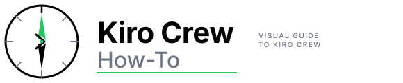

<picture>
  <source media="(prefers-color-scheme: dark)" srcset="resources/logos/kirocrew-howto-logo-dark.svg">
  
</picture>

# Style guide

How to write and format pages in Kiro Crew How To. Follow it so every module
looks the same and reads well for someone who has never used AI.

## Table of contents

- [Who we write for](#who-we-write-for)
- [Plain language rules](#plain-language-rules)
- [Vocabulary](#vocabulary)
- [Surface labels](#surface-labels)
- [Accuracy rules](#accuracy-rules)
- [File and folder naming](#file-and-folder-naming)
- [Module README structure](#module-readme-structure)
- [Header and footer](#header-and-footer)
- [Headings](#headings)
- [Text formatting](#text-formatting)
- [Lists and tables](#lists-and-tables)
- [Code blocks](#code-blocks)
- [Example output](#example-output)
- [Links](#links)
- [Diagrams](#diagrams)
- [Front matter in example files](#front-matter-in-example-files)
- [Images](#images)
- [Commit messages](#commit-messages)
- [Checklist for authors](#checklist-for-authors)

---

## Who we write for

Our reader has **never used AI**. They can open a terminal and copy a command,
but they may not know what a prompt, a tool or JSON is. Each module takes them
one step further, from novice to expert.

## Plain language rules

- **Short sentences.** One idea per sentence.
- **Define every term the first time it appears**, in the module's
  `## Words to know` table, and add it to [GLOSSARY.md](GLOSSARY.md).
- **One concrete example per idea.** Show the exact text to type.
- **Show what the reader should see** after each step, under "You should see
  something like:".
- **Say why**, not just what, when a step could surprise the reader.
- **Use "you"** and the active voice: "Run this command", not "This command
  should be run".
- **Mark limits plainly**: "if your kiro-cli has checkpoints", "macOS and
  Linux only".
- **Warn before risk.** Anything that can delete data, cost money or open the
  dashboard to other people gets a `> **Warning:**` or `> **Risk:**` box.
- Avoid hype words ("powerful", "seamless"), and avoid jargon when a plain word
  works.

## Vocabulary

| Use | For | Do not use |
|---|---|---|
| **Kiro Crew** | The layer the reader talks to (gateway, dashboard, memory, schedules) | "Crew" alone, "KC" |
| **kiro-cli** | The terminal program | "Kiro CLI", "the CLI" when kiro-cli is meant |
| **`kirocrew`** | The Kiro Crew command | — |
| **engine** | The program that does the AI work (Kiro Agent by default) | "backend" in reader-facing text |
| **the agent** | The AI the reader chats with | "the bot", "the AI" |
| **dashboard** | The Kiro Crew web page | "the UI", "the web app" |
| **gateway** | The Kiro Crew background program | "the server" |
| **skill**, **custom agent**, **hook**, **MCP server** | As defined in the glossary | Synonyms that change from page to page |

## Surface labels

Commands behave differently in the dashboard and in a terminal. **Every
command, key and setting gets a surface label**, and only these three:

- **Dashboard**: typed or clicked in the dashboard (the Kiro Crew window).
- **kiro-cli (terminal)**: typed in a terminal: the `kirocrew` command,
  `kiro-cli`, or a plain shell command such as `git`.
- **both**: works in both.

`kirocrew` and `kiro-cli` are two different programs.

Put the label in a table column, or in bold before the step
(`**Surface: kiro-cli (terminal).**`). Write it the same way every time. A
box of terminal commands starts `> **In a terminal. Surface: kiro-cli
(terminal).**`. Anything typed inside `kiro-cli chat`, such as a slash command,
goes in this box:

```markdown
> **In the terminal (kiro-cli)**
>
> Type `/checkpoint list` to see your checkpoints.
```

Every dashboard exercise must work on the default engine (Kiro Agent).

## Accuracy rules

This repo is public and teaches beginners, so a wrong command costs them a lot.

1. **Verify everything** (commands, flags, setting keys, paths, button labels)
   against the public Kiro Crew source
   ([github.com/kirodotdev/KiroCrew](https://github.com/kirodotdev/KiroCrew)) or
   the public kiro-cli docs ([kiro.dev/docs/cli](https://kiro.dev/docs/cli/)).
   If you cannot verify it, leave it out.
2. **Never copy example text from `--help` output.** Write fresh examples with
   neutral names such as `daily-status`, `reviewer`, `my-first-app`,
   `disk-check` or `hello`.
3. **Never paste real output** from your own machine. Write short illustrative
   output, using only strings you found in the public source.
4. **Nothing private.** No company names, internal tools, hostnames, account
   IDs, people's names or your own home path. Use `~/my-project`,
   `you@example.com` and `example.com`.
5. **No secrets**, not even fake ones that look real. Use placeholders such as
   `paste-your-token-here`.

## File and folder naming

| Kind | Pattern | Example |
|---|---|---|
| Module folder | `NN-topic` (two digits, kebab-case) | `04-memory` |
| Module page | `README.md` | `04-memory/README.md` |
| Extra page | kebab-case `.md` | `first-prompts.md` |
| Example files | kebab-case, real extension | `post-tool-log.sh`, `plain-writer.json` |
| Skill folder | the skill's `name` | `07-skills/trip-packing/` |

The number is the learning order. Do not reorder modules.

## Module README structure

Every module `README.md` uses these headings, **in this order, with this exact
text**. The website roadmap (`scripts/website_templates/roadmap.json`) and the
quiz skill link to them, so do not rename them.

```markdown
# <Module title>

## What you will learn
## Words to know
## Before you start
## Step by step
## Try it yourself
## Check your work
## Common problems
## What you learned
## Next
```

- **What you will learn**: four to seven bullets.
- **Words to know**: a two-column table, `Word | What it means`.
- **Before you start**: every tool the exercises need (git, Node.js, a running
  gateway, a Kiro account), each with a one-line check command.
- **Step by step**: numbered `###` sub-headings.
- **Try it yourself**: guided exercises with exact text to type and what to
  expect.
- **Check your work**: a checklist (`- [ ]`).
- **Common problems**: a table, `What you see | What to do`.
- **What you learned**: a short recap.
- **Next**: a link to the next module.

Extra sections (for example "Going further (expert)") go between **Common
problems** and **What you learned**.

## Header and footer

Every module page starts with the logo block (use `../` from a module folder,
no prefix at the repo root):

```html
<picture>
  <source media="(prefers-color-scheme: dark)" srcset="../resources/logos/kirocrew-howto-logo-dark.svg">
  
</picture>
```

Every page ends with this footer:

```markdown
---
**Last updated:** 2026-10-30
**Checked against:** Kiro Crew public source @ 2808e9478c (github.com/kirodotdev/KiroCrew) and kiro.dev/docs/cli
*Part of the [Kiro Crew How To](../) guide.*
```

Write dates as `YYYY-MM-DD`. Files the reader copies into their own setup
(saved prompts, steering examples) may leave the footer out, because it would
be sent to the agent or break once copied.

## Headings

- One `#` heading per file, at the top, after the logo.
- Do not skip levels (`##` then `###`, never `##` then `####`).
- Sentence case: "Write your own skill", not "Write Your Own Skill".
- No emoji in headings.

## Text formatting

- **Bold** for button and menu labels exactly as the dashboard shows them:
  **Customize → Skills**, **Approve**.
- `Code` for anything the reader types or sees literally: commands, file names,
  setting keys, slash commands.
- Use `→` between menu levels.
- Callouts are blockquotes that start with a bold word: `> **Warning:**`,
  `> **Risk:**`, `> **Tip:**`, `> **In a terminal. Surface: kiro-cli (terminal).**`,
  `> **In the terminal (kiro-cli)**` (only for things typed inside `kiro-cli chat`).
- Keep paragraphs to three or four sentences.

## Lists and tables

- Use numbered lists for steps the reader does in order; bullets otherwise.
- Use tables to compare things or to list commands. Keep cells short.
- Escape a `|` inside a table cell as `\|`.

## Code blocks

- **Every fence declares a language**: `bash`, `powershell`, `json`, `python`,
  `yaml`, `markdown`, `text`, `html`, `mermaid`. Use `text` for output and for
  things the reader types in a chat box.
- One command per line, so the reader can copy just one.
- Put a short comment above a command only when it helps.
- Use placeholders in angle brackets: `<name>`, `<job-id>`. Say what to put
  there.

## Example output

Put output after the command, introduced with "You should see something like:"
and fenced as `text`. Keep it short. Use only strings that appear in the public
source, and replace changing values (ids, dates, versions) with placeholders.

## Links

- Between files in this repo, use **relative paths**:
  `[Module 7](../07-skills/README.md)`, `[glossary](../GLOSSARY.md)`.
- Link to another module's `README.md`, or to one of its fixed headings
  (`../20-hooks/README.md#common-problems`).
- External links go to kiro.dev docs or the public Kiro Crew repository. Use
  descriptive link text, not "click here".
- Never link to a private or internal site.

## Diagrams

Use Mermaid. GitHub renders it, and the website renders the same source
with [Pele](https://github.com/obsidianmd/pele). The `mermaid-syntax` pre-commit
hook checks every block with the same bundle.

- `flowchart LR` for steps, `flowchart TD` for layers, `sequenceDiagram` for
  who-talks-to-whom.
- Put labels in quotes: `A["Kiro Crew gateway"]`.
- Name nodes after real parts: "Agent", "Kiro Crew", "kiro-cli", "MCP server".
- Keep it to about ten nodes.
- Do not use `%%{init}%%` directives or themes; the website applies its own.
- Explain the diagram in a sentence or two, for readers who cannot see it.

## Front matter in example files

Skills and saved prompts use YAML front matter between `---` lines.

- Every `SKILL.md` has `name` (equal to its folder name) and `description`
  (what it does and when to use it).
- Saved prompts may have a `description`.
- Steering examples use either no front matter or `inclusion: always` only.
- Do not rely on `triggers` in a shipped skill.

## Images

- Use the logo block above; do not add other logos.
- Add a screenshot only if it comes from a public Kiro Crew build and shows no
  private data. Give every image alt text.
- Prefer a table or a diagram over a screenshot. Screenshots go out of date fast.

## Commit messages

Follow [Conventional Commits](https://www.conventionalcommits.org/):
`type(scope): description`.

| Type | Use for |
|---|---|
| `feat` | A new module section, example or guide |
| `fix` | A wrong command, broken link or typo |
| `docs` | Better wording or explanations |
| `refactor` | Moving content without changing what it says |
| `test` | Script test changes |
| `chore` | Build, CI and tooling |

The scope is the module folder without its number, or the file area:
`docs(memory): ...`, `fix(README): ...`, `chore(scripts): ...`.

## Checklist for authors

- [ ] Every command, flag, key and label is verified against public sources.
- [ ] No example text copied from `--help`; no real output pasted.
- [ ] Nothing private: no internal names, hosts, accounts or home paths.
- [ ] Every slash command and key has a surface label.
- [ ] The module uses the fixed headings, in order.
- [ ] Every new term is in `## Words to know` and in `GLOSSARY.md`.
- [ ] Each step shows what the reader should see.
- [ ] Every code fence has a language.
- [ ] Links are relative and resolve.
- [ ] Mermaid diagrams pass the hook.
- [ ] Logo header and footer are present.
- [ ] `pre-commit run --all-files` passes.

---
**Last updated:** 2026-10-30
**Checked against:** Kiro Crew public source @ 2808e9478c (github.com/kirodotdev/KiroCrew) and kiro.dev/docs/cli
*Part of the [Kiro Crew How To](README.md) guide.*
