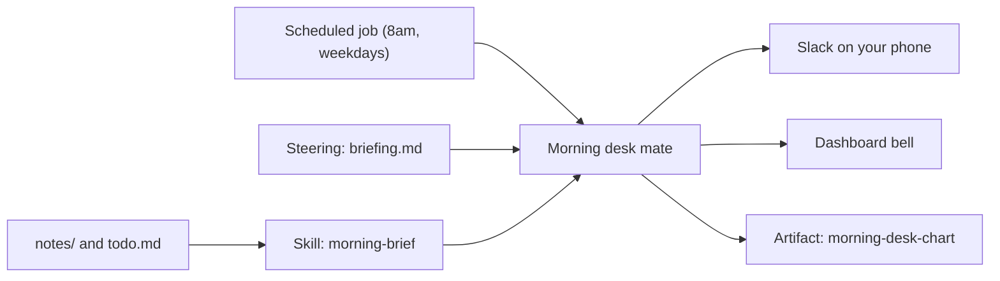

<picture>
  <source media="(prefers-color-scheme: dark)" srcset="../resources/logos/kirocrew-howto-logo-dark.svg">
  
</picture>

# Capstone: My morning desk

**Level:** All levels · **Time:** 2-3 hours · **Surface:** Dashboard, plus a
terminal for copying files and git

**You need:** Modules 4, 6, 7, 8, 9, 12, 13, 14 and 18 done. Module 19 for the
mate. Modules 15, 17 and 20 for the stretch goals.

Your goal, in your own words: "Every weekday, have my own helper read my notes,
check my list, and send me a short briefing on my phone, with a chart I can
keep."

This project puts many earlier modules together. You build it in eight steps.
Each step names the module that taught it, so you can go back if you get stuck.

## What you will learn

- How to join memory, steering, skills and knowledge into one helper.
- How to keep your notes safe with git while the agent works on them.
- How to run a skill every weekday at 8am with a scheduled job.
- How to send the result to your phone and to the dashboard bell.
- How to keep one chart that gets a new version each day.
- How to spread the work over parallel helpers (stretch goal).
- How to log each run with a hook (stretch goal).

## Words to know

| Word | What it means |
|---|---|
| Capstone | A final project that uses what you learned in many modules. |
| Briefing | A short summary you read at the start of the day. |
| Open item | A to-do line that is not done yet. In these files it starts with `- [ ]`. |
| Mate | A named helper you keep, with its own memory and chat thread (Module 19). |
| Scheduled job | A message Kiro Crew sends to the agent at a set time, also called a cron job (Module 12). |
| Artifact | Something the agent made that you keep, such as a chart. Each edit makes a new version (Module 18). |
| Steering file | A Markdown file of standing rules the agent reads in every chat for that project (Module 6). |

## Before you start

| You need | Check |
|---|---|
| A running Kiro Crew gateway and dashboard | Open the dashboard. The chat box shows. |
| git | `git --version` prints a version. |
| Slack connected to Kiro Crew (Module 14) | A message you send the bot gets a reply. |
| A copy of this folder on your computer | You can see `capstone-morning-desk/README.md`. |

This project uses these example files:

| File | What it is |
|---|---|
| [steering/briefing.md](steering/briefing.md) | The steering rule: five bullets, dates as YYYY-MM-DD. |
| [morning-brief/SKILL.md](morning-brief/SKILL.md) | The skill that reads notes, lists open items and draws the chart. |
| [notes/](notes/) | Three sample notes, one each for work, home and learning. |
| [todo.md](todo.md) | A sample to-do list. |

Here is how the parts fit together:



A scheduled job wakes the Morning desk mate each weekday at 8am. The mate
follows the steering rule and runs the skill. The skill reads your notes and
to-do list. The mate then sends the briefing to Slack and the bell, and saves a
new version of the chart.

## Step by step

### 1. Make your desk folder and your helper

**Surface: kiro-cli (terminal)** for the copy. **Surface: Dashboard** for the mate.

Copy this folder to your home folder, and name the copy `my-desk`. Run this
from the folder that holds `capstone-morning-desk`:

```bash
cp -R capstone-morning-desk ~/my-desk
```

Now make the helper. Mates is a Feature Preview, so it is off until you turn it
on.

1. Open **Settings → Developer → Feature Previews** and turn on **Mates**.
2. Click **Mates** in the left rail.
3. Click **New mate**. Name it `Morning desk`. Give it a workspace that points
   at `~/my-desk`.
4. Open the mate's thread and say hello.

You should see the Morning desk mate in the Mates list, with its own thread.

> **Tip:** If you do not want to turn on Mates, use a plain chat instead.
> Make a sidebar folder named `Morning desk` (Module 3). Start a chat in it and
> type: `Use ~/my-desk as this chat's project folder.` Use that chat wherever
> this page says "the mate's thread".

### 2. Add the briefing rule

**Surface: kiro-cli (terminal)**, then **Dashboard** to check.

Steering files for a project live in its `.kiro/steering/` folder. Move the
sample rule there:

```bash
mkdir -p ~/my-desk/.kiro/steering
mv ~/my-desk/steering/briefing.md ~/my-desk/.kiro/steering/briefing.md
```

Open **Customize → Steering**. You should see `briefing.md` in the list.

The rule says: briefings have five bullets, and dates use YYYY-MM-DD. You can
read it in [steering/briefing.md](steering/briefing.md).

### 3. Install the morning-brief skill

**Surface: kiro-cli (terminal)**, then **Dashboard** to check.

Skills you install for yourself live in `~/.kiro/crew/skills/`. Copy the skill
there. A skill inside a project folder needs extra trust before it loads, so
the home copy is simpler.

```bash
mkdir -p ~/.kiro/crew/skills
cp -R ~/my-desk/morning-brief ~/.kiro/crew/skills/morning-brief
```

Open **Customize → Skills**. You should see `morning-brief`.

Try it once by hand. In the mate's thread, type:

```text
$morning-brief
```

You should see something like:

```text
Morning briefing 2026-10-30

- Buy a new washer for the kitchen tap (due 2026-11-01).
- Renew the library card (due 2026-11-02).
- Send the demo agenda to the team (due 2026-11-03).
- Finish lesson two of the drawing course (due 2026-11-04).
- 4 more open items.

Chart saved as morning-desk-chart.
```

Your date and wording will differ. The shape should match: one heading, then
five bullets.

### 4. Add your notes to the Knowledge Library

**Surface: Dashboard.**

The Knowledge Library lets you ask questions about your notes and see the
source file of each answer.

1. Open **Customize → Knowledge**.
2. Click **Add Folder** and pick `~/my-desk/notes`.
3. Wait until the folder shows as a source with an item count.

In the mate's thread, ask:

```text
Which of my notes mentions the kitchen tap? Name the source file.
```

You should see an answer that names `home/2026-10-27.md` as its source.

### 5. Keep your desk safe

**Surface: kiro-cli (terminal)** for git. **Surface: Dashboard** for the rest.

Three layers protect this project. Each one guards a different thing (Module 9).

**Approval mode.** Open the approval pill under the chat box in the mate's
thread and pick **Reads**.

**Reads** is meant to run read-only shell commands on its own and ask you for
everything else. Your table from [Module 2](../02-approval-modes/README.md)
shows what it really does on your setup.

**Git.** Git keeps a copy of every saved version of your files. If a note goes
missing, you can get it back. Turn `~/my-desk` into a git folder and save a
first copy:

**Surface: kiro-cli (terminal).**

```bash
cd ~/my-desk
git init
git add .
git commit -m "Start my morning desk"
```

Now save a copy every weekday morning, before the briefing runs. This job runs
one shell command and uses no AI. Replace `America/Denver` with your own time
zone name.

**Surface: kiro-cli (terminal).**

```bash
kirocrew cron add desk-commit "Daily notes commit" --cron "50 7 * * MON-FRI" --timezone America/Denver --command "cd ~/my-desk && git add -A && git commit -q -m 'Daily notes' || true" --no-persistent-session --minimal-context
```

The `|| true` part stops the job from failing on days when nothing changed.

**Secrets.** If your briefing ever needs a key or password, never put it in a
note. Store it in **Settings → Secrets** with **Add secret**. The agent can use
a stored secret but never sees its value.

### 6. Run the skill every weekday at 8am

**Surface: Dashboard** (ask in chat), or **terminal**.

In the mate's thread, type:

```text
Every weekday at 8am my time, run the morning-brief skill. Send the briefing to me on Slack, and also send me a dashboard notification that it is ready.
```

The agent makes a scheduled job. Open **Schedule** in the left rail. You should
see the new job, with the time and your time zone.

> **In a terminal. Surface: kiro-cli (terminal).**
>
> This is the `kirocrew` command. Type it at a normal terminal prompt, not
> inside `kiro-cli chat`.
>
> You can make the same job with `kirocrew cron add`. Replace
> `America/Denver` with your time zone:
>
> ```bash
> kirocrew cron add morning-desk "Run the morning-brief skill. Send the briefing to me on Slack, and also send me a dashboard notification that it is ready." --cron "0 8 * * MON-FRI" --timezone America/Denver
> ```
>
> A job made this way does not belong to the mate. Ask in the mate's thread if
> you want the mate to run it.

### 7. Send it to your phone and the bell

**Surface: Dashboard.**

You do not need a new setting for this. The job's message already asks for two
things:

- **Slack.** The agent sends you a direct message through the Slack bot you set
  up in Module 14. Open Slack on your phone to read it.
- **The bell.** The agent sends a notification to the bell in the dashboard's
  top bar.

Test it now. On the **Schedule** page, find the `morning-desk` job and click
**Run now**. Or type `trigger the morning-desk job now` in the mate's thread.

You should see a Slack message with the briefing, and a new notification under
the bell.

If a run stops to wait for your approval, answer it from Slack or the
dashboard (Module 14). The briefing then finishes. If it never stops, that
is fine too.

### 8. Keep the chart, one version a day

**Surface: Dashboard**, or ask in chat.

The skill keeps its chart as an artifact named `morning-desk-chart`. The first
run saves it. Every later run updates it, and each update is a new version.

1. Click **Artifacts** in the left rail.
2. Open `morning-desk-chart`. You should see a bar chart of open items.
3. Run the job once more with **Run now**.
4. In the mate's thread, type:

```text
List the versions of the morning-desk-chart artifact.
```

You should see at least two versions. If a day's chart looks wrong, ask:
`go back to version 1 of morning-desk-chart`. A revert adds a new version, so
nothing is lost.

## Try it yourself

Make the briefing your own, using your real notes.

1. Add a new note file in `~/my-desk/notes/work/` with two open items. Give one
   a due date of tomorrow, written as YYYY-MM-DD.
2. Click **Run now** on the `morning-desk` job.
3. Check that tomorrow's item is the first bullet.

Then prove that git has your back:

1. Delete the note you just made: `rm ~/my-desk/notes/work/<your-note>.md`
2. In the mate's thread, type:
   `Put notes/work/<your-note>.md back the way it was in the last commit.`
3. Approve the request. Check that the file is back.

This works only if the note was in a commit. If you made it after the 7:50am
commit, run `git -C ~/my-desk add -A` and
`git -C ~/my-desk commit -m "Add my note"` first.

## Check your work

- [ ] Triggering the job now sends a briefing to the phone.
- [ ] The briefing follows the steering rule: a heading, five bullets, dates as YYYY-MM-DD.
- [ ] The `morning-desk-chart` artifact has a new version.
- [ ] If a file in `notes/` is deleted, you can get it back from git.
- [ ] Next morning it runs on its own.

## Common problems

| What you see | What to do |
|---|---|
| The **Mates** row is not in the left rail. | Turn on **Settings → Developer → Feature Previews → Mates**. Or use the plain-chat path in step 1. |
| `$morning-brief` does nothing, or the skill is not on **Customize → Skills**. | Check the file is at `~/.kiro/crew/skills/morning-brief/SKILL.md`. Open a new chat and try again. |
| The briefing has more than five bullets. | Check `briefing.md` is in `~/my-desk/.kiro/steering/` and shows on **Customize → Steering**. Start a new chat in the mate. |
| No Slack message arrives. | Send the bot a message by hand. If it does not answer, redo Module 14. |
| The job runs at the wrong hour. | Edit the job on **Schedule** and set your time zone. |
| A new chart artifact appears each day instead of new versions. | Check the skill still says to use the slug `morning-desk-chart`. Delete the extra copies on **Artifacts**. |
| The git restore fails with "did not match any file". | The file was never committed. Commit before you delete next time. |

## Going further: parallel helpers in a workflow

**Surface: Dashboard** (ask in chat). Uses Modules 15 and 17.

A workflow is a job in steps that can restart from a failed step. Here, one
helper reads each notes subfolder at the same time. A last step merges their
lists into the briefing.

In the mate's thread, type:

```text
Use a workflow for my morning briefing. Step 1: use one helper per subfolder of ~/my-desk/notes, in parallel, and have each one list its open items. Step 2: read ~/my-desk/todo.md. Step 3: merge everything and write the briefing the morning-brief skill describes.
```

Open **Customize → Workflows**. You should see the run, with one helper per
subfolder in the first step.

To test a restart, add a fourth subfolder, such as `~/my-desk/notes/garden/`,
with one note. Then ask: `re-run that workflow from step 3 only`. Steps 1 and 2
reuse their saved results. Step 3 runs again.

## Going further: log each briefing with a hook

**Surface: Dashboard** (**Customize → Hooks**) and **terminal**. Uses Module 20.

A hook is your own script that Kiro Crew runs at a fixed moment. A `Stop` hook
runs when the agent finishes a turn. This one writes a line to a log file each
time a turn ends with a morning briefing.

It never prints anything, so it cannot make the agent keep going. That means it
needs no loop guard. Module 20's `stop-check-once.sh` needs one because it
prints the block JSON; this one prints nothing.

Save this script as `~/my-hooks/brief-log.sh`:

```bash
#!/bin/bash
# brief-log.sh: write one log line each time a morning briefing is sent.
#
# Event:   Stop
# Matcher: (leave empty)
#
# Kiro Crew gives a Stop hook the agent's final reply in the
# "assistant_text" field on standard input, and the chat's key in
# "session_key". This script prints nothing, so the agent always stops.
#
# Platform: macOS and Linux.

INPUT=$(cat)

# Only log turns whose reply is a morning briefing.
if ! printf '%s' "$INPUT" | grep -q 'Morning briefing'; then
  exit 0
fi

SESSION=$(printf '%s' "$INPUT" | sed -n 's/.*"session_key"[[:space:]]*:[[:space:]]*"\([^"]*\)".*/\1/p' | head -1)
[ -z "$SESSION" ] && SESSION="(unknown chat)"

LOG_DIR="$HOME/hook-logs"
mkdir -p "$LOG_DIR"
TIMESTAMP=$(date "+%Y-%m-%d %H:%M:%S")
printf '[%s] briefing sent in %s\n' "$TIMESTAMP" "$SESSION" >>"$LOG_DIR/morning-desk.log"

exit 0
```

Make it runnable:

**Surface: kiro-cli (terminal).**

```bash
chmod +x ~/my-hooks/brief-log.sh
```

Add the hook:

1. Open **Customize → Hooks** and click **New Hook**.
2. Pick the `Stop` event. Leave the matcher empty.
3. Set the command to `~/my-hooks/brief-log.sh`.
4. Save it, then click **Test**.

<!-- NLT: Stop hooks fire for scheduled-job turns and receive assistant_text and session_key on stdin -->
Click **Run now** on the `morning-desk` job. When the briefing arrives, read
the log:

**Surface: kiro-cli (terminal).**

```bash
cat ~/hook-logs/morning-desk.log
```

You should see something like:

```text
[2026-10-30 08:00:12] briefing sent in <session-key>
```

## What you learned

You built a helper that works while you sleep. A scheduled job wakes it each
weekday. A steering rule shapes the briefing, and a skill does the steps. The
Knowledge Library lets you ask about your notes. Git keeps your notes safe.
Slack and the bell bring the result to you. An artifact keeps the chart, one
version a day.

## Next

You finished the course. Go back to the [learning roadmap](../LEARNING-ROADMAP.md)
to pick a module to go deeper on, or revisit any step above:
[Module 4](../04-memory/README.md),
[Module 6](../06-prompts-and-steering/README.md),
[Module 7](../07-skills/README.md),
[Module 8](../08-knowledge-library/README.md),
[Module 9](../09-protect-secrets-and-files/README.md),
[Module 12](../12-scheduled-jobs/README.md),
[Module 13](../13-monitors/README.md),
[Module 14](../14-phone-and-chat-apps/README.md),
[Module 15](../15-parallel-helpers/README.md),
[Module 17](../17-workflows/README.md),
[Module 18](../18-artifacts/README.md),
[Module 19](../19-mates-and-agents/README.md),
[Module 20](../20-hooks/README.md).

---
**Last updated:** 2026-10-30
**Checked against:** Kiro Crew public source @ 2808e9478c (github.com/kirodotdev/KiroCrew) and kiro.dev/docs/cli
*Part of the [Kiro Crew How To](../) guide.*
