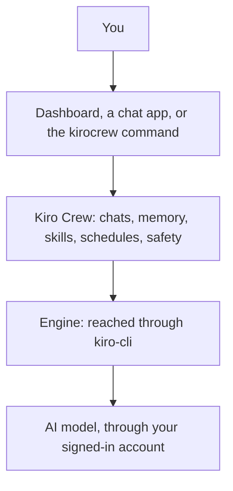
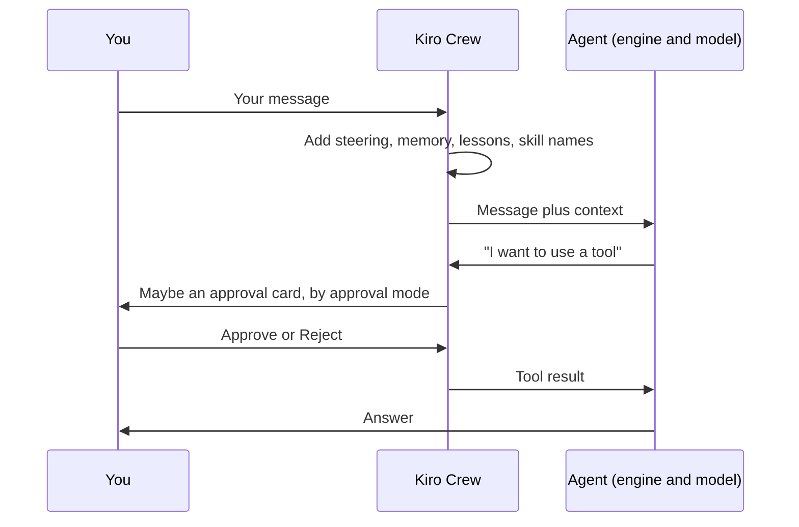

<picture>
  <source media="(prefers-color-scheme: dark)" srcset="resources/logos/kirocrew-howto-logo-dark.svg">
  
</picture>

# Kiro Crew concepts guide

The modules teach one goal at a time. This page steps back and shows how the
parts fit together, so you can pick the right one for a job. Read it after
[Module 5](05-fix-a-mistake/README.md), or any time you wonder "which feature
should I use here?".

New words are in the [glossary](GLOSSARY.md).

## Table of contents

- [The big picture](#the-big-picture)
- [What happens when you send a message](#what-happens-when-you-send-a-message)
- [Ways to give the agent instructions](#ways-to-give-the-agent-instructions)
- [Ways to give the agent new abilities](#ways-to-give-the-agent-new-abilities)
- [Ways to keep your work safe](#ways-to-keep-your-work-safe)
- [Ways to undo](#ways-to-undo)
- [Ways to make it work without you](#ways-to-make-it-work-without-you)
- [Which feature should I use?](#which-feature-should-i-use)

---

## The big picture

Kiro Crew has four layers. You only ever talk to the top one.

| Layer | What it is | Module |
|---|---|---|
| **Surfaces** | Where you type: the dashboard (the desktop app window), a chat app such as Slack, or the `kirocrew` command in a terminal | [1](01-getting-started/README.md), [14](14-phone-and-chat-apps/README.md) |
| **Kiro Crew** | The program on your computer. It keeps chats and memory, runs schedules, and decides what the agent may do | [1](01-getting-started/README.md) |
| **Engine** | The program that runs the agent's thinking and tool use. Kiro Crew reaches it through kiro-cli | [1](01-getting-started/README.md) |
| **Model** | The AI that writes the words. It runs online | [0](00-what-is-an-agent/README.md) |

## What happens when you send a message

1. You type a message.
2. Kiro Crew adds **context**: your steering files, what it remembers about
   you, your lessons, and the names of skills that might help.
3. The agent decides what to do. It may make a **tool call**: read a file,
   write a file, run a command.
4. Your **approval mode** decides whether you see an approval card first.
   What asks first can differ by engine and version.
   [Module 2](02-approval-modes/README.md) shows how to test your setup.
5. The agent gets the tool's result, maybe uses more tools, then answers.
6. Later, in the background, Kiro Crew reads finished chats and saves useful
   facts to **memory** ([Module 4](04-memory/README.md)).

## Ways to give the agent instructions

From "right now" to "always":

| Feature | Who writes it | When it is used | Best for | Module |
|---|---|---|---|---|
| Your message | You | This turn | What you want now | [0](00-what-is-an-agent/README.md) |
| Saved prompt (`@name`) | You | When you pick it | A request you make often | [6](06-prompts-and-steering/README.md) |
| Skill (`$name`) | You, or someone you trust | When you name it, or the agent decides it fits | A job with several steps | [7](07-skills/README.md) |
| Steering file | You | Every chat | Firm rules: "write dates as YYYY-MM-DD" | [6](06-prompts-and-steering/README.md) |
| Lessons and memory | You ("Remember: ...") and Kiro Crew | Every chat, as background | Small preferences and facts about you | [4](04-memory/README.md) |

## Ways to give the agent new abilities

| Feature | What it adds | Module |
|---|---|---|
| **Knowledge Library** | Search over your own files, with a source on each answer | [8](08-knowledge-library/README.md) |
| **Connection** (MCP server) | New tools from outside, such as a file system or a code host | [10](10-connections/README.md) |
| **Browser panel** | A web page the agent can click through while you watch | [11](11-browser/README.md) |
| **Helpers** (subagents) | Several agents working at the same time | [15](15-parallel-helpers/README.md) |
| **Mate** (Feature Preview) | A named helper with its own memory and goals | [19](19-mates-and-agents/README.md) |
| **Custom agent** | A named style and tool list for a chat | [19](19-mates-and-agents/README.md) |
| **App** | Pages, skills and jobs packed into one add-on | [22](22-apps/README.md) |

## Ways to keep your work safe

Each layer guards one thing. None guards everything.
[Module 9](09-protect-secrets-and-files/README.md) teaches all of them.

| Layer | Guards | Does not guard |
|---|---|---|
| Approval pill | You may see an action before it runs | Not every action on every engine |
| Process Sandbox | Credential folders such as `~/.ssh` | Your project folders |
| Secrets Vault | Secret values: the agent never sees them | Files on disk |
| Git and snapshots | Your files and your setup: you can get them back | Nothing is blocked; you recover |
| Denied Commands | A speed bump on one command line | It is not a security boundary |

Hooks are not a safety lock. [Module 20](20-hooks/README.md) explains why.

## Ways to undo

| What went wrong | Fix | Module |
|---|---|---|
| The chat went the wrong way | **Edit & Resend**, Regenerate or **Fork** | [5](05-fix-a-mistake/README.md) |
| A file changed | The **Git** tab shows it; `git restore` puts it back | [5](05-fix-a-mistake/README.md) |
| A saved chart or report | Artifact versions and **Revert** | [18](18-artifacts/README.md) |
| The whole setup | `kirocrew snapshot` and `kirocrew restore` | [23](23-backup-and-hosting/README.md) |

> **Remember:** rewind fixes the chat. Git fixes the files.

## Ways to make it work without you

| Feature | What starts it | Module |
|---|---|---|
| **Scheduled job** | A time or a timer you choose | [12](12-scheduled-jobs/README.md) |
| **Monitor** | A chat wakes itself to check something | [13](13-monitors/README.md) |
| **Task runner** | A task file you hand it | [16](16-task-runner/README.md) |
| **Workflow** | A big job in steps that can restart from one step | [17](17-workflows/README.md) |
| **Hook** | A fixed moment, such as the end of a turn | [20](20-hooks/README.md) |
| **Webhook** (Feature Preview) | Another program sends a web request | [21](21-webhooks/README.md) |

## Which feature should I use?

| I want to... | Use | Module |
|---|---|---|
| Stop retyping the same request | A saved prompt | [6](06-prompts-and-steering/README.md) |
| Make the agent always follow a project rule | A steering file | [6](06-prompts-and-steering/README.md) |
| Make the agent remember a habit of mine | Say "Remember: ..." | [4](04-memory/README.md) |
| Keep one chat private | An **Incognito** or **Temporary** chat | [4](04-memory/README.md) |
| Teach the agent a job with steps | A skill | [7](07-skills/README.md) |
| Ask about my own notes | The Knowledge Library | [8](08-knowledge-library/README.md) |
| Keep a password away from the agent | The Secrets Vault | [9](09-protect-secrets-and-files/README.md) |
| Get a summary every weekday morning | A scheduled job | [12](12-scheduled-jobs/README.md) |
| Be told when a file or page changes | A monitor | [13](13-monitors/README.md) |
| Do three lookups at once | Parallel helpers | [15](15-parallel-helpers/README.md) |
| Redo only the step that failed | A workflow | [17](17-workflows/README.md) |
| Run my own script at the end of each turn | A `Stop` hook | [20](20-hooks/README.md) |
| Move my setup to a new computer | A snapshot | [23](23-backup-and-hosting/README.md) |

---
**Last updated:** 2026-10-30
**Checked against:** Kiro Crew public source @ 2808e9478c (github.com/kirodotdev/KiroCrew) and kiro.dev/docs/cli
*Part of the [Kiro Crew How To](README.md) guide.*
